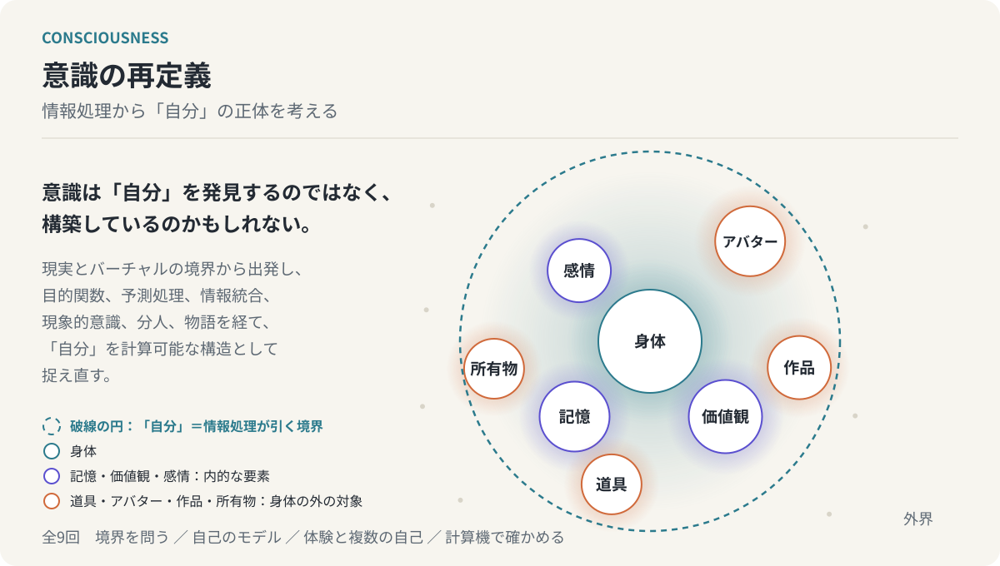
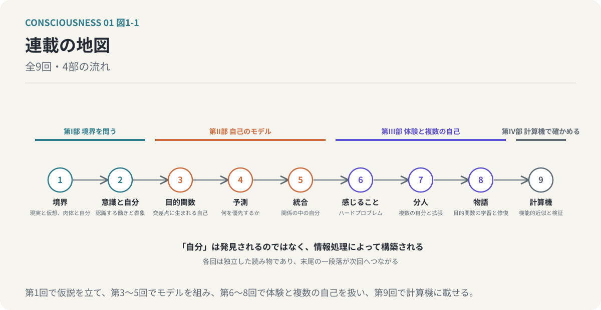

# 意識の再定義

## 情報処理から「自分」の正体を考える、全9回



**「自分」は発見されるのではなく、情報処理によって構築される。**



現実とバーチャルの境界が曖昧になるとき、揺れているのは映像技術ではなく、私たちが世界と「自分」を認識する仕組みのほうである。この連載は、意識を情報処理システムとして捉え、意識と「自分」を分け、複数の目的関数の交差点に自己が創発するという仮説を立てる。予測処理、統合情報理論、ハードプロブレム、分人、物語を順に通り、最後に「自分」を計算機上で動かして確かめる道筋を示す。各回は独立した読み物であり、末尾の一段落が次回へつながる。

[第1回から読む](chapters/01-reality-and-virtuality.md) ／ [最終回を読む](chapters/09-computational-implementation.md) ／ [読み方](guides/READING.md)

## 全9回の目次

| 回 | 文章 | 主題 |
| --- | --- | --- |
| 01 | [現実とバーチャルの境界はどこにあるのか](chapters/01-reality-and-virtuality.md) | 知覚の境界と、肉体に収まらない「自分」 |
| 02 | [意識とは「自分」を認識する情報処理である](chapters/02-consciousness-and-self.md) | 認識する働きと、認識される自己表象を分ける |
| 03 | [「自分」は複数の目的関数の交差点に生まれる](chapters/03-emergent-self.md) | 目的関数の重み付き集合から創発する自己 |
| 04 | [脳は世界を予測し、意識は何を優先するかを決める](chapters/04-predictive-processing.md) | 予測処理・自由エネルギー原理と目的関数の調停 |
| 05 | [「自分」を情報の統合として捉える](chapters/05-integrated-information.md) | 統合情報理論と、相互依存する目的関数の構造 |
| 06 | [なぜ情報処理に「感じる」という体験が生まれるのか](chapters/06-phenomenal-consciousness.md) | ハードプロブレムと、機能的意識・現象的意識の区別 |
| 07 | [「本当の自分」は一人ではない](chapters/07-dividual-and-extended-self.md) | 分人の混合モデルと、肉体の外へ拡張する自己 |
| 08 | [人はなぜ物語を必要とするのか](chapters/08-narrative-and-self.md) | 目的関数を学習し修復する装置としての物語 |
| 09 | [意識の情報処理モデルを計算機で実現する](chapters/09-computational-implementation.md) | 自己を持つAIの機能的近似 |

## 連載の構成

第I部「境界を問う」（1〜2回）は、現実と仮想、肉体と自己の境界が知覚と情報処理の側で引かれていることを確かめ、意識を「自分」という自己表象を構築し認識する働きとして定義する。第II部「自己のモデル」（3〜5回）は、複数の目的関数の交差点に自己が創発するという中心仮説を置き、予測処理によって優先順位が調整され、目的関数が相互依存する統合構造の中で自己が成立すると考える。第III部「体験と複数の自己」（6〜8回）は、機能的意識と現象的意識を区別してハードプロブレムの位置を確認したうえで、文脈で切り替わる分人、肉体の外へ広がる自己、物語による自己の更新を扱う。第IV部「計算機で確かめる」（9回）は、これらの仮説を比較実験が可能な計算モデルへ変換する。

本連載の主張のうち、予測処理・自由エネルギー原理・統合情報理論・分人は、それぞれ提唱者の理論を参照している。目的関数の交差点に自己が創発するという見立て、目的関数モデルとIITの接続、分人を混合モデルとして表すこと、物語を目的関数の修復装置として読むことは、本連載が置いた仮説である。本文中でもその区別を明示している。

<!-- SITE-INDEX-END: 以下はリポジトリ利用者向け。HTML閲覧版のトップページには含めない。 -->

## GitHubで読む

このREADMEと各回の `.md` をGitHubの **Preview** で開く。本文中の図は相対リンク先のSVGとして表示される。外部の画像やフォントは参照しない。挿絵は表紙を含めて93点で、各回の導入に見取り図を一点、本文に7〜14点をおおむね一節に一点、該当段落の直後に置いている。すべて編集可能な独立SVGであり、`scripts/draw_figures.py` から決定論的に再生成できる。数式は本文中のコード表記（`U(x) = Σ_i w_i・f_i(x)` など）で書き、閲覧版では式だけの行を番号付きのブロックにし、`_i` を下付き、`^(j)` を上付きに描く。数式レンダラーは使わない。

## ブラウザで読む（GitHub Pages）

公開ページは https://yamaguchiyoshito.github.io/consciousness-as-computation/ にある。`main` ブランチへのpushで `.github/workflows/pages.yml` が `_site/` を生成し、GitHub Pagesへ配置する。有効にするにはリポジトリの Settings → Pages → Build and deployment で Source を **GitHub Actions** にする。

ローカルで再生成するにはPython 3.11以降とPandoc 3.xを使う。依存パッケージの追加インストールは不要である。

```sh
python scripts/validate.py
python scripts/build.py
python -m unittest discover -s tests -v
```

`_site/index.html` が目次付きの閲覧ページ、`_site/complete.html` が全9回とSVGを一つにまとめた単独ファイルである。GitHub管理対象はMarkdownとSVGなどの原本であり、`_site/` は生成物として `.gitignore` で除外する。

## 連載の成り立ちと編集

全9回の原稿を先に書き、公開にあたって各回の題名・副題・前後リンクの型を揃え、図版を追加した。その後、読みやすさの観点で校正し、段落の結合、各回の導入と結びの圧縮、用語と式の表記の統一、留保の集約、長い回への中見出しの追加を行った。さらに各回の見取り図と具体例・整理・検証の論理の図を加えた。主張と論理は変えていない。校正の方針は[校正メモ](claudedocs/proofreading-2026-10-29.md)にある。図版の配置と意図は[図版計画](claudedocs/figure-plan-2026-10-29.md)にある。[編集ガイド](guides/EDITING.md)に原本と生成物の責務を、[読み方](guides/READING.md)に表示環境の注意をまとめた。閲覧サイトの仕組みは、連載[『意味の関連性 ── RELEVANCE』](https://github.com/yamaguchiyoshito/relevance)と同じ構成である。

## ライセンス

本文と挿絵（`chapters/`、`assets/illustrations/`、表紙を含む）は [クリエイティブ・コモンズ 表示 4.0 国際（CC BY 4.0）](https://creativecommons.org/licenses/by/4.0/deed.ja) の下で提供する。出典として「yamaguchiyoshito『意識の再定義 ── 情報処理から「自分」の正体を考える』」と、このリポジトリまたは公開ページのURLを示せば、複製・再配布・翻案・商用利用ができる。条文の全文は [LICENSE](LICENSE) にある。ビルド用のスクリプトと設定ファイルも同じライセンスの下で提供する。

本文で言及する理論（予測処理、自由エネルギー原理、統合情報理論、意識のハードプロブレム、分人など）は、それぞれの提唱者に帰属する。本文はそれらの理論を要約して参照しており、原文の引用ではない。
