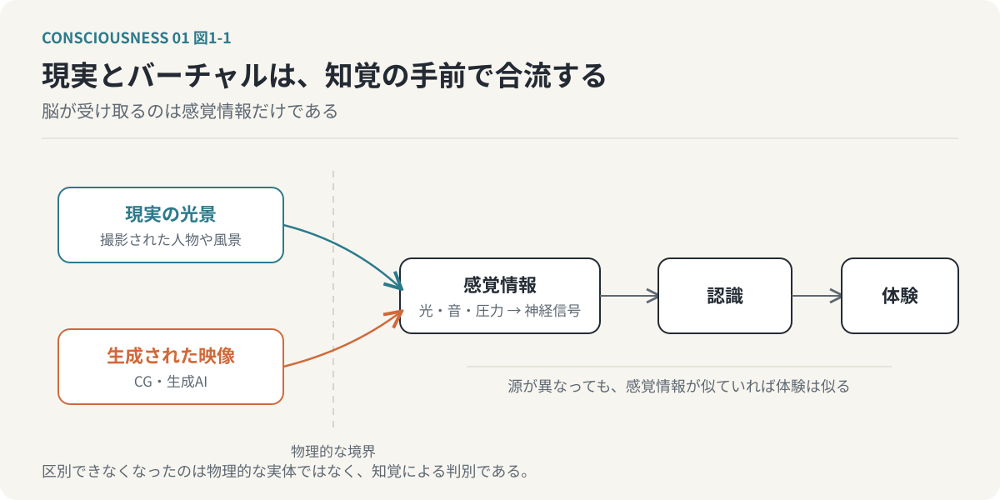
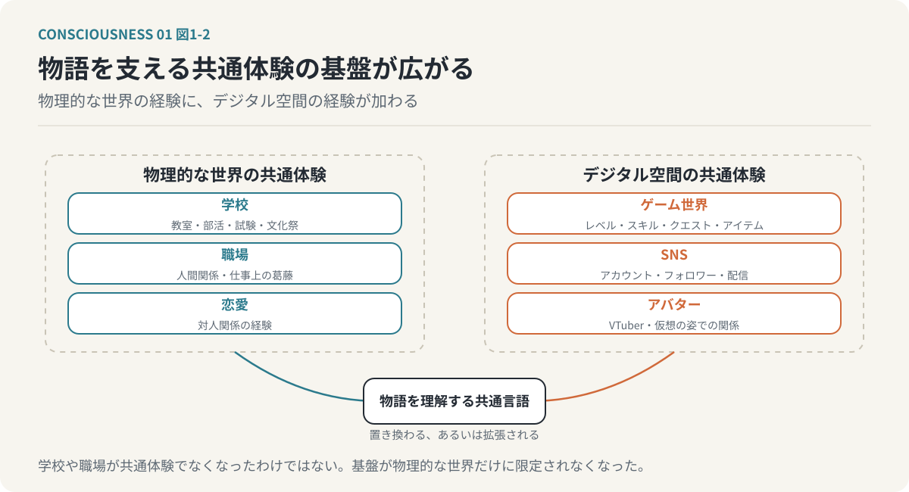
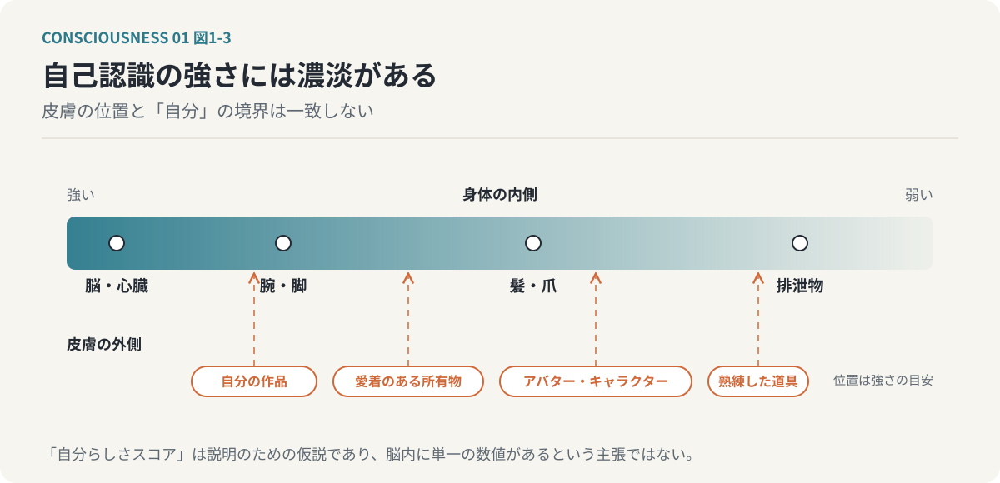
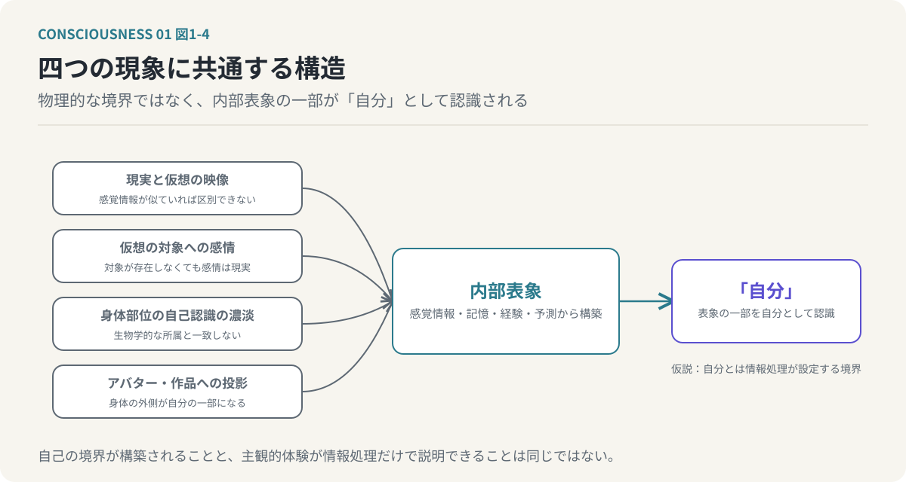

# 第1回　現実とバーチャルの境界はどこにあるのか

## 知覚の境界と、肉体に収まらない「自分」

<!-- NAV:TOP -->
[連載目次](../README.md) | [第2回 →](02-consciousness-and-self.md)
<!-- /NAV -->

私たちは、何をもって現実を現実と判断しているのだろうか。

目の前に存在するものは現実であり、コンピューターの中に存在するものはバーチャルである。この区別は一見すると明確である。しかし、技術の発展とともに、この境界は曖昧になりつつある。

実写映画とCGアニメーションは、かつてまったく異なる表現手法だった。現在では、両者の制作工程は多くの技術を共有している。実写映画にもCGによる背景や人物が登場し、アニメーションにも実写と見分けがつかない映像が存在する。

さらに生成AIの登場によって、現実には存在しない人物や風景を、写真や映像として生成できるようになった。

こうした変化は、単なる映像技術の進歩にとどまらない。

私たちが現実を認識する仕組み、さらには「自分」という存在を認識する仕組みについて、根本的な問いを投げかけている。

### 1. 実写とアニメーションの区別が失われる

かつて実写映画とアニメーションの違いは明確だった。

実写は現実の人物や風景をカメラで撮影する。一方、アニメーションは人間が描いた絵やコンピューターで生成した画像を連続して表示する。

両者は制作方法も、映像の質感も異なっていた。

しかし、現在の映像制作では、実写とCGの境界は技術的に曖昧になっている。

映画の中に登場する都市や建築物、自然環境は、必ずしも現実に存在するものではない。俳優の動きだけを撮影し、背景や周囲の物体をCGで構築することもできる。

反対に、CGアニメーションでは、現実の照明や材質、カメラの光学的特性をシミュレーションすることで、実写に近い映像を生成できる。

押井守監督は、こうした実写とアニメーションの境界が失われる未来を早くから論じていた。

そして生成AIは、この変化をさらに進めている。

従来、現実らしい映像を生成するには、三次元モデルの構築や照明、物理シミュレーションなどの工程が必要だった。生成AIは、大量の映像データから学習した統計的な関係を利用し、画像や映像を直接生成する。

結果として、映像が現実を撮影したものなのか、計算機によって生成されたものなのかを、見た目だけで判断することは難しくなっている。

ただし、ここで区別すべきことがある。

現実とバーチャルが物理的に同じものになったわけではない。両者を人間が知覚によって区別することが難しくなったのである。

重要なのは、この認識上の境界の変化である。

私たちは、外界の物理的な実体を直接認識しているのではない。視覚や聴覚などの感覚情報を通じて、外界を認識している。

その感覚情報が十分に類似していれば、背後にある物理的な生成過程が異なっていても、似た体験が生じる。

現実とバーチャルの境界を考えることは、私たちがどのように世界を認識しているのかを考えることにつながる。

*図1-1：現実とバーチャルは物理的には別の源である。しかし脳が受け取るのは感覚情報だけなので、二つの源は知覚の手前で合流し、似た体験を生む。*

### 2. 物語の共通体験が変わり始めている

この変化は映像表現だけに起きているのではない。

私たちが物語を理解するための前提となる、共通体験そのものも変化している。

物語には、その時代の人々が共通して理解できる設定や状況が必要である。

例えば、学園ものは学校生活という共通体験に依存している。

教室、部活動、試験、文化祭、卒業といった出来事は、多くの人が自分の経験と結びつけて理解できる。

社会人ドラマであれば職場での人間関係や仕事上の葛藤、恋愛作品であれば恋愛や対人関係の経験が、物語を理解するための基盤になる。

これらの作品では、現実社会に存在する制度や人間関係が、物語世界を構成するための共通言語として機能している。

ところが、近年はその共通言語に変化が生じている。

ゲーム世界を舞台にした作品では、レベル、ステータス、スキル、クエスト、アイテムといった概念が、詳しい説明なしに登場する。

『ソードアート・オンライン』や異世界転生ものでは、ゲームの仕組みそのものが物語世界の基本的な構造になっている。

これらの作品を理解するために必要なのは、必ずしも現実社会での経験ではない。ゲームをプレイした経験や、ゲーム的な世界観への理解である。

SNSやVTuberに関する物語にも同様の変化がある。

アカウント、フォロワー、配信、コメント、アバターといった概念が、物語を構成する基本的な要素となる。

つまり、かつて物理的な現実社会で共有されていた経験の一部が、デジタル空間での経験に置き換わり、あるいは拡張されている。

もちろん、学校や職場、恋愛が共通体験でなくなったわけではない。

変化しているのは、物語を成立させるための共通体験が、物理的な世界だけに限定されなくなったという点である。

*図1-2：物語を支える共通体験の基盤が広がっている。学校や職場が共通体験でなくなったわけではなく、デジタル空間の経験が置き換わり、あるいは拡張されている。*

そして、この変化は次の問いにつながる。

バーチャルな世界で経験した出来事は、現実の経験と何が違うのだろうか。

### 3. バーチャルな体験は現実の感情を生み出す

ゲームの中で、自分が長い時間をかけて育てたキャラクターが失われたとする。

そのキャラクターは現実の人間ではない。プログラムとデータによって表現された存在である。

それでも、喪失感を覚えることがある。

あるいは、オンラインゲームの中で他者と協力し、難しい課題を達成したとする。

その世界はコンピューター上に構築されたものであっても、達成感や喜びは現実の感情として生じる。

SNSでの評価や批判も同様である。

画面上に表示された文字や数字が、現実の人間関係や自己評価に影響する。

VTuberのようなアバターを通じた活動では、物理的な外見とは異なる姿で他者と関係を築くことができる。

ここで重要なのは、体験の対象が物理的に存在するかどうかと、その体験によって生じる感情が現実であるかどうかは、別の問題だということである。

仮想的な対象に対して生じた感情も、その感情を経験している人間にとっては現実の出来事である。

この事実は、意識の働きを考えるうえで重要である。

人間の意識は、外界の物理的な実体そのものではなく、感覚情報や記憶、予測を通じて構築された対象に反応する。

バーチャルな世界は、その仕組みを理解するためのわかりやすい例となる。

### 4. 私たちは肉体だけを「自分」と認識しているのか

ここで、現実とバーチャルの問題から、自己認識の問題へと視点を移したい。

私たちは通常、自分の肉体を「自分」だと考えている。

しかし、どこまでが自分の一部なのだろうか。

例えば、心臓や脳を自分にとって重要な身体部位と認識することに、ほとんど疑問はないだろう。

腕や脚も自分の一部である。失うことには強い心理的抵抗が伴う。

一方で、髪や爪はどうだろうか。

髪や爪も生物学的には自分の身体の一部である。しかし、日常的に切断し、捨てることができる。

さらに排泄物は、身体の中にあった物質であるにもかかわらず、排出された瞬間から自分の一部として認識されなくなる。

この違いは、単なる生物学的な分類だけでは説明できない。

身体の各部位に対する自己認識の強さは一様ではないのである。

では、自己の境界は皮膚によって決まるのだろうか。

これも必ずしもそうではない。

大切にしている所有物を傷つけられれば、自分自身が傷つけられたように感じることがある。

長い時間をかけて作った作品を否定されれば、自分の価値を否定されたように感じることもある。

ゲームキャラクターやSNSアカウント、アバターに対しても、同様の自己との結びつきが生じる。

これらは生物学的な肉体の一部ではない。

それでも、人間はそれらを自分の一部、あるいは自分の延長として認識することがある。

「自分」の範囲は、肉体の物理的な境界と必ずしも一致しない。

むしろ、どの対象をどの程度「自分」と認識するかは、経験や関係性、認知的な処理によって変化すると考えられる。

*図1-3：自己認識の強さは身体の中でも一様ではなく、皮膚の外側の対象にも及ぶ。境界は皮膚の位置ではなく、情報処理が引いている。*

### 5. 「自分」とは情報処理によって設定される境界ではないか

ここまでの議論を整理する。

現実とバーチャルは、物理的には異なる。

しかし、人間が受け取る感覚情報が類似していれば、両者を知覚によって区別することは難しくなる。

また、物理的に存在しない対象であっても、人間は現実の感情を抱く。

さらに、自分の身体の一部であっても自己認識の強さは異なり、反対に身体の外側にある対象を自分の一部として認識することもある。

これらの現象には、共通した構造がある。

人間は、物理的な世界の境界をそのまま受け取っているわけではない。

感覚情報や記憶、経験、予測などを通じて、世界に対する内部的な表象を構築している。

そして、その表象の一部を「自分」として認識しているのではないか。

*図1-4：四つの現象に共通する構造。人間は物理的な世界の境界をそのまま受け取るのではなく、内部表象を構築し、その一部を「自分」として認識している。*

ここから、ひとつの仮説を提示できる。

「自分」とは、あらかじめ物理的な世界に設定された境界ではなく、意識の情報処理によって構築される概念ではないか。

この仮説を採用すると、自己認識について新しい説明が可能になる。

肉体の各部位に対する自己認識の違いも、ゲームキャラクターやアバターへの自己の投影も、異なる程度で対象を自己に結びつける情報処理として捉えることができる。

ただし、ここで注意すべき点がある。

自己の境界が情報処理によって構築されることと、主観的な意識体験そのものが情報処理だけで説明できることは同じではない。

前者は自己認識の機能についての仮説であり、後者は意識の存在そのものに関わる問題である。

この区別は、本連載の後半で改めて扱う。

### 6. 意識と「自分」は同じものなのか

ここでさらに一歩進めて考えてみたい。

仮に「自分」が情報処理によって構築される概念であるなら、その「自分」を認識しているものは何なのだろうか。

私たちは日常的に、「自分が考える」「自分が感じる」「自分が判断する」と表現する。

しかし、この表現には異なる二つの働きが含まれている可能性がある。

一つは、情報を認識し、処理する働きである。

もう一つは、その情報処理によって「自分」という対象を構築する働きである。

通常、この二つを区別する必要はない。

しかし、意識を情報処理システムとして理解しようとするなら、両者を分離して考える必要がある。

例えば、自分の能力について考える場合、私たちは「自分はこの仕事が得意だ」「自分はこの作業が苦手だ」と判断する。

このとき、能力を評価する情報処理と、評価の対象である「自分」は、概念的には区別できる。

自分の性格を考える場合も同様である。

「自分は慎重な人間だ」と考えるとき、慎重であるという属性を持つ自己像が、認識の対象になっている。

では、その自己像を生成し、認識し、更新している仕組みは何なのか。

これが、次回から扱う問題である。

### おわりに：現実とバーチャルの境界から、意識の問題へ

現実とバーチャルの境界が曖昧になっていることは、単に映像表現が進歩した結果ではない。

それは、人間が世界をどのように認識しているのかを考えるための重要な手がかりである。

私たちは外界そのものに直接触れるのではなく、感覚情報を通じて世界を認識している。

そして、物理的な肉体だけでなく、キャラクターやアバター、所有物、作品などにも自己を結びつける。

ここから見えてくるのは、「自分」という存在が、必ずしも肉体の境界によって決まるものではないということである。

本連載では、ここからさらに進んで、意識を情報処理システムとして捉える仮説を検討していく。

その出発点となるのは、次の問いである。

「自分」を認識している意識と、認識されている「自分」は、本当に同じものなのだろうか。

次回は、この二つを明確に分離し、意識を情報処理プロセスとして定義する。

<!-- NAV:BOTTOM -->
---

[連載目次](../README.md) | [第2回 →](02-consciousness-and-self.md)
<!-- /NAV -->
