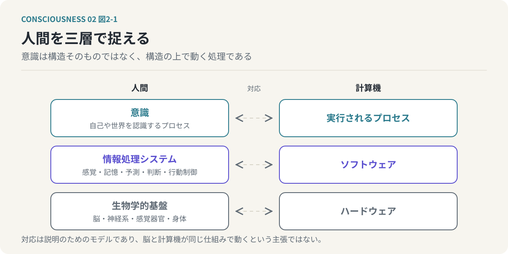
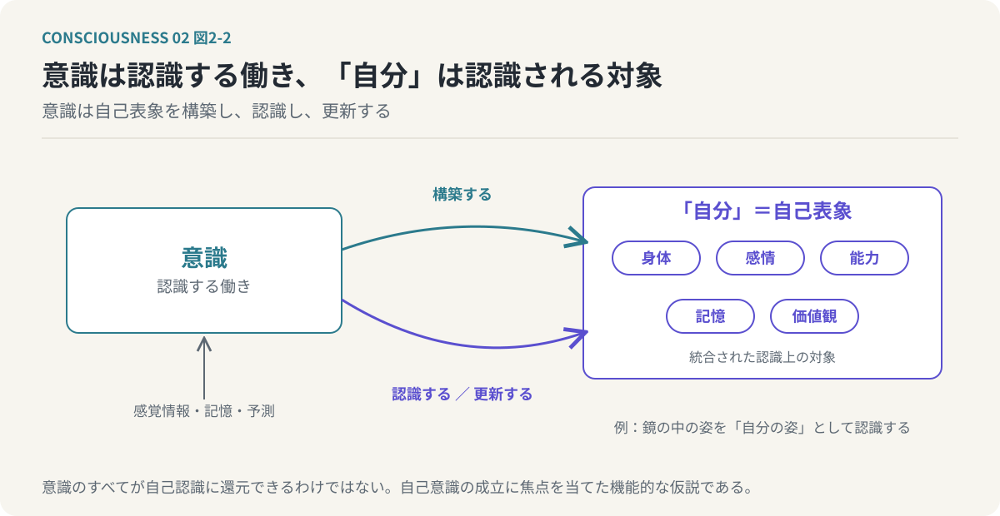
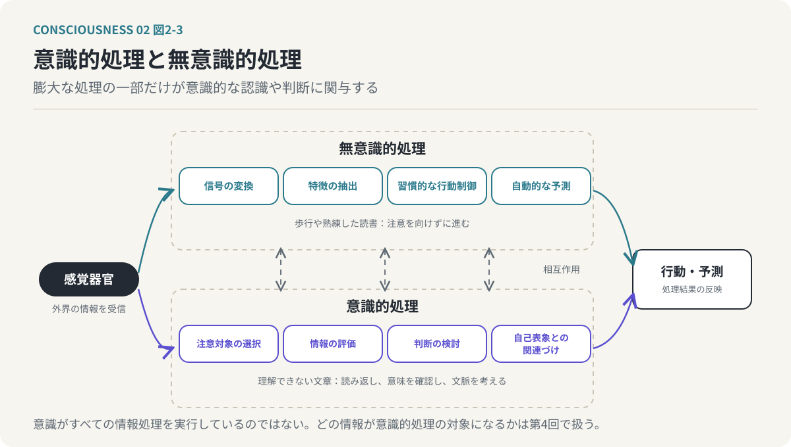
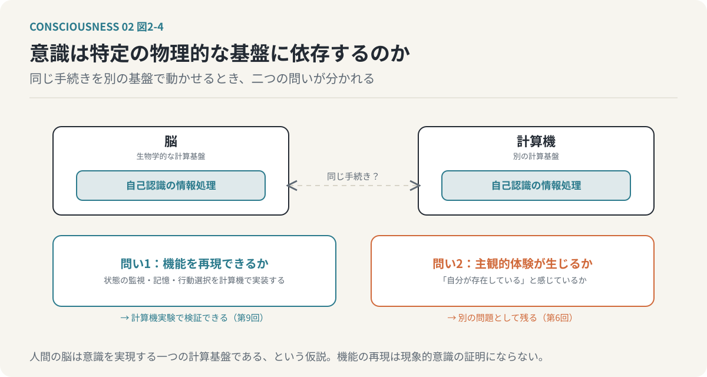
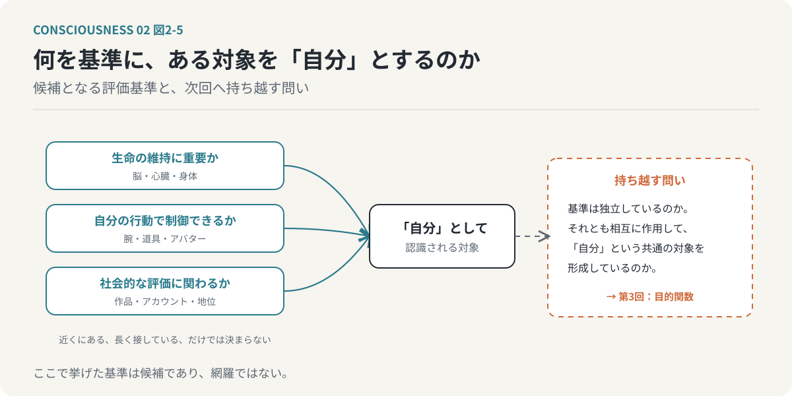

# 第2回　意識とは「自分」を認識する情報処理である

## 認識する働きと、認識される自己表象を分ける

<!-- NAV:TOP -->
[← 第1回](01-reality-and-virtuality.md) | [連載目次](../README.md) | [第3回 →](03-emergent-self.md)
<!-- /NAV -->

私たちは日常的に、「自分が考える」「自分が感じる」「自分が判断する」という表現を使っている。

しかし、ここにはひとつの疑問がある。

考えている「自分」と、考える対象になっている「自分」は、本当に同じものなのだろうか。

例えば、「自分は慎重な人間だ」と考えるとき、私たちは自分自身を観察し、性格を評価している。

このとき、慎重であると評価されている「自分」は、認識の対象である。

一方、その評価を行っている情報処理も存在する。

普段、私たちはこの二つを区別しない。しかし、意識の仕組みを考えるうえでは、両者を分離することが重要になる。

前回は、現実とバーチャルの境界が曖昧になりつつあることから、自己の境界もまた物理的な肉体だけでは決まらない可能性を考えた。

今回は、その議論をさらに進める。

**意識とは何か。そして、意識によって認識される「自分」とは何なのか。**

この二つを情報処理の観点から考えてみたい。

---

### 1. 人間を情報処理システムとして捉える

まず、人間を情報処理システムとして捉えることから始める。

コンピューターは、ハードウェアとソフトウェアによって構成されている。

ハードウェアは物理的な計算基盤であり、ソフトウェアはその基盤上で実行される情報処理の仕組みである。

人間にも、これに対応する構造を考えることができる。

脳や神経系、感覚器官、身体は、生物学的な基盤である。

その基盤上では、感覚情報の処理、記憶、予測、判断、行動の制御など、多様な情報処理が行われている。

そして、これらの情報処理と密接に関係する現象として、意識が存在する。

本連載では、次の三層を区別する。

- 生物学的基盤
  - 脳、神経系、感覚器官、身体などの物理的な構造
- 情報処理システム
  - 感覚、記憶、予測、判断、行動制御などの処理
- 意識
  - 情報処理の中で成立する、自己や世界を認識するプロセス

この三層は、コンピューターのハードウェア、ソフトウェア、実行されるプロセスに対応するものとして考えることができる。

*図2-1：本連載が区別する三層。意識は脳という構造そのものではなく、その構造の上で実行される情報処理の働きとして考える。対応は説明のためのモデルである。*

ただし、これは説明のためのモデルである。

人間の脳とコンピューターが同じ仕組みで動作するという意味ではない。また、意識が生物学的な基盤から完全に独立して存在できると証明されたわけでもない。

重要なのは、意識を脳という物理的な構造そのものと同一視するのではなく、その構造によって実現される情報処理の働きとして考えることである。

この立場を採用すると、意識についての問いが変わる。

「意識は脳のどこにあるのか」という問いだけでなく、「どのような情報処理によって意識の機能が成立するのか」という問いを立てられるようになる。

### 2. 意識と「自分」は同じものではない

ここで、本連載の中心となる仮説を提示する。

**意識とは、外部情報の一部を「自分」として認識する情報処理プロセスである。**

この定義では、意識と「自分」を区別する。

意識は認識する働きであり、「自分」はその認識によって構築される対象である。

例えば、鏡に映った自分の姿を見たとする。

鏡に映っているのは、自分の身体の視覚的な情報である。

私たちは、その情報を単なる人間の姿としてではなく、「自分の姿」として認識する。

ここでは、少なくとも二つの処理が行われている。

一つは、視覚情報から人間の身体を認識する処理である。

もう一つは、その身体が自分自身に対応すると判断する処理である。

後者には、自分の身体についての記憶や、身体の位置、動き、感覚との対応が関係している。

同様のことは、身体以外についても成立する。

「自分は仕事が得意だ」と考える場合、過去の経験や成果をもとに、自分の能力を評価している。

「自分は怒っている」と感じる場合、身体的な変化や感情に関する情報を、自分自身の状態として認識している。

つまり、「自分」とは身体だけを指すものではない。

身体、感情、能力、記憶、価値観など、さまざまな情報が統合された認識上の対象である。

このような、自分自身に関する内部的な表現を「自己表象」と呼ぶ。

本モデルでは、意識の重要な働きのひとつを、この自己表象の形成と認識に求める。

*図2-2：意識と「自分」は同じものではない。意識は認識する働きであり、「自分」はその働きが身体・感情・能力・記憶・価値観から構築し、認識の対象とする自己表象である。*

ただし、意識のすべてを自己認識に還元できると確定したわけではない。

私たちは自分について考えていないときにも、音楽を聴き、景色を眺め、痛みを感じる。

したがって、ここでの定義は意識の全領域を説明する完成された定義ではなく、自己意識の成立に焦点を当てた機能的な仮説である。

### 3. 意識的処理と無意識的処理

私たちの情報処理のすべてが、意識的に行われているわけではない。

例えば、歩いているとき、私たちは通常、足の筋肉の動きを一つひとつ意識していない。

視覚情報をもとに障害物を避けたり、身体のバランスを維持したりする処理の多くは、意識的な注意を向けることなく行われる。

読書も同様である。

文字を見た瞬間、その形状を識別し、単語を認識し、意味を理解するまでには、複数の情報処理が存在する。

しかし、熟練した読者は、文字の線の配置を逐一分析しているわけではない。

無意識的な処理によって、多くの情報が効率的に処理されている。

一方、理解できない文章に遭遇すると、私たちは意識的に注意を向ける。

読み返し、単語の意味を確認し、文脈を考える。

それまで自動的に行われていた処理の一部が、意識的な検討の対象になる。

この違いは重要である。

人間の情報処理には、意識的な注意を必要としない処理と、意識的な注意や判断が関与する処理がある。

両者は独立しているわけではない。

無意識的な処理の結果が意識的な判断に利用されることもあれば、意識的な判断が無意識的な処理の方向を変えることもある。

本モデルでは、この関係を次のように整理する。

- 感覚器官が外界の情報を受信する。
- 受信した情報は、複数の経路で処理される。
  - 無意識的処理
    - 感覚信号の変換
    - 特徴の抽出
    - 習慣的な行動制御
    - 自動的な予測や反応
  - 意識的処理
    - 注意を向ける対象の選択
    - 情報の評価
    - 判断の検討
    - 自己表象との関連づけ
- 意識的処理と無意識的処理は相互作用する。
- 処理結果は行動や予測に反映される。

*図2-3：意識的処理と無意識的処理。膨大な情報処理の一部だけが意識的な認識や判断に関与し、両者は相互作用する。熟練した読書は無意識的に進み、理解できない文章で意識的な検討が始まる。*

ここで重要なのは、意識がすべての情報処理を実行しているわけではないということである。

むしろ、膨大な情報処理の一部が意識的な認識や判断に関与していると考えられる。

では、どの情報が意識的な処理の対象になるのだろうか。

この問いは、次回以降で扱う目的関数や注意配分の問題につながる。

### 4. 肉体のどこまでが「自分」なのか

自己表象という考え方を採用すると、身体と自己の関係を改めて考えることができる。

私たちは通常、自分の肉体を自分自身と認識している。

しかし、その認識の強さは身体の部位によって異なる。

脳や心臓は、生命の維持に不可欠な器官である。

腕や脚も、身体の運動や外界への働きかけを担う重要な部分である。

これらを失うことには、強い心理的抵抗が生じる。

一方、髪や爪は自分の身体を構成する物質であるにもかかわらず、日常的に切断できる。

排泄物は、身体の内部に存在していた物質であるが、排出後には自己の一部として扱われなくなる。

つまり、生物学的に身体を構成していることと、心理的に自己として認識されることは、必ずしも一致しない。

本モデルでは、この違いを連続的な自己認識の強度として捉える。

仮に、ある対象がどの程度「自分」として認識されるかを数値で表すなら、「自分らしさスコア」のようなものを考えることができる。

このスコアは、対象ごとに異なる。

また、状況によって変化する。

例えば、普段は特に意識していない身体部位であっても、そこに痛みが生じれば、強く注意を向けることになる。

反対に、日常的に使用している道具は、操作に習熟することで、自分の身体の延長のように扱われることがある。

このような現象を考えると、自己と非自己の境界は単純な二分法では表現しにくい。

「自分である」か「自分ではない」かだけでなく、「どの程度、自分に結びついた対象として処理されるか」という連続的な関係が存在すると考えられる。

ただし、自分らしさスコアは本モデルの説明上の仮説であり、脳内にそのような単一の数値が実際に存在すると確認されたわけではない。

重要なのは、自己の境界が固定的なものではなく、情報処理の結果として変化し得るという点である。

### 5. 自己の境界は身体の外側にも広がる

自己の範囲が情報処理によって決まるなら、その範囲が肉体の内部に限定される理由はない。

前回取り上げたゲームキャラクターやアバターは、その典型例である。

ゲームの中でキャラクターを操作しているとき、プレイヤーは画面上のキャラクターを単なる外部の物体として認識しているわけではない。

キャラクターが移動すれば、自分が移動したように感じる。

キャラクターが攻撃を受ければ、自分に対する危険として反応する。

もちろん、キャラクターが受けた物理的な損傷が、そのままプレイヤーの肉体に生じるわけではない。

しかし、認識や行動制御の一部において、キャラクターが自己の延長として扱われている。

日常生活でも同様の現象が見られる。

自動車を運転するとき、熟練した運転者は車体の大きさや位置を考慮し、狭い道を通過する。

道具を使う職人は、道具の先端の位置や動きを、自分の身体運動と密接に結びつけて制御する。

自分が作成した作品や文章に対して、強い自己同一性を感じる場合もある。

これらは同じ種類の自己認識とは限らない。

身体運動に関する自己の拡張と、所有物や作品に対する心理的な同一化は、区別して考える必要がある。

しかし、いずれも物理的な肉体の外側にある対象が、自己に関する情報処理と結びつく現象である。

本モデルでは、こうした現象を広い意味での「自己の拡張」として捉える。

自己とは、皮膚の内側に閉じた固定的な対象ではなく、外界との関係によって変化する情報処理上の構造である。

### 6. 意識は特定の物理的な基盤に依存するのか

ここまでの議論から、さらに大きな問いが生じる。

意識を情報処理の働きとして捉えるなら、その処理は必ず人間の脳で実行されなければならないのだろうか。

コンピューターでは、同じ計算手続きを異なるハードウェア上で実行できる。

例えば、同じプログラムを異なる種類のプロセッサーで実行しても、必要な計算上の条件が満たされていれば、同じ結果を得ることができる。

この考え方を意識に適用すると、意識の機能を実現するために必要なのは、特定の物理的な物質ではなく、適切な情報処理の構造ではないかという仮説が生まれる。

この立場では、人間の脳は意識を実現する一つの計算基盤である。

同じ機能を実現できる別の計算基盤が存在するなら、意識の機能的な側面を再現できる可能性がある。

ただし、ここには二つの異なる問題がある。

第一に、人間の意識が行っていると考えられる情報処理を、計算機で再現できるかという問題である。

第二に、その情報処理を再現した計算機に、主観的な体験が生じるかという問題である。

この二つは同一ではない。

例えば、計算機が自分の状態を監視し、過去の行動を記憶し、将来の行動を選択する仕組みを持つことは可能である。

その仕組みを自己認識の機能的な近似として捉えることもできる。

しかし、その計算機が実際に「自分が存在している」と感じているかどうかは、別の問題である。

本連載では、前者を機能的意識の問題、後者を現象的意識の問題として区別する。

*図2-4：意識を情報処理の働きとして捉えると、二つの問いが分かれる。機能の再現は計算機実験で検証できるが、主観的体験が生じるかは別の問題として残る。*

計算機による実装可能性は、意識の機能的な構造を検討するうえで重要な手がかりになる。

一方、機能的な再現が現象的意識の存在を証明するわけではない。

この区別は、第6回で詳しく検討する。

### 7. 「自分」を構築する処理は何を基準にしているのか

ここで、今回の議論を一度整理したい。

意識を自己表象の形成と認識に関わる情報処理として捉えることで、さまざまな現象を共通の枠組みで考えられるようになる。

身体の一部を自分として認識すること。

自分の能力や性格を評価すること。

ゲームキャラクターや道具を自分の延長として扱うこと。

過去の経験をもとに、自分がどのような人間であるかを判断すること。

これらはすべて、何らかの情報を自己に関連づける処理として理解できる。

しかし、まだ重要な問いが残っている。

**情報処理システムは、何を基準にして、ある対象を「自分」として認識するのだろうか。**

単に近くに存在する対象が自分になるわけではない。

長い時間接している対象が、必ず自分の一部になるわけでもない。

反対に、物理的には離れていても、強い自己同一性を感じる対象が存在する。

そこには、何らかの評価基準が働いているはずである。

例えば、生命を維持するために重要な対象は、自己に強く結びつくかもしれない。

自分の行動によって制御できる対象も、自己として認識されやすいかもしれない。

社会的な評価や承認に関係する対象も、自己表象に大きな影響を与える可能性がある。

*図2-5：何を基準に対象を「自分」とするのか。候補となる基準は複数あり、それらが独立しているのか相互作用しているのかという問いを、次回の目的関数へ持ち越す。*

では、これらの評価基準は、それぞれ独立しているのだろうか。

それとも、複数の評価基準が相互に作用することで、「自分」という共通の対象が形成されるのだろうか。

この問いに答えるために、次回は「目的関数」という概念を導入する。

### おわりに：意識は「自分」を発見するのではなく、構築しているのかもしれない

私たちは、自分という存在が最初から確かに存在し、意識がそれを認識していると考えがちである。

しかし、今回検討した情報処理モデルでは、別の見方が可能になる。

意識は、あらかじめ完成された自己を発見しているのではない。

身体、感覚、記憶、経験、価値観などの情報を処理することで、自己表象を構築し、更新しているのではないか。

この立場では、「自分」は固定的な実体ではなく、情報処理によって維持される動的な構造となる。

それでは、その情報処理は何を目指しているのだろうか。

生命の維持なのか。

快楽の追求なのか。

他者からの承認なのか。

あるいは、それらすべてなのだろうか。

次回は、囲碁AIという単純なモデルを出発点に、複数の目的関数から「自分」が創発するという仮説を考える。

**「自分」は最初から存在するのではなく、複数の目的が交差する場所に生まれるのかもしれない。**

<!-- NAV:BOTTOM -->
---

[← 第1回](01-reality-and-virtuality.md) | [連載目次](../README.md) | [第3回 →](03-emergent-self.md)
<!-- /NAV -->
