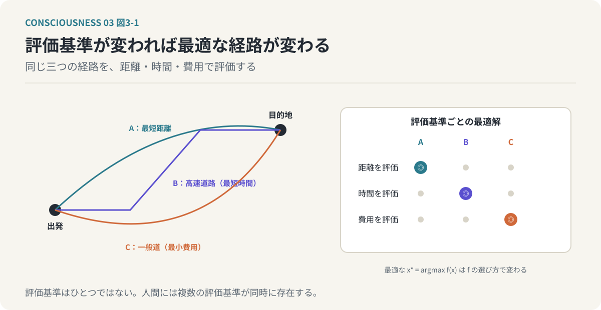
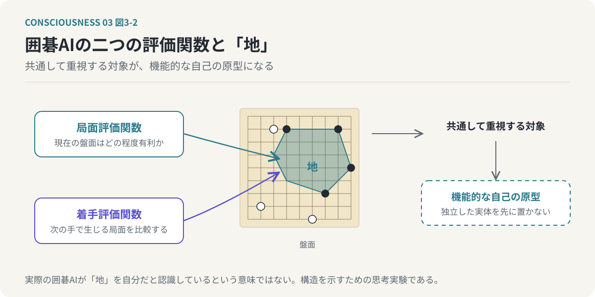
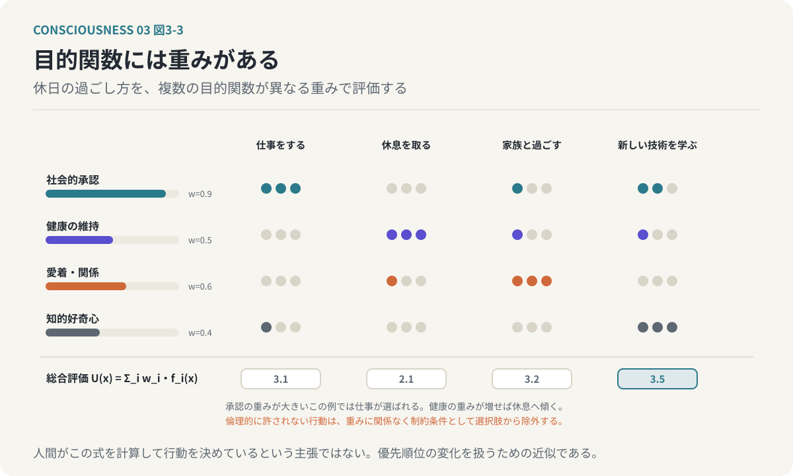
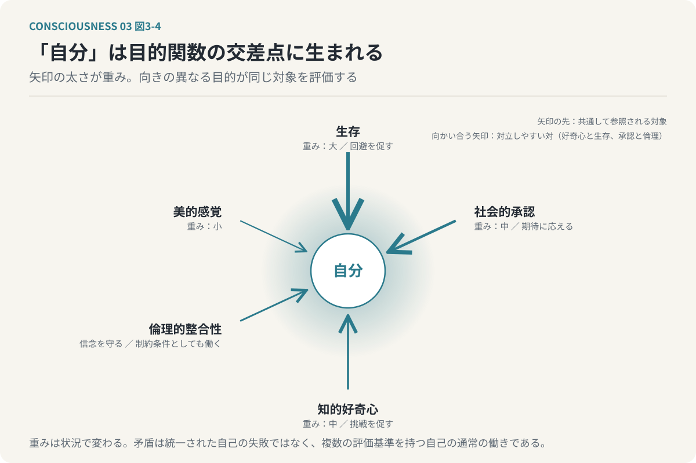
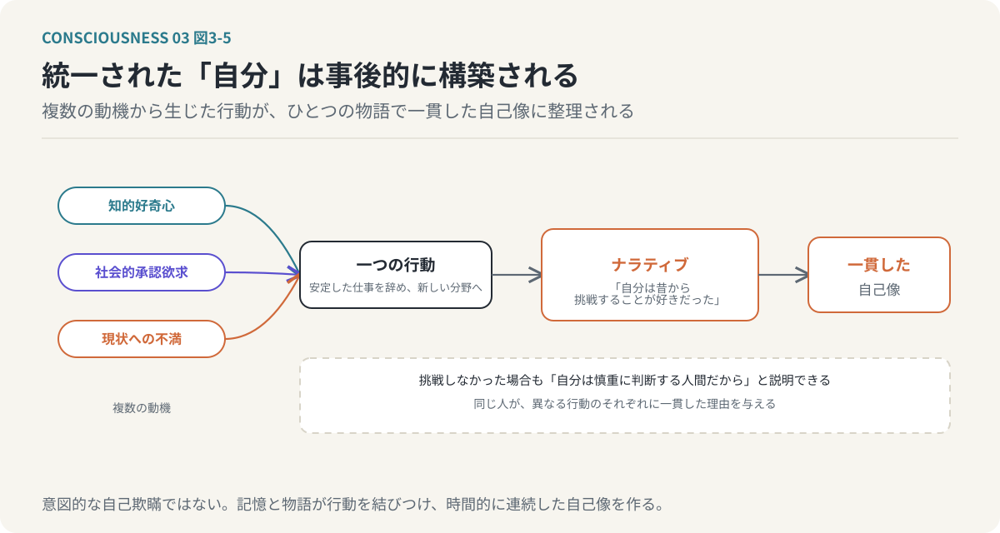
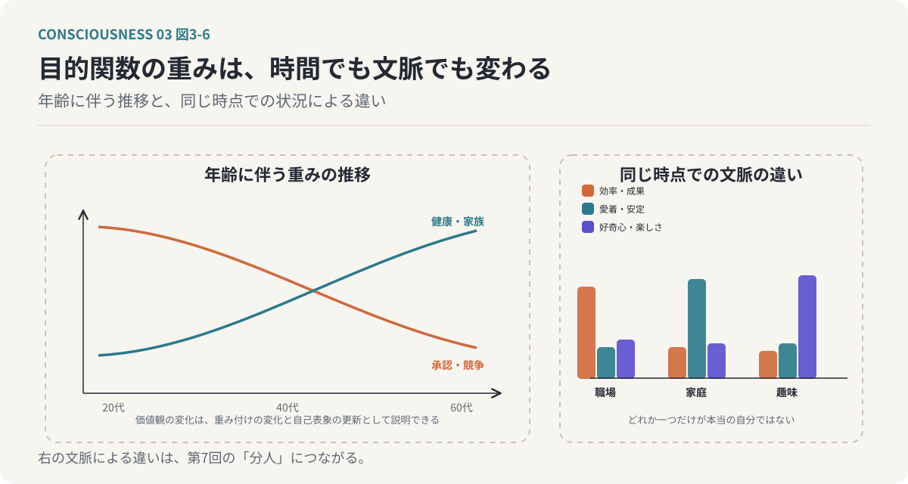
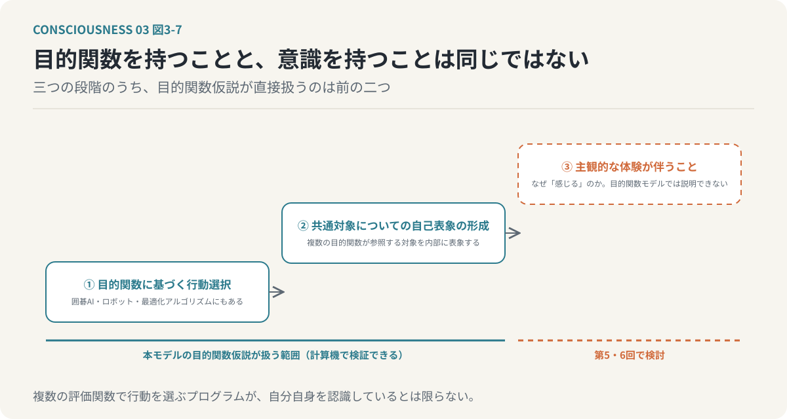

# 第3回　「自分」は複数の目的関数の交差点に生まれる

## 目的関数の重み付き集合から創発する自己

<!-- NAV:TOP -->
[← 第2回](02-consciousness-and-self.md) | [連載目次](../README.md) | [第4回 →](04-predictive-processing.md)
<!-- /NAV -->

私たちは、自分という存在が一つのまとまったものであると考えている。自分の考え、自分の欲求、自分の価値観。それらはすべて、ひとりの「自分」に属していると思っている。しかし、実際の人間の行動を振り返ると、この考え方には疑問が生じる。

健康でありたいと思いながら、身体に悪いとわかっているものを食べる。

他者から認められたいと思いながら、周囲の期待に反する行動を選ぶ。

安定した生活を望みながら、新しい挑戦に惹かれる。

私たちは、互いに矛盾する欲求や価値観を同時に抱えている。それにもかかわらず、それらをすべて「自分の考え」として認識している。なぜだろうか。

前回は、情報処理システムが何を基準にして「自分」という対象を形成するのか、という問いを残した。今回は、この問いに対して「目的関数」という概念を導入する。

**「自分」とは、複数の目的関数が共通して重視する対象として創発する概念である。**

これが今回検討する仮説である。

---

### 1. 目的関数とは何か

目的関数とは、ある状態や行動が、どの程度望ましいかを評価するための関数である。例えば、目的地までの移動経路を選択する場合を考える。最も短い距離を選びたいのであれば移動距離を評価する関数が、最も早く到着したいのであれば移動時間を評価する関数が、費用を抑えたいのであれば交通費を評価する関数が必要になる。それぞれの目的によって、最適な経路は異なる。同じ移動経路であっても、何を重視するかによって評価が変わるのである。

*図3-1：目的関数とは評価基準である。同じ三つの経路でも、距離・時間・費用のどれを評価するかで最適解が変わる。評価基準は一つではない。*

計算機の最適化問題では、こうした評価基準を数式として表現する。ある状態を `x`、その望ましさを評価する関数を `f(x)` とすれば、最も望ましい状態は次のように表せる。

`x* = argmax_x f(x)`　（式3-1）

`argmax` は関数の値を最大にする入力を求める操作であり、この式は「評価関数 `f(x)` が最大となる状態 `x*` を選ぶ」と読む。これはあくまで評価基準と選択を数学的に表現したものであり、人間の脳にこの数式がそのまま実装されているという意味ではない。重要なのは、ある行動が望ましいかどうかを判断するためには、何らかの評価基準が必要だということである。そして、人間には、そのような評価基準が一つだけ存在するわけではない。

### 2. 囲碁AIにとっての「自分」とは何か

人間よりも単純な情報処理システムとして、囲碁AIを考えてみたい。囲碁AIは、盤面の状態を評価し、次にどの手を打つかを選択する。その働きを単純化すると、二つの評価関数を考えることができる。一つは、現在の局面がどの程度有利かを評価する局面評価関数である。もう一つは、次にどの手を打つことが望ましいかを評価する着手評価関数である。局面評価関数は現在の盤面に対して評価を行い、着手評価関数は候補となる着手によって生じる局面を比較する。両者の役割は異なる。しかし、どちらも自分にとって有利な盤面を形成し、最終的に勝利することを目指している点は共通している。囲碁では、盤面における「地」が重要な評価対象となる。

ここで一つの思考実験を行う。仮に、この二つの評価関数が共通して重視する対象を、囲碁AIにとっての機能的な「自己」と呼ぶことにする。この場合、「地」は自己を説明するための一つの候補になる。もちろん、実際の囲碁AIが「地」を自分自身だと認識しているという意味ではなく、囲碁の勝敗は地の大小だけで決まるわけでもない。注目したいのは、評価関数同士の関係である。

**複数の評価関数が共通して重視する対象は、それぞれの関数から独立した、システム全体の中心的な概念として捉えられる。**

この中心的な概念を「自己」の機能的な原型として考えるのである。

*図3-2：囲碁AIの思考実験。役割の異なる二つの評価関数が共通して重視する対象を、機能的な「自己」の原型と考える。最初から自己という実体を置く必要はない。*

この思考実験では、最初から「自己」という独立した実体を用意する必要はない。評価関数が存在し、それらが共通して重視する対象が存在する。その関係から、自己に相当する概念を導くことができる。ただし、共通の評価対象が存在するだけで自己認識が成立するとは限らず、その対象がシステム内部で表象され、自身の状態や行動を評価するために利用される仕組みも必要となる。囲碁AIの例は自己の成立を証明するものではなく、複数の評価関数から共通の対象が生まれるという構造を、単純な形で示すためのモデルである。

なお、本連載では囲碁AIの評価関数も人間の欲求や価値判断も含めて「目的関数」と呼び、これから組み立てる見方を「目的関数モデル」と呼ぶ。

### 3. 人間は複数の目的関数を持っている

人間の場合、目的関数は囲碁AIよりもはるかに多様である。例えば、次のような評価基準を考えることができる。

| 目的関数 | 評価すること |
| --- | --- |
| 生存本能 | 生命を維持する。危険を回避する。身体の状態を保つ |
| 社会的承認欲求 | 他者から評価される。集団に受け入れられる。社会的な地位や信頼を獲得する |
| 知的好奇心 | 未知の情報を獲得する。新しい問題を解決する。世界に対する理解を深める |
| 性的欲求 | 性的な快楽や親密さを求める。生殖に関係する行動を動機づける |
| 倫理的整合性 | 自分の行動を価値観や規範に一致させる。他者に対する責任を果たす。不正や矛盾を回避する |
| 美的感覚 | 美しいものを求める。調和や表現に価値を見いだす。芸術的な体験を追求する |

これらは、人間の欲求や価値判断を目的関数として捉え直した例である。実際の人間の動機がこのように明確な関数として分離されているわけではなく、ここに挙げたものだけで人間の行動を説明できるわけでもない。しかし、人間が複数の異なる評価基準を持ち、それらを組み合わせて行動していることは、日常的な経験からも理解できる。

例えば、休日に仕事をするかどうかを考える。仕事をすれば成果が増え、社会的な評価につながるかもしれない。一方、休息を取ることは健康の維持につながり、家族や友人と過ごすことは愛着や人間関係の維持につながり、新しい技術を学ぶことは知的好奇心を満たす。どれか一つだけが正しいわけではなく、それぞれに異なる価値がある。私たちは、これらの評価基準を同時に考慮しながら行動を選択している。

### 4. 目的関数には重みがある

複数の目的関数が存在する場合、すべてを同じ程度に重視するとは限らない。普段は知的好奇心を重視している人でも、生命の危険が迫れば安全の確保を優先するだろう。社会的承認を重視している人でも、強い倫理的な葛藤が生じれば、周囲の期待に反する行動を選ぶかもしれない。つまり、各目的関数の重要度は状況によって変化する。この関係を、重み付きの目的関数として表現することができる。

`U(x) = Σ_i w_i・f_i(x)`　（式3-2）

`U(x)` は状態 `x` に対する総合的な評価、`f_i(x)` は個別の目的関数、`w_i` は各目的関数の重みである。この式は「それぞれの目的関数で状態を評価し、重みを掛けて足し合わせたものが総合評価になる」と読む。望ましい状態は、式3-1と同じく総合評価が最大となる `x* = argmax_x U(x)` として表される。健康を重視する重みが大きくなれば休息を選びやすくなり、社会的承認の重みが大きくなれば仕事を優先しやすくなり、知的好奇心の重みが大きくなれば、新しい学習を選びやすくなる。

*図3-3：目的関数の重み付き和。承認の重みが大きい例では仕事が選ばれ、健康の重みが増せば休息へ傾く。倫理的に許されない行動は重みに関係なく制約条件として除外する。*

人間が実際にこの式を計算して行動を決めているという主張ではなく、この数式は複数の目的とその優先順位を扱うための近似モデルである。また、単純な重み付き和ではすべての価値判断を説明できない。倫理的に許されない行動は、どれほど大きな利益が得られるとしても選択肢から除外される場合がある。そのような判断には、重み付けではなく制約条件として扱うべき要素が存在する。この区別は、第9回の実装でも使う。それでも、目的関数と重みという考え方は、人間の行動が状況によって変化することを説明するうえで有用である。

### 5. 「自分」は目的関数の交差点に生まれる

今回の中心的な仮説に進む。人間には複数の目的関数が存在し、それぞれが異なる対象や状態を評価し、異なる行動を促す。しかし、これらの目的関数は完全に独立しているわけではなく、多くの場合、共通した対象に関係している。生存本能は自分の身体の状態を重視し、社会的承認欲求は他者から見た自分の評価を重視する。知的好奇心は自分が何を知っているか、何を理解できるかに関係し、倫理的整合性は自分の行動が自分の価値観に一致しているかを評価する。これらは異なる目的関数である。それでも、それぞれの評価には、共通して参照される対象が存在する。それが「自分」である。

生存するのは誰なのか。承認されるのは誰なのか。知識を獲得するのは誰なのか。倫理的な判断を行うのは誰なのか。このように考えると、複数の目的関数が、共通してある対象の状態や行動を評価していることがわかる。

**目的関数モデルでは、この共通した評価対象の表象が、目的関数群の相互作用によって形成されると仮定する。**

これが「自分」の創発である。創発とは、個別の要素だけでは説明できない性質や構造が、要素間の相互作用によって成立することを意味する。ただし、「自分」という言葉が各目的関数の定義に最初から含まれているなら、そこから自己の存在を導いても循環論法になる。厳密には、各目的関数が共通する状態変数や行動主体に関する情報を利用し、その相互作用から自己表象が形成される過程を説明する必要がある。目的関数モデルの仮説は、単に複数の目的関数が存在するということではない。それらの目的関数が相互作用し、共通の対象を評価し、その対象についての情報を統合することで、「自分」という表象が形成されるということである。

*図3-4：「自分」は複数の目的関数の交差点に生まれる。矢印の太さは重みを表し、状況で変わる。向きの異なる目的が同じ対象を評価するので、自己は構造的に矛盾を含む。*

### 6. なぜ「自分」は矛盾するのか

このモデルを採用すると、人間の自己が矛盾を含む理由も説明できる。人間の目的関数は、必ずしも同じ方向を向いていない。知的好奇心は未知の領域への挑戦を促し、生存本能は危険の回避を促す。社会的承認欲求は周囲の期待に応えることを促し、倫理的整合性は、周囲の期待に反してでも自分の信念を守ることを促す場合がある。これらは、どちらかが間違っているという問題ではない。異なる目的関数が、異なる状態を望ましいと評価しているのである。ある目的関数にとって最適な行動が、別の目的関数にとっては望ましくない場合がある。その結果、私たちは葛藤する。

仕事を続けたいと思いながら、休みたいとも思う。他者に認められたいと思いながら、他者に合わせたくないとも思う。新しい挑戦をしたいと思いながら、失敗を恐れる。この矛盾を、単に判断力の不足や意志の弱さとして理解する必要はない。複数の目的関数を持つシステムでは、異なる評価基準が競合することは自然なことであり、すべての目的関数が常に同じ結論を出す方が特殊な状態である。ここから、重要な帰結が導かれる。

**「自分」が複数の目的関数の相互作用によって形成されるなら、「自分」はその構造上、矛盾を含む存在となる。**

私たちが感じる内面的な葛藤は、統一された自己の失敗ではなく、複数の評価基準を持つ自己の通常の働きである。

### 7. 統一された「自分」は事後的に構築される

それでは、なぜ私たちは、これほど多くの矛盾を抱えながら、一つの「自分」が存在すると感じるのだろうか。ここで重要になるのがナラティブ、すなわち出来事や経験を意味のある物語として結びつける働きである。

例えば、ある人が安定した仕事を辞め、新しい分野に挑戦したとする。その行動には、複数の目的関数が関与しているかもしれない。知的好奇心が新しい分野への関心を生み、社会的承認欲求が新しい成功を求め、現状への不満が変化を促した可能性がある。しかし、本人は後から「自分は昔から挑戦することが好きだった」と説明するかもしれない。この説明は行動に一定の一貫性を与え、複数の動機から生じた行動が、一つの性格や価値観に基づく選択として整理される。逆に、挑戦しなかった場合にも、「自分は慎重に物事を判断する人間だから」と説明できる。同じ人間が、異なる状況で異なる行動を取り、それぞれの行動に対して一貫した理由を与えることがある。

これは、意図的に自分を欺いているということではない。人間は過去の出来事を記憶し、それらを関連づけ、意味のある物語として理解する。その働きによって、時間的に連続した自己のイメージが形成される。目的関数モデルでは、このようなナラティブを、複数の目的関数から生じた行動を統合的に理解する仕組みとして捉える。つまり、私たちが感じる一貫した「自分」は、必ずしも行動に先立って存在する単一の意思決定主体ではない。複数の判断や行動の結果を、記憶と物語によって結びつけた表象である可能性がある。

*図3-5：統一された「自分」は事後的に構築される。複数の動機から生じた行動が、一つの物語によって一貫した自己像に整理される。挑戦しなかった場合にも別の一貫した理由が与えられる。*

統一された自己は錯覚だ、と言われることがある。この言い方は、自己が存在しないという意味ではない。

**最初から矛盾のない、単一で不変の自己が存在するという見方が、情報処理の実態を十分に表していないという意味である。**

自己は存在しないのではなく、複数の処理から構築され、維持され、更新されるものとして存在するのである。

### 8. 自己は固定的なものではなく、変化し続ける

目的関数モデルから、もう一つの帰結が導かれる。自己が複数の目的関数とその重み付けによって形成されるなら、目的関数の重みが変化することで、自己のあり方も変化する。若い頃には社会的承認や競争を重視していた人が、年齢を重ねるにつれて健康や家族との関係を重視するようになることがある。新しい知識を獲得することで、以前は重要だと考えていた価値観が変化する場合もあるし、大きな失敗や成功によって、自分の能力に対する評価が変わることもある。これらの変化を単に性格が変わったと捉えることもできるが、目的関数モデルでは、評価基準の重み付けが変化し、それに伴って自己表象が更新されたと説明できる。

さらに、同じ時点でも、状況によって重み付けは変化する。職場では効率や成果を重視し、家庭では愛着や安定を重視し、趣味の時間には好奇心や楽しさを重視する。このとき、どれか一つだけが本当の自分であり、残りが偽物だと考える必要はない。それぞれが、異なる目的関数の重み付けによって現れる自己のあり方である。この考え方は、第7回で扱う「分人」という概念につながる。人間は、一つの固定的な人格をあらゆる状況で表出しているのではなく、文脈に応じて異なる自己の側面を表出している。

*図3-6：目的関数の重みは時間でも文脈でも変わる。年齢に伴う価値観の変化は重み付けの変化として、同じ時点での違いは第7回の分人として説明する。*

### 9. 目的関数を持つことと、意識を持つことは同じではない

目的関数モデルの限界も明確にしておきたい。目的関数を持つ情報処理システムは、人間だけではない。囲碁AIも、ロボットも、さまざまな最適化アルゴリズムも、評価基準に基づいて動作する。複数の目的関数を組み合わせることも、計算機上で実現できる。しかし、それだけで意識が成立するとはいえない。複数の評価関数を用いて最適な行動を選択するプログラムは複雑な判断を実行できるが、そのプログラムが自分自身を認識しているとは限らない。自分自身に関する情報を内部状態として保持していたとしても、それが主観的体験を伴うかどうかは別問題である。

ここでは、少なくとも三つの段階を区別する必要がある。第一は、目的関数に基づいて行動を選択することである。第二は、複数の目的関数が共通して参照する対象について、自己表象を形成することである。第三は、その自己表象や情報処理に、主観的体験が伴うことである。

*図3-7：目的関数を持つことと意識を持つことは同じではない。目的関数仮説が直接扱うのは行動選択と自己表象の形成であり、主観的体験の段は第5回と第6回で検討する。*

目的関数モデルが直接扱うのは、主として第一と第二の段階である。第三の段階、すなわちなぜ情報処理に「感じる」という体験が伴うのかという問題は、目的関数モデルだけでは説明できず、第5回で統合情報理論（IIT）を導入して検討する。それでも、目的関数モデルを計算可能な形式で表現できることには意味がある。自己表象がどのような条件で形成され、どのように行動へ影響するのかを、計算機実験によって検証する道が開かれるからである。

### おわりに：「自分」は矛盾する目的の交差点にある

**自己は最初から存在する統一的な実体ではなく、複数の目的関数の相互作用によって構築される動的な概念であり、矛盾を含むことは例外ではなく構造的な性質である。**

囲碁AIの例では、異なる評価関数が共通して重視する対象を、機能的な自己の原型として考えた。人間では、生存、承認、好奇心、倫理、美意識など、さまざまな評価基準が同時に働き、必ずしも整合しない。それらが共通する状態や行動主体を評価し、その情報を統合することで、「自分」という表象が形成される。私たちは、矛盾しているから自分を見失うのではない。複数の異なる目的を持ち、それらを調停し続けること自体が、「自分」という存在の成り立ちである。

ここで新たな疑問が生じる。情報処理システムは、どの目的関数をいつ優先し、何を重要な情報として選ぶのだろうか。予測できない出来事に直面したとき、優先順位はどのように変化するのだろうか。この問題を考えるためには、脳が外界をどのように認識しているのかを理解する必要がある。次回は、予測処理と自由エネルギー原理を導入し、意識を不確実性の中で目的関数の優先順位を調整する情報処理として捉える。

<!-- NAV:BOTTOM -->
---

[← 第2回](02-consciousness-and-self.md) | [連載目次](../README.md) | [第4回 →](04-predictive-processing.md)
<!-- /NAV -->
