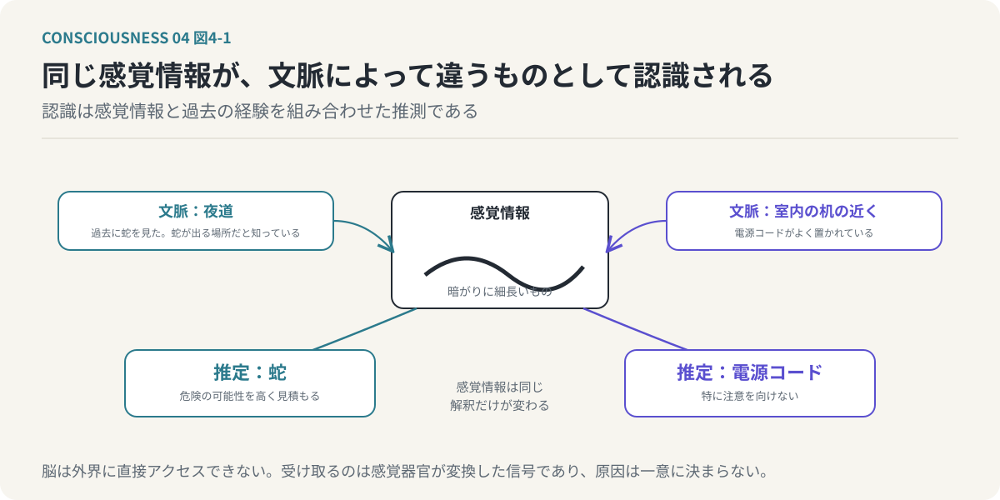
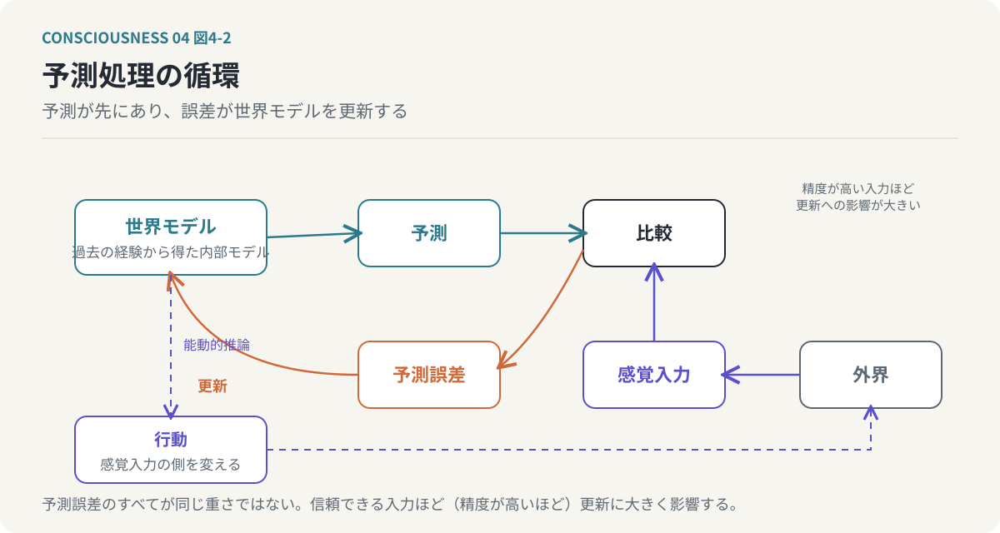
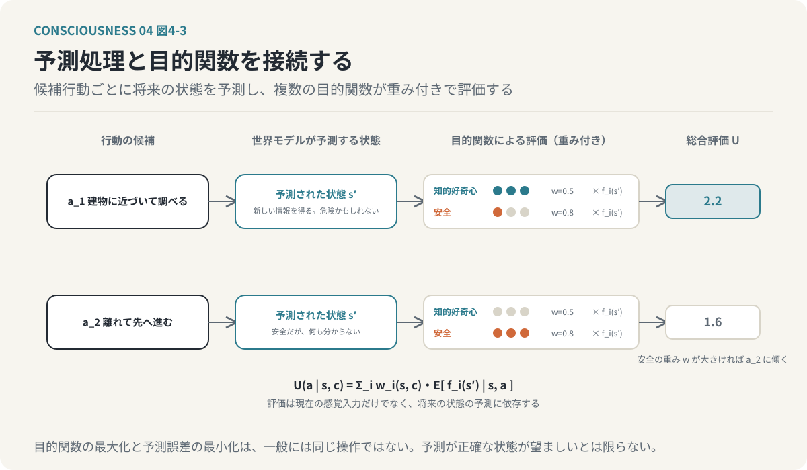
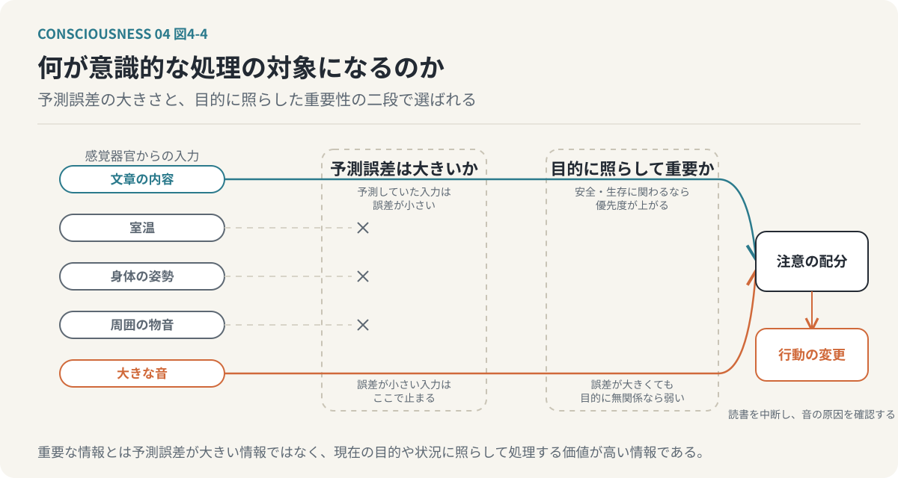
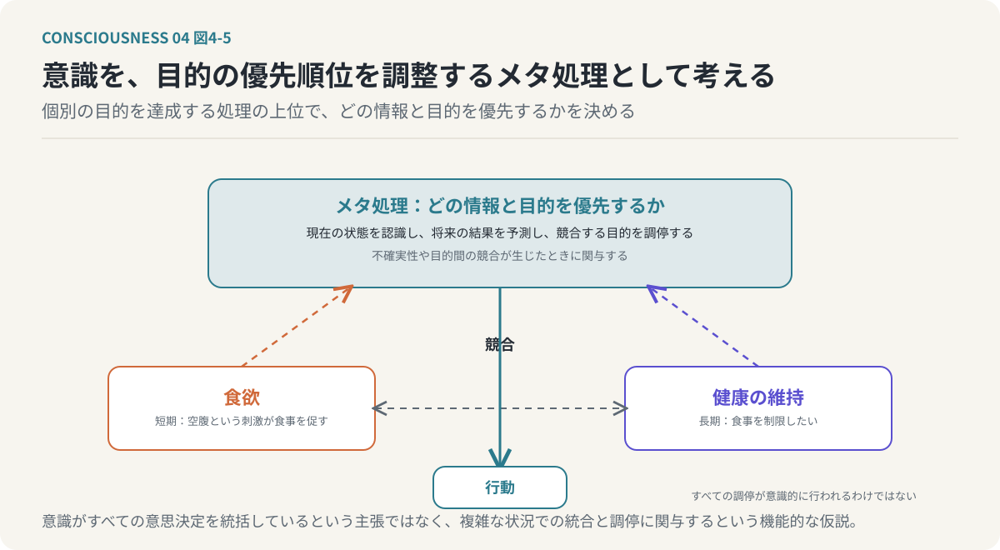
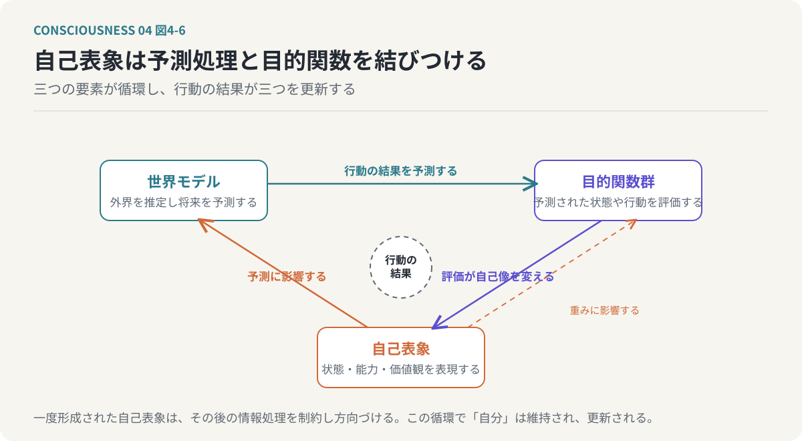
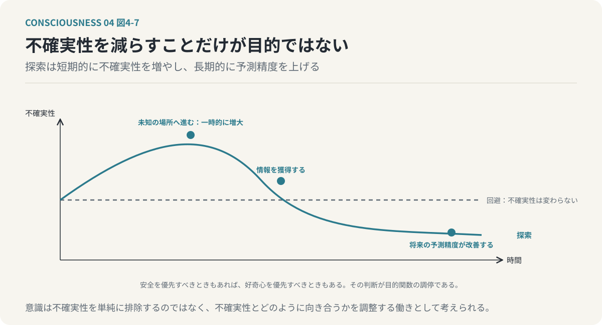

# 第4回　脳は世界を予測し、意識は何を優先するかを決める

## 予測処理・自由エネルギー原理と目的関数の調停

<!-- NAV:TOP -->
[← 第3回](03-emergent-self.md) | [連載目次](../README.md) | [第5回 →](05-integrated-information.md)
<!-- /NAV -->

私たちは、目の前にある世界をそのまま認識していると思っている。目で物を見て、耳で音を聞き、手で触れる。そして、それらの感覚情報をもとに、周囲で何が起きているのかを理解する。しかし、この説明には重要な問題がある。

脳は、外界そのものに直接アクセスできない。脳が受け取っているのは、感覚器官によって変換された電気的な信号である。目に入る光、耳に届く空気の振動、皮膚に加わる圧力。これらは感覚器官によって神経信号へ変換され、脳へ伝達される。脳は、その信号を生み出した外界の原因を直接知ることができない。それにもかかわらず、私たちは周囲の世界を認識し、未来を予測し、行動を選択している。どのようにして、それが可能になるのだろうか。

前回は、複数の目的関数の相互作用から「自分」が形成されると考えた。しかし、複数の目的関数が存在するとして、何を基準にその優先順位を決めるのだろうか。未知の状況に直面したとき、どの目的関数を重視し、どの行動を選択するのだろうか。今回は、この問いを考えるために、予測処理と自由エネルギー原理を導入する。

**意識とは、予測によって世界を理解し、不確実性の中で何を優先するかを調整する情報処理である。**

これが今回検討する仮説である。

---

### 1. 脳は外界を直接認識できない

脳は頭蓋骨の中に存在する。そこは光が届かず、外界の音も直接は伝わらない空間である。脳が世界について知るためには、感覚器官を経由する必要がある。

例えば、目の前で大きな音がしたとする。その音は、誰かが物を落とした音かもしれないし、風で扉が閉まった音かもしれないし、近くで車が衝突した音かもしれない。脳が受け取るのは、音の大きさや周波数、時間的な変化などに関する感覚情報であり、その情報だけで何が起きたのかが必ず一意に決まるわけではない。同じような音が、異なる原因によって発生することがあるからである。これは視覚でも同様である。暗い場所で細長いものを見たとき、それが木の枝なのか、蛇なのかを即座に判断できない場合がある。感覚情報には曖昧さが存在する。

それでは、脳はどのようにして外界の状態を判断しているのだろうか。一つの説明は、過去の経験を利用して、感覚情報の原因を推測しているというものである。夜道で細長いものを見たとき、過去に蛇を見た経験や、その場所に蛇が生息しているという知識があれば、蛇である可能性を高く見積もるかもしれない。反対に、室内で同じような形状を見た場合には、電源コードだと判断する可能性が高い。同じ感覚情報であっても、状況や過去の経験によって解釈は変わる。

*図4-1：同じ感覚情報が、文脈によって違うものとして認識される。認識は感覚情報を読み取った結果ではなく、感覚情報と過去の経験を組み合わせた推測である。*

つまり、私たちの認識は、感覚情報を単純に読み取った結果ではない。感覚情報と過去の経験を組み合わせて、外界の状態を推測した結果なのである。

### 2. 脳は世界モデルを使って予測する

この仕組みを説明する考え方の一つが、予測処理（Predictive Processing）である。予測符号化とも呼ばれる。予測処理では、脳は外界についての内部的なモデルを持ち、そのモデルを利用して感覚入力を予測すると考える。この内部的なモデルを「世界モデル」と呼ぶ。世界モデルには、過去の経験から獲得したさまざまな情報が含まれる。物体は重力によって落下するという知識があり、人間の表情や声の調子から相手の感情を推測することもでき、交通信号が赤になれば車が停止する可能性が高いと予測できる。こうした知識は、世界の状態を予測するために利用される。

重要なのは、脳が感覚情報を受け取ってから初めて世界を理解するのではなく、感覚入力に先立って予測を生成しているという考え方である。階段を下りているとき、私たちは次の段がどの程度の高さにあるかを予測しながら足を動かしている。予測した位置に段が存在すれば、特に意識することなく歩き続けられる。しかし、予想していた場所に段がなければ、身体は大きく反応する。予測と実際の感覚入力に差が生じたからである。

予測処理では、この差を「予測誤差」と呼ぶ。予測誤差は、現在の世界モデルが感覚入力をどの程度説明できているかを示す情報となる。予測が正確であれば世界モデルを大きく変更する必要はなく、予測が外れれば世界モデルを更新する必要が生じる。この処理を繰り返すことで、脳は外界についての理解を維持し、変化する環境に適応していると考えられる。

### 3. 予測誤差によって世界モデルを更新する

予測処理の基本的な構造は、循環的なものである。まず、世界モデルから次に受け取る感覚情報を予測する。次に、実際の感覚情報を受け取り、予測と比較してその差を計算する。差が大きければ世界モデルを修正し、修正した世界モデルを使って次の予測を行う。この循環を簡略化すると、次のようになる。

1. 世界モデルから予測を生成する。
2. 感覚器官から情報を受け取る。
3. 予測と感覚入力を比較する。
4. 予測誤差を算出する。
5. 予測誤差に基づいて世界モデルを更新する。
6. 更新した世界モデルから新しい予測を生成する。

*図4-2：予測処理の循環。脳は感覚入力に先立って予測を生成し、誤差で世界モデルを更新する。行動によって感覚入力の側を変える経路が、能動的推論につながる。*

この仕組みを、単純な数式で表してみる。実際に観測した情報を `o`、世界モデルによる予測を `ô` とすると、予測誤差とその大きさを評価する損失は次のように表せる。

`e = o - ô`　（式4-1）

`L = (o - ô)²`　（式4-2）

式4-1は「予測誤差とは観測と予測の差である」、式4-2は「差が大きいほど損失が大きい」と読む。予測と観測が一致すれば損失は小さくなり、この損失を小さくするように世界モデルを更新することで、将来の予測精度を改善できる。

もちろん、実際の脳における予測処理は、これほど単純ではない。感覚情報は多次元であり、予測には不確実性が伴う。また、予測誤差のすべてが同じ重要度を持つわけではない。暗闇で見えた不明瞭な物体に関する視覚情報と、明るい場所で明確に見えた物体に関する情報では、信頼できる程度が異なる。そのため、予測誤差の大きさだけでなく、情報の信頼性も考慮する必要がある。予測処理では、こうした信頼性を精度（Precision）として扱う。信頼性の高い感覚情報から生じた予測誤差は世界モデルの更新に大きく影響し、信頼性の低い情報から生じた予測誤差は、相対的に小さな影響しか与えない場合がある。つまり、脳は単に予測誤差を計算するだけではなく、どの予測誤差を重要なものとして扱うかも調整しているのである。

### 4. 自由エネルギー原理は何を説明するのか

神経科学者のKarl Fristonが提唱した自由エネルギー原理（Free Energy Principle）は、生命システムが環境の中で一定の状態を維持し続けることを、情報理論や確率論の枠組みから説明しようとするものである。生命システムは、環境からの影響を受けながらも、自身が存続できる状態を維持する必要がある。人間は体温や血糖値などを一定の範囲に保ち、外界の変化によって身体の状態が乱れれば、それに対応する行動や生理的な調整が行われる。自由エネルギー原理は、このような仕組みを、単なる反射の集合ではなく、環境と自身の状態を推定しながら調整する過程として考える。具体的には、システムが生成モデルに基づいて外界を推定し、変分自由エネルギーを小さくする方向で状態を更新するという枠組みを用いる。

今回の議論で重要なのは、その中心的な考え方である。生命システムは、外界の状態を推測し、予測し、実際の入力との不整合を減らすように働く。そして、そのための方法は、内部モデルを修正することだけではない。自分自身が行動することで、感覚入力の側を変えることもできる。部屋が寒いと感じたとき、現在の室温についての認識を更新することもできるが、それだけでは寒さは解消しない。暖房をつけたり、衣服を追加したりすることで、身体が受け取る感覚入力そのものを変えることができる。つまり、システムは世界の予測を変更するだけでなく、世界への働きかけによって予測と観測の関係を変えることができる。このように、知覚と行動を一体として扱う考え方は、能動的推論（Active Inference）と呼ばれる枠組みにつながる。

二つの留保を添えておく。ここでいう自由エネルギーは熱力学の自由エネルギーと同じ量ではなく、確率モデルに基づいて定義される情報理論的な量である。また、変分自由エネルギーの最小化は単純な予測誤差の最小化と完全に同じではなく、観測をどの程度説明できるかという要素に加えて、推定の複雑さなどに関係する要素も含まれる。

### 5. 予測処理と目的関数を接続する

前回の目的関数モデルに戻る。前回は、人間の行動を複数の目的関数の重み付き最適化（式3-2）として表現した。今回は、このモデルを予測処理と接続する。まず、世界モデルによって、将来どのような状態が生じるかを予測する。次に、予測された状態が、各目的関数にとってどの程度望ましいかを評価する。そして、目的関数の重みに基づいて行動を選択する。

知らない場所を歩いているとき、見慣れない建物を発見したとする。知的好奇心は、その建物に近づいて調べることを促すかもしれない。一方、生存や安全に関する目的関数は、危険な場所に近づかないことを促すかもしれない。建物が安全であると予測されれば好奇心を満たす行動を選びやすくなり、危険があると予測されれば安全を優先する可能性が高くなる。つまり、目的関数の評価は、現在の感覚入力だけでなく、将来の状態に関する予測に依存する。この関係を、次のように表現できる。

`U(a | s, c) = Σ_i w_i(s, c)・E[f_i(s') | s, a]`　（式4-3）

`a` は候補となる行動、`s` は現在の推定状態、`c` は文脈、`s'` は行動後に予測される状態、`E` は予測される結果についての期待値、`w_i(s, c)` は状態と文脈によって変化する目的関数の重みである。この式は「候補となる行動ごとに将来の状態を予測し、その状態を各目的関数で評価し、重みを掛けて足し合わせる」と読む。

*図4-3：予測処理と目的関数の接続。候補行動ごとに将来の状態を予測し、複数の目的関数が重み付きで評価する。安全の重みが大きければ離れる行動へ傾く。*

自由エネルギー原理と目的関数モデルの接続については、注意が必要である。目的関数の最大化と予測誤差の最小化は、一般には同じ操作ではない。予測誤差が小さい状態が、必ずしも望ましい状態とは限らないからである。危険な状況を正確に予測できたとしても、その状況が望ましいわけではないし、未知の場所へ向かう行動は、一時的に不確実性を増大させる場合があるが、知識の獲得という目的には適しているかもしれない。能動的推論では、選好する状態への接近と、不確実性を減らす情報獲得の双方を考慮する。目的関数モデルはこの考え方と接続できる可能性があるが、それぞれの目的関数を自由エネルギー原理のどの要素に対応させるかは、追加の理論的検討が必要である。

### 6. 意識は何を重要な情報として選ぶのか

予測処理と目的関数を接続すると、次の問題が現れる。世界には膨大な情報が存在するが、人間はそのすべてに同時に注意を向けることはできない。文章を読んでいるとき、周囲の物音や室温、身体の姿勢など、多くの情報が感覚器官から入力されている。それでも、通常は文章の内容に注意を集中できる。一方、突然大きな音がすれば、注意はその音へ向けられる。なぜだろうか。

この現象には、予測誤差と目的関数の両方が関係していると考えられる。まず、大きな音は予測していなかった感覚入力である可能性が高く、予測誤差が大きくなる。さらに、その音が危険を示している可能性があれば、生存や安全に関係する評価基準が重要になる。その結果、文章を読むという現在の行動よりも、音の原因を確認することが優先される。目的関数モデルでは、この変化を注意配分と目的関数の重み付けの調整として捉える。世界モデルが感覚入力を予測し、予測誤差が生じ、その大きさと信頼性が評価され、目的関数群がその情報の重要性を評価し、注意の配分が変化し、必要に応じて行動が変更される。

*図4-4：何が意識的な処理の対象になるのか。予測誤差が大きいだけでは足りず、現在の目的に照らして処理する価値が高い情報が注意を得る。*

この考え方では、重要な情報とは、単に予測誤差が大きい情報ではない。

**現在の目的や状況に照らして、処理する価値が高い情報である。**

同じニュースを見ても、ある人は経済への影響に注意を向け、別の人は倫理的な問題に注意を向けるかもしれない。同じ情報でも、どの目的関数を重視するかによって、認識のされ方が変わるのである。

### 7. 意識を目的関数の優先順位を調整するメタ処理として考える

ここまでの議論を統合する。脳は世界モデルを用いて外界を予測し、予測と感覚入力の差から生じる予測誤差で世界モデルを更新する。一方、複数の目的関数は、予測された状態や行動を異なる基準から評価し、その評価結果に基づいて注意配分や行動選択が変化する。では、この全体の中で意識はどのような役割を持つのだろうか。本連載では、次の仮説を採用する。

**意識の重要な機能の一つは、不確実性や目的間の競合が生じたとき、どの情報と目的を優先するかを調整するメタ処理である。**

ここでいうメタ処理とは、個別の目的を直接達成する処理ではなく、それらの処理の優先順位や関係を調整する働きである。食事をするという行動を考える。空腹であれば、食欲に関係する処理が行動を促す。しかし、健康上の理由から食事を制限しようとしている場合、短期的な欲求と長期的な健康維持の目的が競合する。このとき、単純に空腹という刺激へ反応するだけでは、複数の目的を調停できない。現在の状態を認識し、将来の結果を予測し、どちらの目的を優先するかを判断する必要がある。目的関数モデルでは、こうした目的間の調停を、意識の重要な機能として位置づける。

*図4-5：意識を目的の優先順位を調整するメタ処理として考える。個別の目的を達成する処理ではなく、競合する目的のどちらを優先するかを決める働きである。*

ただし、すべての目的間調停が意識的に行われるわけではない。習慣的な行動や自動化された判断にも複数の評価基準が関与することがあり、意識的な判断が常に最も合理的な結果をもたらすわけでもない。ここで述べているのは、意識がすべての意思決定を統括しているという主張ではなく、意識的な処理が、複雑な状況での情報の統合や目的間の調停に関与するという機能的な仮説である。

### 8. 自己表象は予測処理と目的関数を結びつける

第2回で導入した自己表象、すなわち身体の状態、能力、価値観、過去の経験など、自分自身に関する情報の内部的な表現を取り上げる。自己表象は、単に過去の情報を保存するだけのものではなく、将来の予測や行動選択にも影響する。

「自分は人前で話すことが苦手だ」と考えている人がいるとする。その人は、人前で話す場面に直面したとき、失敗する可能性を高く予測するかもしれない。その予測は不安という情動に関係し、行動選択にも影響する。一方、人前で話す経験を重ね、成功体験を蓄積すれば、自己表象が変化する可能性がある。「自分はある程度、人前で話すことができる」という認識に変われば、将来の予測も変化する。このように、自己表象は予測処理に影響し、同時に、予測処理の結果によって自己表象が更新される。

目的関数との間にも、同様の関係が存在する。「自分は他者に誠実でありたい」と考える場合、その自己表象は倫理的な目的関数の重み付けに影響するかもしれない。逆に、倫理的な判断を繰り返すことによって、「自分は誠実な人間だ」という自己表象が強化される可能性もある。整理すると、世界モデルが行動の結果を予測し、目的関数群が予測された状態や行動を評価し、自己表象がその予測と評価の双方に影響し、行動の結果が世界モデルと自己表象を更新する。

*図4-6：自己表象は予測処理と目的関数を結びつける。世界モデルが結果を予測し、目的関数が評価し、自己表象が双方に影響し、行動の結果が三つを更新する。*

ここには、単純な一方向の情報処理ではなく、循環的な構造が存在する。自己表象は、情報処理の結果として形成されるだけではない。一度形成された自己表象が、その後の情報処理を制約し、方向づけるのである。この循環によって、「自分」は継続的に維持され、更新されると考えられる。

### 9. 意識は不確実性をなくすためだけに存在するのか

もう一つ重要な問題を考えたい。予測処理や自由エネルギー原理を単純に理解すると、生命システムは不確実性を減らすことだけを目指しているように見える。しかし、人間は必ずしも不確実性の低い環境だけを求めるわけではない。未知の場所へ旅行する。新しい技術を学ぶ。難しい問題に挑戦する。結末のわからない物語を楽しむ。これらの行動は一時的に不確実性を増大させるが、それでも人間は積極的にそのような行動を選択する。なぜだろうか。

目的関数モデルでは、この行動を知的好奇心や探索欲求によって説明できる。一方、能動的推論の枠組みでは、将来の不確実性を減らすために情報を獲得する行動として説明できる場合がある。未知の場所へ進むことは現在の不確実性を増やすかもしれないが、探索を通じて新しい情報を得ることで、将来の予測精度を改善できる。つまり、短期的な不確実性の増大が、長期的な情報獲得につながる場合がある。

*図4-7：不確実性を減らすことだけが目的ではない。探索は短期的に不確実性を増やし、長期的に予測精度を上げる。どちらを選ぶかの判断が目的関数の調停である。*

この点は、人間の知的活動や創造性を考えるうえで重要である。意識を単に予測誤差を減らす仕組みとして理解すると、探索や挑戦の価値を十分に説明できない。むしろ、不確実性を回避すべき状況と、不確実性を受け入れて探索すべき状況を区別することが重要になる。目的関数モデルでは、こうした判断を複数の目的関数の調停として捉える。安全性を優先すべきときもあれば、好奇心を優先すべきときもあり、その優先順位は、環境、身体の状態、過去の経験、自己表象などによって変化する。

**意識は、不確実性を単純に排除するのではなく、不確実性とどのように向き合うかを調整する働きとして考えられる。**

### 10. 予測処理だけでは「感じること」を説明できない

ここまで、意識を予測処理と目的関数の調停という観点から説明してきた。しかし、この説明にも限界がある。ある計算機が世界モデルを持ち、外界を予測し、予測誤差を計算し、複数の目的関数に基づいて行動を選択できるとする。さらに、その計算機が自己表象を持ち、過去の経験に応じて自分自身のモデルを更新できるとする。この計算機は、人間の意識が持つと考えられる機能の一部を再現している。それでは、この計算機は何かを「感じている」のだろうか。予測誤差を計算することと、予測が外れたことに驚く体験をすることは、同じなのだろうか。危険を評価することと、恐怖を感じることは、同じなのだろうか。

この問いには、今回のモデルだけでは答えられない。予測処理と目的関数によって、情報がどのように処理され、行動がどのように選択されるかを説明することはできる。しかし、その処理に主観的体験が伴う理由は、別の問題として残る。これは、意識のハードプロブレムと呼ばれる問題につながる。本連載では、機能的な説明と現象的な説明を区別する。

次の段階では、複数の情報処理が統合されること自体に注目する。これまで考えてきた意識のモデルには、共通する特徴がある。感覚情報、予測、目的関数、自己表象、記憶は、それぞれ独立した処理ではなく、相互に影響し合いながら、一つの情報処理システムとして機能している。この情報の統合に、意識の成立を説明する手がかりがあるのだろうか。この問いを考えるために、次回は統合情報理論（IIT）を導入する。

### おわりに：意識は世界を予測しながら、何を重視するかを調整する

**「自分」は個々の情報処理の中にあるのではなく、それらが統合される構造の中にある。**

脳は外界そのものを直接認識するのではなく、過去の経験から形成された世界モデルで世界の状態を推測し、実際の入力との誤差によって世界モデルを更新する。一方、複数の目的関数は予測される状態や行動を異なる基準から評価し、どの目的関数を優先するかによって、注意の向け方や行動選択が変化する。目的関数モデルでは、意識の重要な働きの一つを、こうした予測処理と目的関数の調停に求める。自己表象はこの処理に影響を与え、処理の結果によって更新される。

感覚情報を受け取ること、世界を予測すること、複数の目的を評価すること、目的間の矛盾を調停すること、自己表象を形成し更新すること。これらの処理が並列に存在するだけで、統一された「自分」が成立するとは限らない。重要なのは、それらがどのように結びつき、互いに影響し合っているかである。次回は、この可能性を統合情報理論（IIT）の観点から検討する。

<!-- NAV:BOTTOM -->
---

[← 第3回](03-emergent-self.md) | [連載目次](../README.md) | [第5回 →](05-integrated-information.md)
<!-- /NAV -->
