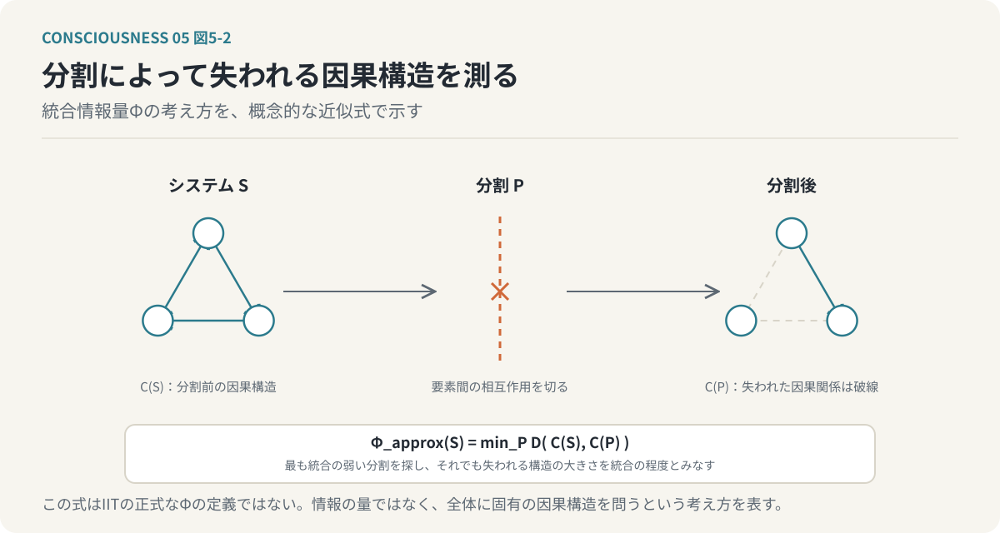
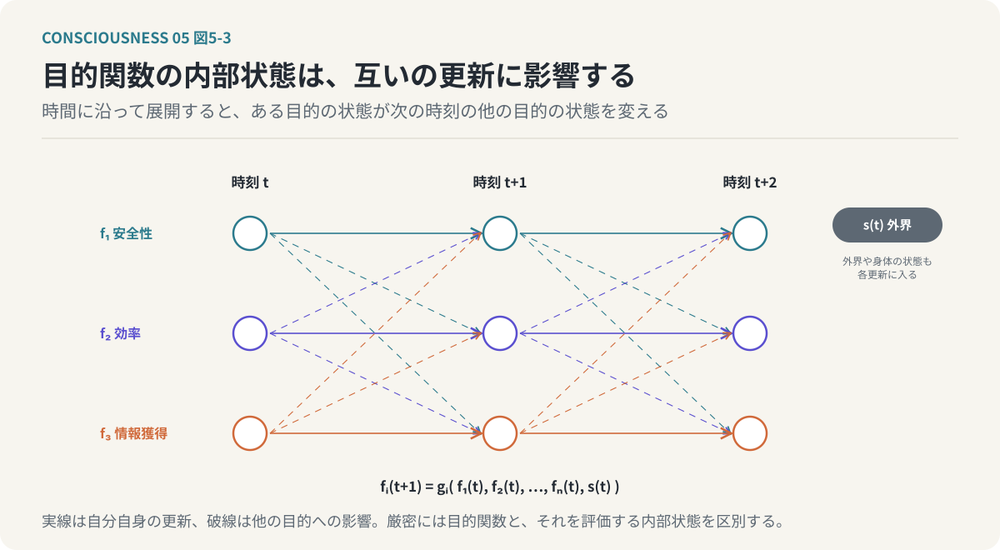
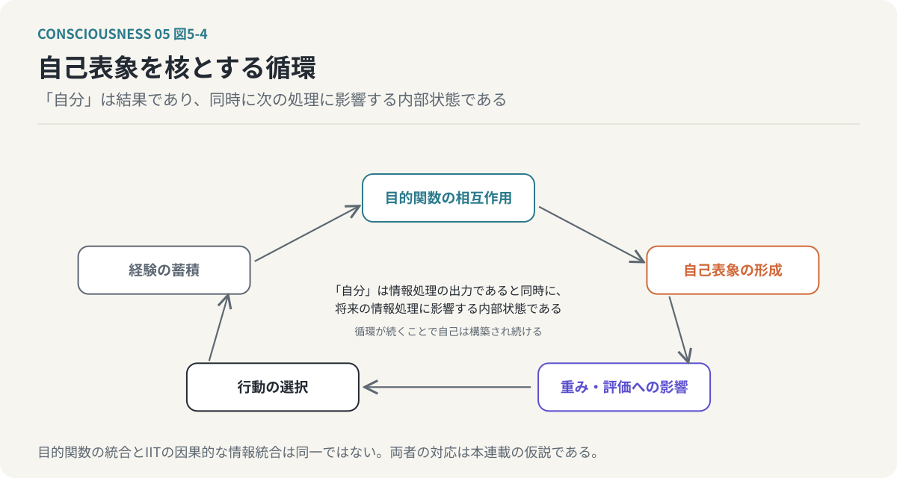
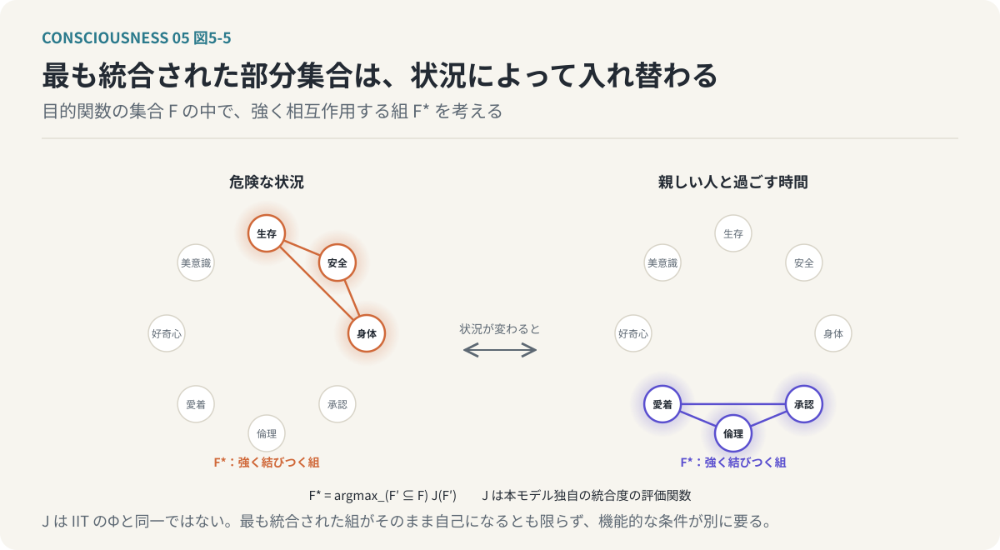
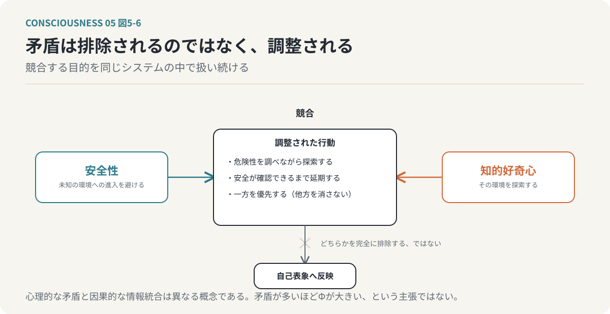

# 第5回　「自分」を情報の統合として捉える

## 統合情報理論と、相互依存する目的関数の構造

<!-- NAV:TOP -->
[← 第4回](04-predictive-processing.md) | [連載目次](../README.md) | [第6回 →](06-phenomenal-consciousness.md)
<!-- /NAV -->

私たちは、自分の中に複数の考えや欲求が存在することを知っている。仕事を続けたいと思いながら、休みたいとも思う。新しいことに挑戦したいと思いながら、失敗を恐れる。他者から認められたいと思いながら、他者の評価に左右されたくないとも思う。こうした矛盾する欲求は日常的に経験するものであり、それにもかかわらず、私たちはそれらをすべて「自分の考え」として認識している。なぜ、異なる情報処理の集合から、一つの「自分」という感覚が生まれるのだろうか。

ここまで、意識と自己表象を分け、複数の目的関数の交差点に「自分」が創発し、予測処理がその優先順位を調整すると考えてきた。しかし、複数の目的関数が存在し、それぞれが情報を処理していることと、それらが一つの意識を構成することは同じではない。個別の処理が並列に動いているだけなら、それらは単なる処理の集合である。では、何が処理の集合を一つのシステムとして成立させるのだろうか。今回は、この問いに対して統合情報理論（Integrated Information Theory：IIT）を導入する。

**「自分」とは、複数の情報処理が相互に影響し合い、部分に分割できない構造を形成することで成立する概念である。**

これが今回検討する仮説である。

---

### 1. 複数の情報処理が存在するだけでは「自分」は生まれない

まず、複数の目的関数を持つ計算機システムを考えてみよう。このシステムには、安全性を評価する関数、効率を評価する関数、情報獲得を評価する関数の三つがあるとする。安全性の評価関数は危険の少ない行動を、効率の評価関数は短時間で目的を達成できる行動を、情報獲得の評価関数は新しい知識を得られる行動を高く評価する。これらの関数が個別に動作しているだけなら、三つの独立した評価処理が存在するにすぎない。

では、それぞれの評価結果を集めて、一つの数値にまとめたらどうだろうか。各評価値に重みを付けて加算すれば、式3-2のとおり総合評価を計算できる。しかし、計算結果を一つにまとめることと、情報処理の構造そのものが統合されていることは異なる。三つの関数が完全に独立しており、最後に結果を加算するだけなら、それぞれの処理を分離して実行しても同じ結果を得られる。そこには、個別の処理を超える相互作用は存在しない。

一方、安全性の評価結果が情報獲得の評価方法を変え、情報獲得の結果が効率の評価に影響し、効率の評価が安全性の判断を変える場合はどうだろうか。各関数はもはや完全に独立しておらず、ある関数の状態を変更すると、他の関数の処理も変化する。システム全体の振る舞いは、個別の関数を独立に評価するだけでは説明できなくなる。この違いが重要である。

**情報を集約することと、情報処理が相互依存する構造を形成することは、同じではない。**

「自分」という統合的な表象の成立を考えるためには、単に目的関数の数を増やすのではなく、目的関数間の相互作用に注目する必要がある。

### 2. 統合情報理論は何を説明しようとしているのか

統合情報理論（IIT）は、神経科学者のGiulio Tononiらによって発展してきた意識理論である。この理論の特徴は、意識を情報処理の機能だけから説明するのではなく、意識体験そのものの性質から出発する点にある。今この文章を読んでいるとき、文字の形、文章の意味、周囲の音、身体の感覚などが、一つの体験の中に存在している。それぞれの情報は異なる経路で処理されているにもかかわらず、私たちはそれらを完全に独立した体験として認識しているわけではない。また、一つの意識体験を、完全に独立した複数の体験に分割することもできない。IITは、このような意識体験の統一性や不可分性に注目し、意識がシステムの因果的な統合構造と関係すると考える。

重要なのは、単に大量の情報を処理しているだけでは意識の成立条件を説明できないという点である。膨大な情報を処理するシステムであっても、内部の処理が完全に独立している場合と、互いに強く依存している場合では、システムの構造は異なる。IITでは、システム全体が持つ因果的な構造が、その部分へどの程度還元できないかを問題にし、この還元不可能性を定量化するために統合情報量Φ（ファイ）を導入する。Φは一般的な情報量や相互情報量を単純に合計したものではなく、システムの接続数が多ければ自動的に大きくなるものでもない。IITが対象とするのは、システムの要素間に成立する因果的な関係と、その関係が部分へ分割できない程度である。

### 3. 統合情報量Φとは何か

Φを直観的に理解するために、二つのシステムを比較してみよう。一つ目は、独立した三つの処理装置からなるシステムである。各装置はそれぞれ別の入力を受け取り、別の出力を生成し、装置間に相互作用はない。この場合、システム全体の振る舞いは三つの装置の振る舞いを個別に記述することで説明でき、システムを三つに分割しても、各装置の因果的な働きは変わらない。二つ目は、三つの処理装置が互いの状態に影響を与えるシステムである。装置Aの状態が装置Bに影響し、装置Bの状態が装置Cに影響し、装置Cの状態が装置Aに影響する。この場合、各装置の振る舞いは他の装置の状態に依存し、システムを分割して相互作用を取り除くと、全体として成立していた因果的な構造が失われる。

このような違いを評価することが、統合情報という考え方の出発点となる。独立した処理の集合では、各部分が独立して動作し、分割しても各部分の働きが変わらず、全体に固有の因果的な統合が存在しない。相互依存する処理の集合では、各部分が他の部分の状態に影響し、分割すると因果的な関係が失われ、全体として還元不可能な構造が成立する。

*図5-1：情報を集約することと、情報処理が相互依存することは同じではない。左は分割しても各部分の働きが変わらない。右は分割すると全体に固有の因果構造が失われる。*

本連載では、後者の性質を自己の成立と結びつけて考える。IITの厳密なΦの計算には、システムの状態遷移、要素間の因果関係、分割による因果構造の変化などを扱う必要がある。次の式は、あくまで考え方を説明するための概念的な近似である。

`Φ_approx(S) = min_P D(C(S), C(P))`　（式5-1）

`S` は対象システム、`P` はシステムの分割、`C(S)` と `C(P)` は分割前と分割後の因果的な構造、`D` は二つの構造の差異を評価する関数、`min_P` は統合の弱さを示す分割を探索する操作である。この式は「最も統合の弱い分割を探し、それでも失われる因果構造の大きさを統合の程度とみなす」と読む。IITの正式なΦの定義ではないが、全体の因果構造が分割によってどの程度失われるか、という考え方を表現している。問題にしているのは、情報の量そのものではなく、システム全体に固有の因果的な構造である。

*図5-2：統合情報量Φの考え方。最も統合の弱い分割を探し、それでも失われる因果構造の大きさを統合の程度とみなす。概念的な近似であり、IITの正式な定義ではない。*

### 4. 目的関数の集合と統合情報を接続する

ここから、第3回で提示した目的関数モデルとIITを接続する。目的関数モデルでは、生存、社会的承認、知的好奇心、倫理、美意識などの目的関数が、それぞれ異なる状態を評価すると考えた。これらの目的関数が完全に独立している場合、システムは複数の評価処理を実行するだけである。しかし、実際の人間の価値判断では、目的関数が相互に影響している。社会的承認を得たいという欲求は倫理的な判断に影響することがあり、他者から評価されたいという理由で自分の価値観に反する行動を選ぶ場合もある。反対に、倫理的な価値観が強ければ、社会的な評価を失ってでも信念を守る場合がある。知的好奇心によって獲得した知識が安全性に関する判断を変えることもあれば、自分の能力に対する評価を変化させることもある。つまり、目的関数は単に独立した評価値を出力しているのではなく、一つの目的に関する情報が、別の目的の評価や重み付けを変える場合がある。

目的関数モデルでは、この相互作用に注目する。目的関数の集合を `F = {f_1, f_2, ..., f_n}` と表し、各目的関数が独立しているのではなく、相互依存関係を持つと仮定する。

`f_i(t+1) = g_i(f_1(t), f_2(t), ..., f_n(t), s(t))`　（式5-2）

`f_i(t)` は時刻 `t` における目的関数 `i` に関係する内部状態、`g_i` は内部状態を更新する処理、`s(t)` は外界や身体に関する状態である。この式は「ある目的の次の内部状態は、自分自身だけでなく他のすべての目的の現在の内部状態と、外界の状態によって決まる」と読む。厳密には目的関数そのものと、その目的を評価する内部状態は区別する必要がある。表現したいのは、ある目的に関する内部状態が、他の目的に関する状態の更新へ影響するという関係である。

*図5-3：目的関数の内部状態は互いの更新に影響する。時間に沿って展開すると、ある目的の状態が次の時刻の他の目的の状態を変える。外界や身体の状態も各更新に入る。*

このような相互依存が存在すると、個別の目的関数だけでは説明できないシステム全体の振る舞いが生じる。本連載では、そうした統合構造から自己表象が形成されるという仮説を考える。目的関数の相互作用とIITのΦの対応については、第11節でまとめて留保を述べる。

### 5. 「自分」は統合された目的関数の集合なのか

第3回では、「自分」を複数の目的関数の交差点として説明した。今回は、この考え方をさらに進める。目的関数が共通した対象を評価するだけでは、統一された自己が成立するとは限らない。重要なのは、各目的関数の評価が相互に作用し、その結果が自己表象へ反映されることである。

自分の能力について考える場合を想定する。知的好奇心は新しいことを学びたいという動機を生み出し、社会的承認欲求はその能力が他者からどのように評価されるかを重視する。生存や安全に関係する目的はその能力が生活の維持にどのように役立つかを評価し、倫理的な目的はその能力を何のために使うべきかを判断する。これらの評価が統合されることで、「自分は何ができるのか」「何を大切にしているのか」「どのような人間でありたいのか」という自己表象が形成される。そして、一度形成された自己表象は、目的関数の評価に影響する。「自分は誠実な人間でありたい」という自己表象は倫理的な目的の重みを高め、その結果、社会的承認よりも倫理的な整合性を優先する行動が選択される場合がある。

ここには循環が存在する。目的関数の相互作用によって自己表象が形成され、自己表象が目的関数の重みや評価に影響し、その結果として行動が選択され、行動の結果が新たな経験として自己表象に反映される。この循環を繰り返すことで、自己は継続的に構築される。

*図5-4：「自分」は目的関数の交差点であると同時に、相互作用から形成され、再び各目的関数へ影響を返す統合的な表象である。この循環が自己を構築し続ける。*

目的関数モデルでは、このような相互依存する情報処理の構造を、「自分」の成立を説明する中心的な要素として位置づける。

**「自分」とは、複数の目的関数が共通して参照する対象であると同時に、それらの相互作用によって形成され、再び各目的関数へ影響を与える統合的な表象である。**

この定義では、自己は情報処理の単なる出力ではない。自己表象は、情報処理の結果であると同時に、将来の情報処理に影響する内部状態でもある。

### 6. 最も統合された部分集合と自己の対応

IITでは、システムの中で成立する統合的な因果構造を考える（IIT 3.0ではこれを最大統合情報概念構造と呼び、理論の改訂に伴って定義も発展している）。本連載では、この考え方をシステム内の統合的な因果構造を考えるための手がかりとして利用する。

目的関数の集合 `F` のすべての目的関数が、常に同じ程度に相互作用しているとは限らない。ある状況では生存、安全、身体に関する目的が強く結びつき、別の状況では社会的承認、倫理、愛着に関する目的が強く相互作用する。知的好奇心や美的感覚に関する処理が、特定の行動において中心的な役割を持つ場合もある。目的関数モデルでは、このような相互作用の変化によって、自己表象を形成する情報処理の構造も変化すると考える。仮に、目的関数群の部分集合 `F'` に対して統合の程度を評価する関数 `J(F')` を定義すると、最も統合された部分集合は次のように表現できる。

`F* = argmax_(F' ⊆ F) J(F')`　（式5-3）

この式は「目的関数の部分集合のうち、統合度 `J` が最大になる組 `F*` を選ぶ」と読む。`J` は目的関数モデル独自の評価関数であり、IITのΦと同一ではない。また、最も統合された部分集合が必ずそのまま自己になるとも限らず、自己表象の成立には、その集合が自身の状態や行動をどのように表現し、利用するかという機能的な条件も必要である。したがって目的関数モデルでは、最も統合された処理構造と自己表象の間に対応関係が存在する可能性を、仮説的な対応として検討する。

*図5-5：最も統合された部分集合は状況によって入れ替わる。統合度の評価関数Jは本モデル独自のものでIITのΦとは同一ではなく、最も統合された組がそのまま自己になるとも限らない。*

### 7. 矛盾は情報統合の障害なのか

第3回で提示した「自己は本質的に矛盾を含む」という主張を改めて考えたい。一般に、矛盾は解消すべき問題として扱われる。ある行動を選びたいという欲求と、それを避けたいという欲求が同時に存在すれば、判断が難しくなる。しかし、複数の目的関数を持つシステムにおいて、矛盾は必ずしも異常な状態ではない。異なる目的が存在すれば、それぞれが異なる行動を高く評価することは自然である。

安全性を重視する目的関数は未知の環境への進入を避けようとし、知的好奇心を重視する目的関数はその環境を探索しようとする。この二つの目的は競合するが、どちらか一方を完全に排除する必要はない。危険性を調べながら探索するという行動を選ぶこともできるし、安全性が十分に確認できるまで探索を延期することもできる。このような判断では、複数の目的が同時に考慮されている。矛盾する目的を単純に排除するのではなく、その関係を調整しているのである。

*図5-6：矛盾は排除されるのではなく調整される。競合する目的を同じシステムの中で扱い続けることが自己の機能であり、心理的な矛盾と因果的な情報統合は別の概念である。*

目的関数モデルでは、こうした処理を自己の重要な機能として捉える。矛盾する目的を同時に保持し、その関係を評価しながら行動を選択し、その結果が自己表象へ反映される。複数の目的が競合する状況では、異なる評価基準を相互に参照し、調停する必要が生じるため、目的間の相互作用が重要になる可能性がある。

**自己の統一性とは、矛盾が存在しないことではなく、矛盾する情報を同じシステムの中で扱い続けられることである。**

なお、心理的な矛盾と因果的な情報統合は異なる概念であり、矛盾が多いほどΦが大きくなるという主張ではない（第11節）。

### 8. 目的関数の重みと情報統合は変化する

これまでの議論では、目的関数の集合とその相互作用に注目してきた。しかし、人間の目的関数の重みは固定されていない。危険な状況では安全性が優先され、仕事をしているときには達成や効率に関する目的が重視され、家族や親しい人と過ごしているときには愛着や関係の維持に関する目的が重要になる。このような重みの変化は、目的関数間の相互作用にも影響する可能性がある。ある目的が強く優先されれば、他の目的の評価が行動選択へ与える影響は小さくなるかもしれない。一方、複数の目的を同時に考慮する状況では、それらの間の調停が必要になる。

目的関数モデルでは、時刻 `t` における重みをベクトル `w(t) = (w_1(t), w_2(t), ..., w_n(t))` で表し、情報処理の統合状態が、この重みと目的関数間の結合関係に依存して変化すると考える。重要なのは、目的関数の重みが変わることと、IITのΦが変わることを直接同一視しないことである。Φはシステムの因果的な構造に依存するため、重みを変えただけで因果的な構造が変化しなければ、Φも必ず変化するとは限らない。一方、重みの変化が内部の状態遷移や相互作用を変えるなら、統合構造が変化する可能性はある。この関係を計算機上で検証することは、第9回で扱う実装上の課題となる。

### 9. 睡眠や麻酔は情報統合の問題として説明できるのか

目的関数モデルとIITの接続を考えるうえで、意識の状態が大きく変わる睡眠や麻酔は、統合という見方を試す対象になる。私たちは、覚醒しているときには外界の情報を認識し、判断し、行動することができる。一方、深い睡眠や全身麻酔の状態では、通常の覚醒状態と比べて意識体験や外界への応答が大きく変化する。この違いは、単に神経活動の量だけで説明できるのだろうか。脳は睡眠中にも活動しており、神経活動が存在することと、覚醒時と同じような意識体験が成立することは同じではない。

ここで注目されるのが、脳内の情報処理がどの程度統合されているかという問題である。意識研究では、外部刺激に対する脳の応答の複雑さや、神経活動の統合と分化を評価する研究が行われている。摂動複雑性指標（Perturbational Complexity Index：PCI）は、脳に刺激を与え、その後に生じる活動の複雑さを評価する指標であり、意識状態の違いを調べるために利用される。ただし、PCIはIITのΦを直接計算した値ではなく、睡眠中の意識体験は一様ではなく夢を見る場合もあるので、覚醒、睡眠、麻酔を単純に高Φ・低Φだけで分類できるわけではない。それでも、意識状態の変化と情報統合の関係を調べることは、IITや関連する意識理論を検証するうえで重要である。

目的関数モデルにとっても、この問題は意味を持つ。目的関数を評価する処理が存在していても、それらが自己表象や他の処理と十分に連携しなければ、覚醒時と同じような統合的な自己の働きは成立しない可能性がある。この仮説を検証するためには、単なる計算量ではなく、内部処理の相互依存関係を測定する必要がある。

### 10. 自己の統合をどのように検証するのか

ここまでの議論は、目的関数モデルとIITを接続する理論的な仮説である。では、この仮説をどのように検証できるのだろうか。

まず、安全性、効率、好奇心など、異なる目的関数を持つ計算機システムを考え、内部構造の異なるシステムを比較する。第一のシステムでは目的関数を独立に計算し、各目的関数は他の目的関数の内部状態に影響しない。第二のシステムでは目的関数間に相互作用を導入し、安全性の評価が好奇心の重みに影響し、好奇心による情報獲得が安全性の評価を変更する。第三のシステムではさらに自己表象を導入し、目的関数の相互作用から自己に関する内部状態を生成して、将来の評価や行動選択に反映する。この三つのシステムを比較することで、次のような問いを検証できる。

- 目的関数間の相互作用によって、どのような行動の違いが生じるか。
- 独立した評価関数だけでは再現できない判断が生じるか。
- 自己表象を導入すると、行動の一貫性や適応性が変化するか。
- 一部の相互作用を取り除くと、自己表象や行動がどのように変化するか。
- 目的関数の重みを変更すると、内部の統合構造が変化するか。

重要なのは、単に複雑な行動が生じたことをもって、統合情報量Φが増大したと判断しないことである。行動の複雑さと因果的な情報統合は同じ指標ではなく、実際に統合情報を評価するためには、内部の状態遷移や因果関係を分析する必要がある。また、自己表象の有無によって行動が変化したとしても、それだけで現象的な意識の存在が証明されるわけではない。それでも、こうした計算機実験には意味がある。自己表象の形成や維持にどのような情報処理上の条件が必要なのかを、観測可能な形で検証できるからである。この方向性は、第9回で扱う計算機による機能的近似へとつながる。

### 11. 統合情報が存在すれば、意識が存在するのか

最後に、今回の議論における最も重要な限界をまとめて確認しておきたい。

IITは、意識と統合された因果的な情報構造の間に本質的な関係があると主張する。しかし、この主張は、現在の意識科学において確立された結論ではなく、意識を説明する理論にはIIT以外にもさまざまな立場が存在する。また、情報統合の指標を計算できることと、主観的体験の存在を確認できることは同じではない。ある計算機システムが複雑な因果的相互作用を持ち、統合情報に関係する指標が高い値を示したとしても、そのシステムが何かを感じているかどうかについては、追加の理論的な前提が必要となる。

目的関数モデルとIITの接続についても、三つの留保がある。第一に、目的関数間の相互作用が存在するだけで、IITにおける高いΦが成立するとは限らない。両者を接続するためには、相互作用を実際の因果構造として記述し、その統合の程度を評価する必要があり、対応は現時点では本連載が提案する理論的な仮説である。第二に、心理的な矛盾と因果的な情報統合は異なる概念であり、IITは矛盾が多いほどΦが大きくなるとも、矛盾の解消がΦの減少を意味するとも主張していない。第三に、目的関数の重みや統合度 `J` の変化は、Φの変化と同一ではない。

IITはその関係を同一性として説明しようとし、目的関数モデルは自己表象がどのような情報処理によって成立するかを説明しようとする。目的関数モデルは「どのような情報が処理され、自己がどのように形成されるか」という機能的な問いを、IITは「どのような因果的構造が意識体験に対応するか」という現象的な問いを扱う。両者を接続することは可能かもしれないが、自己表象の形成を説明できることと、意識体験の存在を説明できることの間には、まだ大きな隔たりがある。本連載ではこの隔たりを無視せず、機能的な説明がどこまで可能であり、何が未解決なのかを明確にする。

### おわりに：「自分」は情報の量ではなく、関係の中に生まれる

**「自分」は個別の目的関数の中にも、評価値を加算した結果にもなく、複数の情報処理が相互に依存して一つの構造を形成する関係の中に成立する。**

複数の目的関数が存在するだけでは、統合された自己は成立しない。重要なのは、目的関数が互いに影響し合い、共通の自己表象を形成し、その自己表象が再び情報処理に影響するという循環的な構造である。これは、第3回の「自己は目的関数の交差点に生まれる」という仮説を発展させたものである。ただし、目的関数の統合とIITが扱う因果的な情報統合は同一視できず、情報処理の統合を説明できたとしても、その処理に主観的体験が伴う理由は依然として残る。

私たちは、情報を処理するだけではない。赤い色を見る。痛みを感じる。音楽を美しいと感じる。自分が存在していると感じる。こうした「感じる」という体験は、どこから生まれるのだろうか。次回は、機能的意識と現象的意識を明確に区別し、意識のハードプロブレムを検討する。

**情報を処理することと、情報を「体験する」ことは、果たして同じなのだろうか。**

<!-- NAV:BOTTOM -->
---

[← 第4回](04-predictive-processing.md) | [連載目次](../README.md) | [第6回 →](06-phenomenal-consciousness.md)
<!-- /NAV -->
