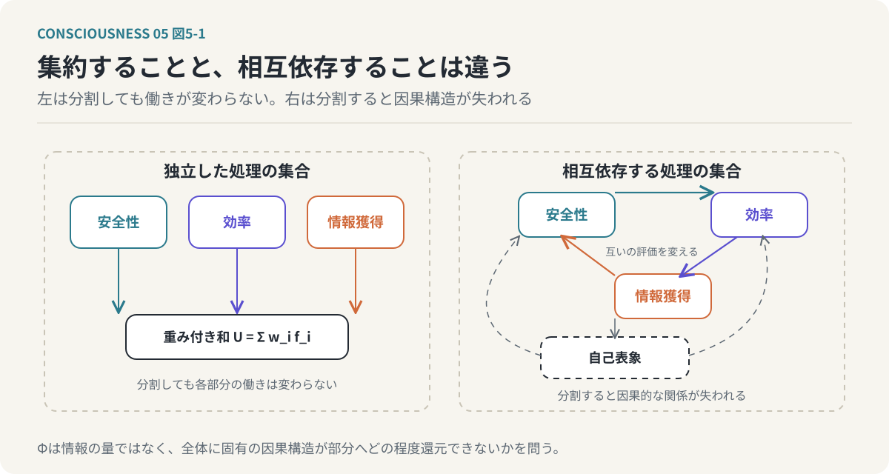

# 第5回　「自分」を情報の統合として捉える

## 統合情報理論と、相互依存する目的関数の構造

<!-- NAV:TOP -->
[← 第4回](04-predictive-processing.md) | [連載目次](../README.md) | [第6回 →](06-phenomenal-consciousness.md)
<!-- /NAV -->

私たちは、自分の中に複数の考えや欲求が存在することを知っている。

仕事を続けたいと思いながら、休みたいとも思う。

新しいことに挑戦したいと思いながら、失敗を恐れる。

他者から認められたいと思いながら、他者の評価に左右されたくないとも思う。

こうした矛盾する欲求は、日常的に経験するものである。

それにもかかわらず、私たちはそれらをすべて「自分の考え」として認識している。

なぜ、異なる情報処理の集合から、ひとつの「自分」という感覚が生まれるのだろうか。

これまでの連載では、意識を情報処理システムとして捉え、その機能を説明するモデルを構築してきた。

第2回では、意識と自己表象を区別した。

第3回では、複数の目的関数が共通して重視する対象として「自分」が創発するという仮説を提示した。

第4回では、予測処理と目的関数を接続し、意識を不確実性の中で目的の優先順位を調整する働きとして考えた。

しかし、ここまでの説明には、重要な問題が残っている。

複数の目的関数が存在し、それぞれが情報を処理していることと、それらがひとつの意識を構成することは同じではない。

個別の処理が並列に動いているだけなら、それらは単なる処理の集合である。

では、何が処理の集合をひとつのシステムとして成立させるのだろうか。

今回は、この問いに対して統合情報理論（Integrated Information Theory：IIT）を導入する。

**「自分」とは、複数の情報処理が相互に影響し合い、部分に分割できない構造を形成することで成立する概念ではないか。**

これが今回検討する仮説である。

---

### 1. 複数の情報処理が存在するだけでは「自分」は生まれない

まず、複数の目的関数を持つ計算機システムを考えてみよう。

このシステムには、次の三つの評価関数があるとする。

- 安全性を評価する関数
- 効率を評価する関数
- 情報獲得を評価する関数

それぞれの関数は、与えられた状態を独立して評価する。

安全性の評価関数は、危険の少ない行動を高く評価する。

効率の評価関数は、短時間で目的を達成できる行動を高く評価する。

情報獲得の評価関数は、新しい知識を得られる行動を高く評価する。

これらの関数が個別に動作しているだけなら、三つの独立した評価処理が存在するにすぎない。

では、それぞれの評価結果を集めて、ひとつの数値にまとめたらどうだろうか。

例えば、各評価値に重みを付けて加算する。

`U(x) = w₁f₁(x) + w₂f₂(x) + w₃f₃(x)`

この式によって、複数の評価関数を統合した総合評価を計算できる。

しかし、計算結果をひとつにまとめることと、情報処理の構造そのものが統合されていることは異なる。

三つの関数が完全に独立しており、最後に結果を加算するだけなら、それぞれの処理を分離して実行しても同じ結果を得られる。

そこには、個別の処理を超える相互作用は存在しない。

一方、安全性の評価結果が情報獲得の評価方法を変え、情報獲得の結果が効率の評価に影響し、効率の評価が安全性の判断を変える場合はどうだろうか。

各関数は、もはや完全に独立していない。

ある関数の状態を変更すると、他の関数の処理も変化する。

システム全体の振る舞いは、個別の関数を独立に評価するだけでは説明できなくなる。

この違いが重要である。

**情報を集約することと、情報処理が相互依存する構造を形成することは、同じではない。**

「自分」という統合的な表象の成立を考えるためには、単に目的関数の数を増やすのではなく、目的関数間の相互作用に注目する必要がある。

### 2. 統合情報理論は何を説明しようとしているのか

統合情報理論（IIT）は、神経科学者Giulio Tononiらによって発展してきた意識理論である。

この理論の特徴は、意識を情報処理の機能だけから説明するのではなく、意識体験そのものの性質から出発する点にある。

私たちの意識体験には、いくつかの特徴がある。

例えば、今この文章を読んでいるとき、文字の形、文章の意味、周囲の音、身体の感覚などが、ひとつの体験の中に存在している。

それぞれの情報は異なる経路で処理されているにもかかわらず、私たちはそれらを完全に独立した体験として認識しているわけではない。

また、ひとつの意識体験を、完全に独立した複数の体験に分割することもできない。

IITは、このような意識体験の統一性や不可分性に注目する。

その中心的な考え方は、意識がシステムの因果的な統合構造と関係するというものである。

ここで重要なのは、単に大量の情報を処理しているだけでは意識の成立条件を説明できないという点である。

膨大な情報を処理するシステムであっても、内部の処理が完全に独立している場合と、互いに強く依存している場合では、システムの構造は異なる。

IITでは、システム全体が持つ因果的な構造が、その部分へどの程度還元できないかを問題にする。

この還元不可能性を定量化するために導入されるのが、統合情報量Φ（ファイ）である。

ただし、IITのΦは、一般的な情報量や相互情報量を単純に合計したものではない。

また、システムの接続数が多ければ自動的にΦが大きくなるわけでもない。

IITが対象とするのは、システムの要素間に成立する因果的な関係と、その関係が部分へ分割できない程度である。

### 3. 統合情報量Φとは何か

統合情報量Φを直観的に理解するために、二つのシステムを比較してみよう。

ひとつ目は、独立した三つの処理装置からなるシステムである。

各装置は、それぞれ別の入力を受け取り、別の出力を生成する。

装置間に相互作用はない。

この場合、システム全体の振る舞いは、三つの装置の振る舞いを個別に記述することで説明できる。

システムを三つに分割しても、各装置の因果的な働きは変わらない。

二つ目は、三つの処理装置が互いの状態に影響を与えるシステムである。

装置Aの状態が装置Bに影響し、装置Bの状態が装置Cに影響し、装置Cの状態が装置Aに影響する。

この場合、各装置の振る舞いは、他の装置の状態に依存する。

システムを分割して相互作用を取り除くと、全体として成立していた因果的な構造が失われる。

このような違いを評価することが、統合情報という考え方の出発点となる。

概念的には、次のように整理できる。

- 独立した処理の集合
  - 各部分が独立して動作する。
  - 分割しても各部分の働きが変わらない。
  - 全体に固有の因果的な統合が存在しない。
- 相互依存する処理の集合
  - 各部分が他の部分の状態に影響する。
  - 分割すると因果的な関係が失われる。
  - 全体として還元不可能な構造が成立する。

*図5-1：情報を集約することと、情報処理が相互依存することは同じではない。左は分割しても各部分の働きが変わらない。右は分割すると全体に固有の因果構造が失われる。*

本連載では、後者の性質を自己の成立と結びつけて考える。

なお、IITの厳密なΦの計算には、システムの状態遷移、要素間の因果関係、分割による因果構造の変化などを扱う必要がある。

そのため、次のような単純な式は、あくまで考え方を説明するための概念的な近似である。

`Φ_approx(S) = min_P D(C(S), C(P))`

ここで、

- `S`：対象システム
- `P`：システムの分割
- `C(S)`：分割前の因果的な構造
- `C(P)`：分割後の因果的な構造
- `D`：二つの構造の差異を評価する関数
- `min_P`：統合の弱さを示す分割を探索する操作

である。

この式はIITの正式なΦの定義ではない。

しかし、全体の因果構造が分割によってどの程度失われるか、という考え方を表現している。

ここで問題にしているのは、情報の量そのものではなく、システム全体に固有の因果的な構造である。

### 4. 目的関数の集合と統合情報を接続する

ここから、第3回で提示した目的関数モデルとIITを接続する。

目的関数モデルでは、人間の行動を複数の評価基準によって説明した。

生存、社会的承認、知的好奇心、倫理、美意識などの目的関数が、それぞれ異なる状態を評価する。

これらの目的関数が完全に独立している場合、システムは複数の評価処理を実行するだけである。

しかし、実際の人間の価値判断では、目的関数が相互に影響している。

例えば、社会的承認を得たいという欲求は、倫理的な判断に影響することがある。

他者から評価されたいという理由で、自分の価値観に反する行動を選ぶ場合もある。

反対に、倫理的な価値観が強ければ、社会的な評価を失ってでも信念を守る場合がある。

また、知的好奇心によって獲得した知識が、安全性に関する判断を変えることもある。

新しい知識が、自分の能力に対する評価を変化させることもある。

つまり、目的関数は単に独立した評価値を出力しているのではない。

ひとつの目的に関する情報が、別の目的の評価や重み付けを変える場合がある。

本モデルでは、この相互作用に注目する。

目的関数の集合を次のように表す。

`F = {f₁, f₂, ..., fₙ}`

そして、各目的関数が独立しているのではなく、相互依存関係を持つと仮定する。

`fᵢ(t+1) = gᵢ(f₁(t), f₂(t), ..., fₙ(t), s(t))`

ここで、

- `fᵢ(t)`：時刻tにおける目的関数iに関係する内部状態
- `gᵢ`：内部状態を更新する処理
- `s(t)`：外界や身体に関する状態

である。

厳密には、目的関数そのものと、その目的を評価する内部状態は区別する必要がある。

ここで表現したいのは、ある目的に関する内部状態が、他の目的に関する状態の更新へ影響するという関係である。

このような相互依存が存在すると、個別の目的関数だけでは説明できないシステム全体の振る舞いが生じる。

本連載では、そうした統合構造から自己表象が形成されるという仮説を考える。

ただし、目的関数間の相互作用が存在するだけで、IITにおける高いΦが成立するとは限らない。

目的関数モデルとIITを接続するためには、相互作用を実際の因果構造として記述し、その統合の程度を評価する必要がある。

両者の対応は、現時点では本連載が提案する理論的な仮説である。

### 5. 「自分」は統合された目的関数の集合なのか

第3回では、「自分」を複数の目的関数の交差点として説明した。

今回は、この考え方をさらに進める。

目的関数が共通した対象を評価するだけでは、統一された自己が成立するとは限らない。

重要なのは、各目的関数の評価が相互に作用し、その結果が自己表象へ反映されることである。

例えば、自分の能力について考える場合を想定する。

知的好奇心は、新しいことを学びたいという動機を生み出す。

社会的承認欲求は、その能力が他者からどのように評価されるかを重視する。

生存や安全に関係する目的は、その能力が生活の維持にどのように役立つかを評価する。

倫理的な目的は、その能力を何のために使うべきかを判断する。

これらの評価が統合されることで、「自分は何ができるのか」「何を大切にしているのか」「どのような人間でありたいのか」という自己表象が形成される。

そして、一度形成された自己表象は、目的関数の評価に影響する。

例えば、「自分は誠実な人間でありたい」という自己表象は、倫理的な目的の重みを高めるかもしれない。

その結果、社会的承認よりも倫理的な整合性を優先する行動が選択される場合がある。

ここには循環が存在する。

目的関数の相互作用によって自己表象が形成される。

自己表象が目的関数の重みや評価に影響する。

その結果として行動が選択される。

行動の結果が、新たな経験として自己表象に反映される。

この循環を繰り返すことで、自己は継続的に構築される。

*図5-2：「自分」は目的関数の交差点であると同時に、相互作用から形成され、再び各目的関数へ影響を返す統合的な表象である。この循環が自己を構築し続ける。*

本モデルでは、このような相互依存する情報処理の構造を、「自分」の成立を説明する中心的な要素として位置づける。

**「自分」とは、複数の目的関数が共通して参照する対象であると同時に、それらの相互作用によって形成され、再び各目的関数へ影響を与える統合的な表象である。**

この定義では、自己は情報処理の単なる出力ではない。

自己表象は、情報処理の結果であると同時に、将来の情報処理に影響する内部状態でもある。

### 6. 最大統合情報概念構造と自己の対応

IITでは、システムの中で成立する統合的な因果構造を考える。

IIT 3.0では、最大統合情報概念構造（Maximally Integrated Conceptual Structure：MICS）という概念が用いられる。

また、IITの改訂に伴い、概念や数学的な定義も発展している。

本連載では、MICSを、システム内の統合的な因果構造を考えるための理論的な手がかりとして利用する。

ここで、目的関数の集合を改めて考える。

`F = {f₁, f₂, ..., fₙ}`

すべての目的関数が、常に同じ程度に相互作用しているとは限らない。

ある状況では、生存、安全、身体に関する目的が強く結びつくかもしれない。

別の状況では、社会的承認、倫理、愛着に関する目的が強く相互作用するかもしれない。

また、知的好奇心や美的感覚に関する処理が、特定の行動において中心的な役割を持つ場合もある。

本モデルでは、このような相互作用の変化によって、自己表象を形成する情報処理の構造も変化すると考える。

仮に、目的関数群の部分集合 `F'` に対して、統合の程度を評価する関数 `J(F')` を定義する。

その場合、最も統合された部分集合を次のように表現できる。

`F* = argmax_(F' ⊆ F) J(F')`

ここで、

- `F'`：目的関数の部分集合
- `J(F')`：部分集合の統合度を評価する関数
- `F*`：統合度が最大となる部分集合

である。

この `J` は、本モデル独自の評価関数であり、IITのΦと同一ではない。

また、最も統合された部分集合が、必ずそのまま自己になるとも限らない。

自己表象の成立には、その集合が自身の状態や行動をどのように表現し、利用するかという機能的な条件も必要である。

したがって、本モデルでは、最も統合された処理構造と自己表象の間に対応関係が存在する可能性を検討する。

IITの統合構造を、そのまま自己と同一視するのではなく、自己の形成を説明するための仮説的な対応として扱う。

### 7. 矛盾は情報統合の障害なのか

ここで、第3回で提示した「自己は本質的に矛盾を含む」という主張を改めて考えたい。

一般に、矛盾は解消すべき問題として扱われる。

ある行動を選びたいという欲求と、それを避けたいという欲求が同時に存在すれば、判断が難しくなる。

しかし、複数の目的関数を持つシステムにおいて、矛盾は必ずしも異常な状態ではない。

異なる目的が存在すれば、それぞれが異なる行動を高く評価することは自然である。

例えば、安全性を重視する目的関数は、未知の環境への進入を避けようとする。

一方、知的好奇心を重視する目的関数は、その環境を探索しようとする。

この二つの目的は競合する。

しかし、どちらか一方を完全に排除する必要はない。

危険性を調べながら探索するという行動を選ぶこともできる。

あるいは、安全性が十分に確認できるまで探索を延期することもできる。

このような判断では、複数の目的が同時に考慮されている。

矛盾する目的を単純に排除するのではなく、その関係を調整しているのである。

本モデルでは、こうした処理を自己の重要な機能として捉える。

矛盾する目的を同時に保持し、その関係を評価しながら行動を選択する。

そして、その結果が自己表象へ反映される。

ここで、IITとの接続について注意すべき点がある。

IITは、心理的な矛盾が多いほど統合情報量Φが大きくなると主張しているわけではない。

また、目的間の矛盾を解消することが、Φの減少を意味するわけでもない。

心理的な矛盾と因果的な情報統合は、異なる概念である。

両者を接続するためには、矛盾を処理する際に、内部の因果的な相互作用がどのように変化するかを検証する必要がある。

それでも、ここには興味深い仮説が存在する。

複数の目的が競合する状況では、異なる評価基準を相互に参照し、調停する必要が生じる。

そのため、目的間の相互作用が重要になる可能性がある。

**自己の統一性とは、矛盾が存在しないことではなく、矛盾する情報を同じシステムの中で扱い続けられることなのかもしれない。**

### 8. 目的関数の重みと情報統合は変化する

これまでの議論では、目的関数の集合と、その相互作用に注目してきた。

しかし、人間の目的関数の重みは固定されていない。

例えば、危険な状況では安全性が優先される。

仕事をしているときには、達成や効率に関する目的が重視される。

家族や親しい人と過ごしているときには、愛着や関係の維持に関する目的が重要になる。

このような重みの変化は、目的関数間の相互作用にも影響する可能性がある。

ある目的が強く優先されれば、他の目的の評価が行動選択へ与える影響は小さくなるかもしれない。

一方、複数の目的を同時に考慮する状況では、それらの間の調停が必要になる。

本モデルでは、目的関数の重みベクトルを次のように表す。

`w(t) = (w₁(t), w₂(t), ..., wₙ(t))`

そして、情報処理の統合状態が、この重みや内部の結合関係に依存して変化すると考える。

`J(t) = J(F, w(t), A(t))`

ここで、

- `F`：目的関数の集合
- `w(t)`：時刻tにおける重み
- `A(t)`：目的関数間の相互作用構造
- `J(t)`：工学的な統合度の近似指標

である。

重要なのは、目的関数の重みが変わることと、IITのΦが変わることを直接同一視しないことである。

IITのΦは、システムの因果的な構造に依存する。

目的関数の重みを変えただけで、因果的な構造が変化しなければ、Φも必ず変化するとは限らない。

一方、重みの変化が内部の状態遷移や相互作用を変えるなら、統合構造が変化する可能性はある。

この関係を計算機上で検証することは、後の連載で扱う実装上の課題となる。

### 9. 睡眠や麻酔は情報統合の問題として説明できるのか

意識と情報統合の関係を考えるうえで、睡眠や麻酔は重要な対象となる。

私たちは、覚醒しているときには外界の情報を認識し、判断し、行動することができる。

一方、深い睡眠や全身麻酔の状態では、通常の覚醒状態と比べて意識体験や外界への応答が大きく変化する。

この違いは、単に神経活動の量だけで説明できるのだろうか。

脳は睡眠中にも活動している。

また、神経活動が存在することと、覚醒時と同じような意識体験が成立することは同じではない。

ここで注目されるのが、脳内の情報処理がどの程度統合されているかという問題である。

意識研究では、外部刺激に対する脳の応答の複雑さや、神経活動の統合と分化を評価する研究が行われている。

例えば、摂動複雑性指標（Perturbational Complexity Index：PCI）は、脳に刺激を与え、その後に生じる活動の複雑さを評価する指標である。

PCIは、意識状態の違いを調べるために利用される。

ただし、PCIはIITのΦを直接計算した値ではない。

また、睡眠中の意識体験は一様ではなく、夢を見る場合もある。

したがって、覚醒、睡眠、麻酔を単純に高Φ・低Φだけで分類できるわけではない。

それでも、意識状態の変化と情報統合の関係を調べることは、IITや関連する意識理論を検証するうえで重要である。

本モデルにとっても、この問題は意味を持つ。

目的関数を評価する処理が存在していても、それらが自己表象や他の処理と十分に連携しなければ、覚醒時と同じような統合的な自己の働きは成立しない可能性がある。

この仮説を検証するためには、単なる計算量ではなく、内部処理の相互依存関係を測定する必要がある。

### 10. 自己の統合をどのように検証するのか

ここまでの議論は、目的関数モデルとIITを接続する理論的な仮説である。

では、この仮説をどのように検証できるのだろうか。

まず、複数の目的関数を持つ計算機システムを考える。

安全性、効率、好奇心など、異なる目的関数を実装する。

そのうえで、内部構造の異なるシステムを比較する。

第一のシステムでは、目的関数を独立に計算する。

各目的関数は、他の目的関数の内部状態に影響しない。

第二のシステムでは、目的関数間に相互作用を導入する。

安全性の評価が好奇心の重みに影響し、好奇心による情報獲得が安全性の評価を変更する。

第三のシステムでは、さらに自己表象を導入する。

目的関数の相互作用から自己に関する内部状態を生成し、その自己表象を将来の評価や行動選択に反映する。

この三つのシステムを比較することで、次のような問いを検証できる。

- 目的関数間の相互作用によって、どのような行動の違いが生じるか。
- 独立した評価関数だけでは再現できない判断が生じるか。
- 自己表象を導入すると、行動の一貫性や適応性が変化するか。
- 一部の相互作用を取り除くと、自己表象や行動がどのように変化するか。
- 目的関数の重みを変更すると、内部の統合構造が変化するか。

ここで重要なのは、単に複雑な行動が生じたことをもって、統合情報量Φが増大したと判断しないことである。

行動の複雑さと因果的な情報統合は、同じ指標ではない。

実際に統合情報を評価するためには、内部の状態遷移や因果関係を分析する必要がある。

また、自己表象の有無によって行動が変化したとしても、それだけで現象的な意識の存在が証明されるわけではない。

それでも、こうした計算機実験には意味がある。

なぜなら、自己表象の形成や維持に、どのような情報処理上の条件が必要なのかを、観測可能な形で検証できるからである。

この方向性は、第9回で扱う計算機による機能的近似へとつながる。

### 11. 統合情報が存在すれば、意識が存在するのか

最後に、今回の議論における最も重要な限界を確認しておきたい。

IITは、意識と統合された因果的な情報構造の間に本質的な関係があると主張する。

しかし、この主張は、現在の意識科学において確立された結論ではない。

意識を説明する理論には、IIT以外にもさまざまな立場が存在する。

また、情報統合の指標を計算できることと、主観的な体験の存在を確認できることは同じではない。

例えば、ある計算機システムが複雑な因果的相互作用を持ち、統合情報に関係する指標が高い値を示したとする。

それでも、そのシステムが何かを感じているかどうかについては、追加の理論的な前提が必要となる。

IITは、その関係を同一性として説明しようとする。

一方、本連載の目的関数モデルは、自己表象がどのような情報処理によって成立するかを説明しようとする。

この二つの理論は、異なる問題を扱っている。

目的関数モデルは、「どのような情報が処理され、自己がどのように形成されるか」という機能的な問いを扱う。

IITは、「どのような因果的構造が意識体験に対応するか」という現象的な問いを扱う。

両者を接続することは可能かもしれない。

しかし、自己表象の形成を説明できることと、意識体験の存在を説明できることの間には、まだ大きな隔たりがある。

本連載では、この隔たりを無視しない。

むしろ、機能的な説明がどこまで可能であり、何が未解決なのかを明確にすることが重要である。

### おわりに：「自分」は情報の量ではなく、関係の中に生まれる

今回は、統合情報理論を手がかりに、複数の情報処理がどのようにひとつの自己を形成するのかを考えた。

複数の目的関数が存在するだけでは、統合された自己が成立するとは限らない。

重要なのは、目的関数が互いに影響し合い、共通の自己表象を形成し、その自己表象が再び情報処理に影響するという循環的な構造である。

この見方では、「自分」は個別の目的関数の中に存在するわけではない。

また、目的関数の評価値を単純に加算した結果でもない。

複数の情報処理が相互に依存し、全体としてひとつの構造を形成する関係の中に成立する。

ここには、第3回で提示した「自己は目的関数の交差点に生まれる」という仮説を、さらに発展させる可能性がある。

ただし、目的関数の統合と、IITが扱う因果的な情報統合を同一視することはできない。

そして、情報処理の統合を説明できたとしても、その処理に主観的な体験が伴う理由は依然として残る。

私たちは、情報を処理するだけではない。

赤い色を見る。

痛みを感じる。

音楽を美しいと感じる。

自分が存在していると感じる。

こうした「感じる」という体験は、どこから生まれるのだろうか。

もし意識が統合された情報そのものであるなら、情報処理と主観的体験の間に、私たちが通常考えているような区別は存在しないのかもしれない。

しかし、その主張は何によって正当化されるのだろうか。

そして、人間以外の情報処理システムにも、同じことが成立するのだろうか。

次回は、機能的意識と現象的意識を明確に区別し、意識のハードプロブレムを検討する。

さらに、AIが意識的な行動を実行することと、実際に意識を持つことの違いについて考える。

**情報を処理することと、情報を「体験する」ことは、果たして同じなのだろうか。**

<!-- NAV:BOTTOM -->
---

[← 第4回](04-predictive-processing.md) | [連載目次](../README.md) | [第6回 →](06-phenomenal-consciousness.md)
<!-- /NAV -->
