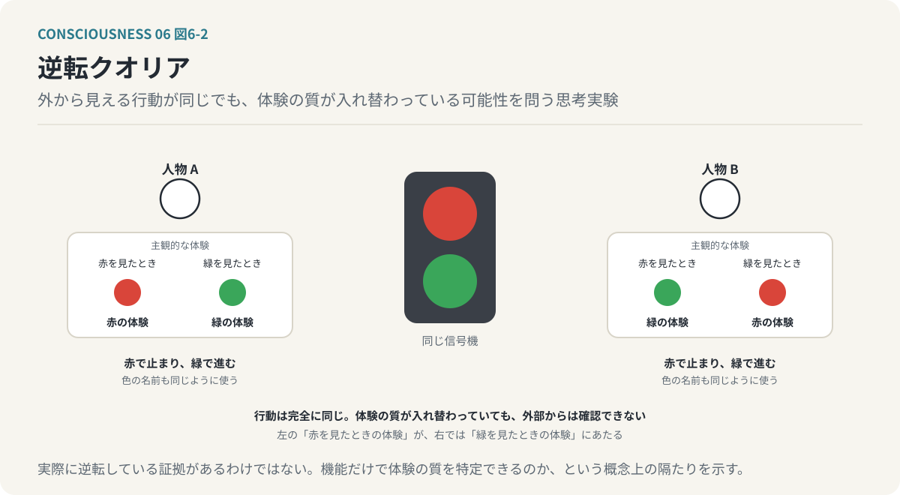
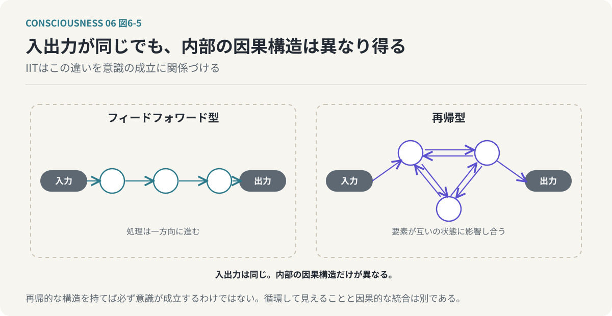
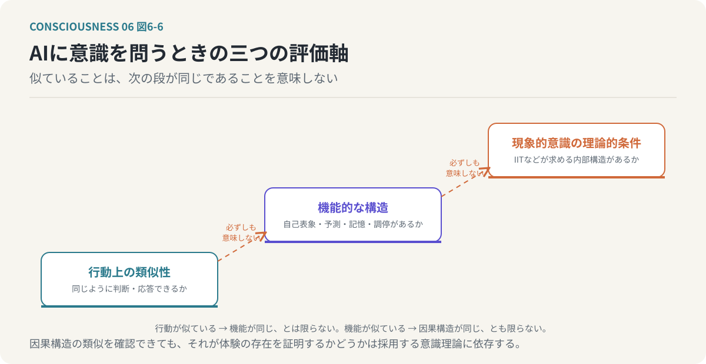
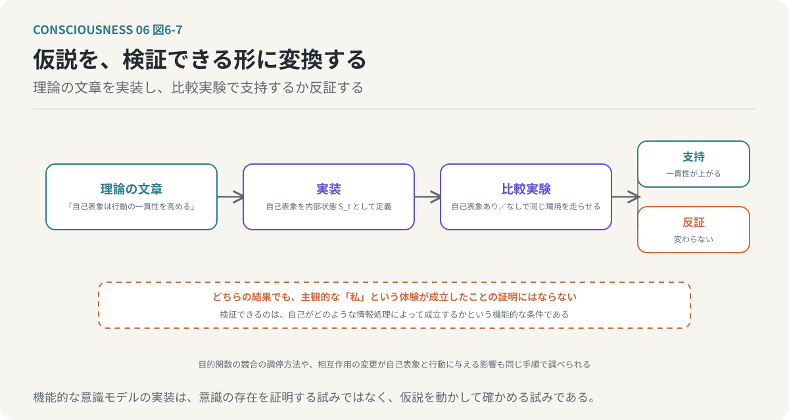
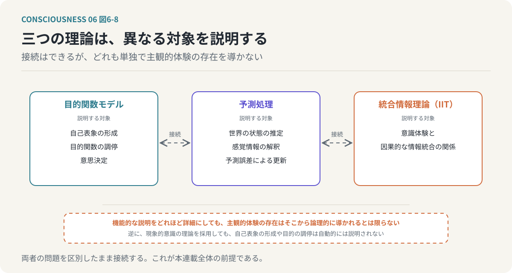

# 第6回　なぜ情報処理に「感じる」という体験が生まれるのか

## ハードプロブレムと、機能的意識・現象的意識の区別

<!-- NAV:TOP -->
[← 第5回](05-integrated-information.md) | [連載目次](../README.md) | [第7回 →](07-dividual-and-extended-self.md)
<!-- /NAV -->

私たちは、赤い色を見ることができる。赤いリンゴを見れば、それが赤いということを認識する。しかし、ここには二つの異なる出来事が含まれている。一つは、光の波長を検出し、色を識別するという情報処理である。もう一つは、赤い色を「赤い」と感じる体験である。

前者は、計算機でも実現できる。カメラで画像を取得し、画素の情報を分析すれば、画像に含まれる色を分類できるし、物体を認識してそれが赤いリンゴであると判断することもできる。しかし、その計算機が赤い色を体験しているかどうかは、別の問題である。計算機が赤色を正しく分類できることは、計算機が赤色を感じていることを意味しない。それでは、私たちが赤い色を見たときに経験する、あの「赤さ」はどこから生まれるのだろうか。

ここまでの議論は、情報がどのように処理され、目的関数がどのように評価され、自己表象がどのように形成されるかという、主として情報処理の機能についての説明だった。これらを説明できたとしても、一つの問題が残る。

**なぜ、その情報処理に主観的体験が伴うのだろうか。**

今回は、この問題を正面から考える。

---

### 1. 情報を処理することと、情報を体験することは異なる

まず、情報処理と主観的体験の違いを明確にしたい。人間が熱いものに触れた場合を考える。皮膚の感覚受容器が刺激を検出し、神経信号が脊髄や脳へ伝わる。身体は刺激に反応して手を引っ込め、刺激の位置や強さを認識して、次に同じものへ触れないように行動を変える。これらは、入力を受け取り、状態を推定し、行動を選択し、経験を記憶するという情報処理の観点から説明できる。しかし、人間の場合、そこには痛みという体験が伴う。単に危険を検出しているだけではなく、痛いと感じているのである。

痛みを検出する機能と、痛みを感じる体験を区別してみる。前者は、外部刺激に対する情報処理として記述できる。後者は、その情報処理が当事者にとってどのように経験されるかという問題である。これを、意識の機能的側面と現象的側面の違いとして整理できる。機能的意識は、情報を認識し、注意を配分し、状態を評価し、行動を選択し、経験を記憶し、自己表象を形成するという、システムが何を行うかという観点から説明する。現象的意識は、赤い色を見るという体験、痛みを感じるという体験、音楽を美しいと感じる体験、不安や喜びを感じる体験、自分が存在しているという感覚のように、その処理が主体にとってどのように感じられるかという観点から考える。この違いが、意識研究における重要な問題となる。

*図6-1：機能的意識はシステムが何を行うかで説明できる。現象的意識はその処理が主体にどう感じられるかを問う。両者の間の隙間がハードプロブレムである。*

### 2. 意識のハードプロブレムとは何か

哲学者のDavid Chalmersは、意識に関する問題を、機能的な問題とハードプロブレムに区別した。機能的な問題には、なぜ人間は外界の情報を識別できるのか、どのように注意を向ける対象を選ぶのか、なぜ過去の経験を記憶できるのか、どのように自分自身の状態を認識するのか、といった問いがある。これらは非常に難しい問題だが、原理的には、神経活動や計算処理の仕組みを明らかにすることで説明できると考えられる。それに対して、ハードプロブレムは異なる。

**なぜ物理的な情報処理に、主観的体験が伴うのか。**

これがハードプロブレムである。脳の視覚処理を完全に解明し、どの神経細胞がどのような入力に反応し、どのような信号を伝達し、どのように色を識別するかを説明できたとする。それでも、なぜその処理が赤色を感じる体験になるのかという問いが残る。神経活動と主観的体験の対応関係を明らかにすることはできるかもしれないが、対応しているという事実だけでは、なぜ体験が存在するのかを説明したことにはならない。

この問題は、計算機に置き換えるとさらに明確になる。人間と同じように画像を認識し、感情を表現し、自分について語るAIが存在したとする。そのAIは、赤いリンゴを見て「赤くて美しい」と答え、痛みを模倣した刺激を受ければ「痛い」と発言し、自分の状態について質問されれば内部状態を説明する。それでも、そのAIが実際に赤色や痛みを体験しているかどうかは、外部からの振る舞いだけでは判断できない。機能的に同じように振る舞うことと、主観的体験を持つことの関係が、明らかではないからである。

### 3. クオリアという問題

主観的体験の質的な側面を、哲学ではクオリア（Qualia）と呼ぶ。赤い色を見たときの赤さ、コーヒーを飲んだときの苦さ、音楽を聴いたときの響き、痛みを感じたときの不快さ。これらは単なる物理的な刺激の性質ではなく、その刺激が意識の中でどのように経験されるかという性質である。赤い色と緑の色を区別する計算機は、それぞれの波長や画像データの違いを検出できる。しかし、赤色を見たときの体験と緑色を見たときの体験が、なぜ異なる質を持つのかは、分類機能を説明するだけでは明らかにならない。

さらに奇妙な思考実験を考えてみたい。二人の人間が、赤色と緑色を完全に正しく識別できるとする。どちらも信号機の赤を見れば停止し、緑を見れば進み、色の名前も同じように覚えている。しかし、一方が赤色を見たときの主観的体験が、もう一方にとっての緑色の体験と入れ替わっていたとしたらどうだろうか。外部から観測できる行動が完全に同じであれば、その違いを確認できるだろうか。これは、逆転クオリアと呼ばれる思考実験である。

*図6-2：逆転クオリアの思考実験。外から見える行動と言葉の使い方が完全に同じでも、体験の質が入れ替わっている可能性を外部から確認できない。*

この思考実験が示しているのは、外部から観測可能な機能だけで、主観的体験の質を完全に特定できるのかという問題である。実際に二人のクオリアが逆転しているという証拠があるわけではなく、主観的体験の違いが必ず機能から独立していると証明されたわけでもない。重要なのは、情報処理の機能を説明することと、その処理がどのように体験されるかを説明することの間に、概念上の隔たりがあるという点である。

### 4. 機能的に完全なAIは、意識を持つのか

一つの思考実験を行う。あるAIが、人間の意識に関係すると考えられる機能をすべて備えているとする。そのAIは外界を観測し、世界モデルを持って未来を予測し、予測誤差によって内部モデルを更新する。複数の目的関数を持ってその優先順位を調整し、過去の経験を記憶し、自分自身の能力や価値観についての自己表象を持ち、自分の行動を振り返って理由を説明し、他者との関係に応じて行動を変化させる。ここまでの連載で考えてきた、機能的な意識モデルを実装したAIである。それでは、このAIは意識を持っているといえるのだろうか。これには、少なくとも三つの異なる立場が存在する。

| 立場 | 主張 | 帰結 |
| --- | --- | --- |
| 機能で十分 | 適切な情報処理の機能が実現されれば、意識も成立する | 脳とは異なる基盤でも、必要な機能を再現できれば意識が成立し得る |
| 機能では不十分 | 人間と同じように振る舞うシステムでも、主観的体験を持つとは限らない | 意識の成立には、特定の物理的性質や因果的構造が必要かもしれない |
| 問いの立て方を再検討 | 主観的体験を情報処理とは独立した何かとして扱うこと自体が、問題を不必要に難しくしている | 問いの前提を見直す必要がある |

これらの立場は、現在も議論されている。重要なのは、機能的に高度なAIが存在することと、そのAIに主観的体験が存在することを、最初から同一視しないことである。本連載では、機能的な意識を計算機上で近似する可能性を検討するが、その実装が成功したとしても、現象的意識の存在を証明したことにはならない。

### 5. 統合情報理論はハードプロブレムにどう答えるのか

前回取り上げた統合情報理論（IIT）は、この問題に対して特徴的な回答を提示する。IITは、意識を情報処理の結果として後から付け加わるものとは考えず、特定の因果的な情報構造そのものに対応すると考える。

従来の問いを振り返ってみよう。なぜ情報処理に意識体験が伴うのか。この問いは、情報処理と意識体験を別々のものとして捉え、その間の関係を説明しようとしている。しかし、IITの立場では、両者を完全に独立した存在として扱わない。適切な統合的因果構造が成立していることと、意識体験が存在することを、同じ現象の異なる記述として捉えようとする。この立場では、問題の中心は次の問いへ移る。

**どのような因果的な情報構造が、どのような意識体験に対応するのか。**

*図6-3：IITは問いを置き換える。情報処理と体験を別のものとして関係を説明するのではなく、統合的な因果構造が成立していることと体験が存在することを同じ現象の二つの記述として扱う。*

ここで重要なのが、情報統合の不可分性である。あるシステムの各部分が独立して動作している場合、その全体を一つの意識として捉える根拠は弱い。一方、各部分が相互に影響し、全体として分割できない因果的な構造を形成している場合、IITはそこに意識の成立条件を求め、統合された因果構造を数学的に特徴づけるために統合情報量Φなどの概念を用いる。ただし、Φは単純な情報量や計算量ではなく、任意の情報処理システムについて何らかの統合指標が正の値を持てば、それだけでIITの意味における意識が成立するというわけでもない。IIT自体が意識の成立を実証的に解明した理論として確立されているわけではなく、IITはハードプロブレムに対する一つの理論的な回答を提示しているのであって、問題を最終的に解決したわけではない。

### 6. 目的関数モデルとIITは何を説明するのか

ここまで構築してきた目的関数モデルとIITの関係を整理したい。目的関数モデルでは、意識を複数の目的関数の相互作用によって形成される情報処理システムとして捉え、その中心に、身体、能力、価値観、記憶などの情報から形成され、目的関数の評価や重み付けに影響する自己表象を置いた。このモデルが説明しようとしているのは、主として自己の機能と構造である。一方、IITは、意識体験の存在を統合的な因果構造から説明しようとする。

| 観点 | 目的関数モデル | IIT |
|---|---|---|
| 中心的な問い | 自己はどのように形成されるか | 意識体験は何によって成立するか |
| 主な説明対象 | 評価・判断・自己表象 | 意識体験と因果的構造 |
| 基本要素 | 目的関数・重み・予測・記憶 | 要素間の因果的な相互作用 |
| 自己の扱い | 目的関数群から形成される表象 | 自己表象との直接対応は理論上自明ではない |
| 矛盾の扱い | 異なる目的間の競合と調停 | 心理的矛盾そのものはΦの定義ではない |
| 検証対象 | 行動・判断・内部状態 | 因果構造と意識状態の対応 |

本連載では、両者を相補的な理論として接続できる可能性を考えている。ただし、目的関数の集合がそのままIITの概念構造に対応するとは限らず、自己表象が形成されたことによって必ず意識体験が成立するわけでもない。両者を統合するためには、目的関数モデルを実際の因果的な状態遷移として記述し、その構造をIITの枠組みで分析する必要がある。これは、第9回で計算機による近似モデルを検討する際の重要な課題となる。

### 7. AIが「愛している」と言うことと、愛を感じることは違う

現象的意識の問題を、もう少し身近な例で考えてみたい。AIが人間に対して「あなたを愛している」と発言したとする。そのAIは相手の好みを記憶し、過去の会話を参照して相手が喜ぶ行動を選択し、相手が困っていれば助けようとし、相手との関係を継続するように行動する。このような仕組みを計算機上で実装することは原理的に可能である。愛着に相当する目的関数を設定し、特定の相手との関係維持を高く評価するように設計し、相手の状態を予測してその人にとって望ましい行動を選択し、過去の経験によって関係に関する内部表象を更新する。このようなAIは、機能的には愛着に似た行動を示す。

しかし、そのAIが愛を感じているかどうかは別問題である。愛情に似た行動を生成することと、愛情を主観的に体験することは、概念的に区別できるからである。同じことは、倫理的な判断についても成立する。AIは倫理的なルールや価値基準に従って行動を選択し、他者への影響を予測して害の少ない行動を選ぶことができるが、そのAIが罪悪感や責任感を主観的に感じているとは限らない。自己認識についても同様であり、AIが「私はこういう能力を持っている」「私はこの問題を解決できない」と説明できたとしても、それだけで自分が存在しているという体験を持つとはいえない。

ここには重要な区別がある。機能的な愛とは、相手の状態を評価し、相手との関係を維持し、相手に配慮した行動を選択することである。現象的な愛とは、相手を愛しているという主観的体験を持つことである。

*図6-4：AIが「愛している」と言うことと、愛を感じることは違う。機能的な側面は計算機上で実装できるが、それだけで現象的な側面まで実現されたとは結論できない。*

両者が人間において密接に関係していることは確かである。しかし、計算機に機能的な側面を実装しただけで、現象的な側面まで実現されたとは結論づけられない。本連載で計算機による実装を検討する際にも、この区別を維持する。

### 8. AIのアーキテクチャは意識の成立に関係するのか

もう一つ重要な問題がある。仮に意識が情報処理の構造と関係しているなら、計算機のアーキテクチャによって、意識の成立可能性が異なるのだろうか。IITの立場では、これは重要な問題になる。IITが重視するのは、外部から観測される入出力だけではなく、システム内部の因果的な構造だからである。

同じ入力に対して同じ出力を生成する二つのシステムが存在したとする。一つは処理が一方向に進むフィードフォワード型の構造であり、もう一つは複数の要素が互いに影響し合う再帰的な構造である。両者が機能的に同じ振る舞いを示したとしても、内部の因果的な構造は異なる。IITでは、この違いが意識の成立に関係すると考える。

*図6-5：入出力が同じでも内部の因果構造は異なり得る。IITはこの違いを意識の成立に関係づける。ただし再帰的なら必ず意識が成立するわけではない。*

特に、要素間の相互作用が一方向に限られる構造と、相互に因果的な影響を及ぼし合う構造では、統合情報の性質が異なる可能性がある。ただし、再帰的な構造を持てば必ず現象的意識が成立するというわけではなく、単に処理を繰り返すことや内部状態を保持することだけで、IITの要求する因果的な統合が成立するとは限らない。また、現在のAIシステムを単純にフィードフォワード型と分類することも適切ではない。ニューラルネットワーク内部の計算構造、推論時の状態管理、外部メモリ、エージェントとしての反復実行などは、それぞれ異なる水準の構造である。重要なのは、情報の流れが循環しているように見えることと、システム内部に特定の因果的な統合構造が存在することを区別することである。この観点からすると、AIの意識を検討するためには、単に言語能力や問題解決能力を評価するだけでは不十分であり、内部状態がどのように変化し、各要素が互いにどのような因果的影響を与えるかを調べる必要がある。

### 9. 人間の意識とAIの意識を同じ基準で評価できるのか

さらに根本的な問題が生じる。私たちは、他者に意識が存在することをどのように判断しているのだろうか。他人の主観的体験を直接観測することはできず、他者が赤色をどのように感じているかを、自分自身の体験として確認することはできない。それでも、私たちは通常、他者にも意識が存在すると考えている。その判断には、他者の行動や言語的な報告、身体の構造、脳の働きなど、さまざまな根拠が関係しており、人間同士では、共通した生物学的構造を持つことが、意識の存在を推測する強い根拠となる。

しかし、AIの場合、その根拠の一部が利用できない。AIは人間と同じ神経系を持たず、生物学的な身体を持たない場合もある。その一方で、人間に似た会話や行動を生成できる。このため、人間と同じ言語的な基準だけで意識の存在を判断することには問題がある。AIが「私は痛みを感じている」と発言した場合、その発言は痛みに関する主観的体験の報告かもしれないが、学習した言語パターンや内部の評価処理によって生成された応答である可能性もあり、発言だけではその違いを特定できない。反対に、AIが人間と異なる表現しかできないからといって、主観的体験が存在しないと結論づけることもできない。ここには、他者の心の問題と呼ばれる哲学的な問題が存在する。

他者の主観的体験を直接観測できない以上、意識の存在を推測するための基準が必要になる。本連載では、少なくとも次の三つを区別する。第一は行動上の類似性であり、人間と同じような判断や応答ができるかを評価する。第二は機能的な構造であり、自己表象、予測処理、記憶、目的関数の調停などが実装されているかを評価する。第三は現象的意識に関する理論的な条件であり、IITなどの理論に基づいて、意識体験に関係するとされる内部構造が存在するかを検討する。これらは異なる評価軸である。行動が似ていることは機能が同じであることを必ずしも意味せず、機能が似ていることは内部の因果構造が同じであることを必ずしも意味しない。そして、因果構造の類似性を確認できたとしても、それが現象的意識の存在を証明するかどうかは、採用する意識理論に依存する。

*図6-6：AIに意識を問うときの三つの評価軸。行動が似ていても機能が同じとは限らず、機能が似ていても因果構造が同じとは限らず、因果構造の類似が体験を証明するかは理論に依存する。*

### 10. 機能的な意識の実装には意味があるのか

ここまでの議論から、一つの疑問が生じるかもしれない。計算機に自己表象や目的関数を実装しても、主観的体験の存在を証明できないのであれば、そのような実装にはどのような意味があるのだろうか。この問いに対しては、明確な答えがある。

**機能的な意識モデルの実装は、自己がどのような情報処理によって成立するかという仮説を、検証可能な形に変換するために重要である。**

複数の目的関数を持つエージェントを構築し、過去の経験を記憶する仕組みを導入し、自分の能力や価値観についての自己表象を形成させる。そして、自己表象を持たない場合と持つ場合の行動を比較する。自己表象を導入したことによって、行動の一貫性や環境への適応が変化するのであれば、自己表象が情報処理上で果たす機能を検証できる。複数の目的関数が競合する状況を与えてその調停方法を比較することも、目的関数の相互作用を変更したときに自己表象や行動がどのように変わるかを調べることもできる。こうした実験によって、自己の成立に必要な機能的な条件を明らかにできる可能性がある。

*図6-7：仮説を検証できる形に変換する。理論の文章を内部状態として実装し、あり／なしの比較実験で支持するか反証する。どちらの結果でも体験の証明にはならない。*

ただし、ここで実装する自己表象は、計算機の内部状態として定義されたものであり、その存在は、主観的な「私」という体験が成立したことを意味しない。本連載では、この限界を認めたうえで、計算機による機能的近似を検討する。それは、意識の存在を計算機で証明する試みではなく、意識についての仮説を、実際に動作する情報処理システムとして表現し、その働きを検証する試みである。

### 11. 意識の機能を説明することと、意識の存在を説明すること

今回の議論を整理したい。私たちは、意識という言葉を異なる意味で使っている。周囲の情報を認識していることを意味する場合、自分自身について考えられることを意味する場合、赤い色や痛みを主観的に体験していることを意味する場合がある。これらは密接に関係しているが、同一の問題ではない。目的関数モデルは主として自己表象と意思決定の機能を扱い、予測処理モデルは世界の状態を推定し感覚情報を解釈する仕組みを扱い、統合情報理論は意識体験と因果的な情報統合の関係を説明しようとする。この三つの理論は、異なる説明対象を持つ。

*図6-8：三つの理論は異なる対象を説明する。接続することで意識の全体像に近づけるかもしれないが、機能的な説明をどれほど詳細にしても主観的体験の存在がそこから導かれるとは限らない。*

それぞれを接続することによって、意識の全体像に近づくことはできるかもしれない。しかし、機能的な説明をどれほど詳細にしても、それだけで主観的体験の存在が論理的に導かれるとは限らない。逆に、現象的意識についての理論を採用したとしても、自己表象がどのように形成され、目的関数がどのように調停されるかを自動的に説明できるわけではない。したがって、両者の問題を区別したまま接続する必要がある。

本連載がここまでに明確にした立場は二つある。機能的な立場は、意識に関係する情報処理を構造と機能から説明し、自己表象の形成、目的関数の調停、予測処理、記憶などを対象とし、計算機による近似と実験的な検証が可能である。現象的な立場は、情報処理に主観的体験が伴う理由を問い、IITなどの理論によって説明を試みるが、何をもって意識体験の存在を確認するかという問題が残る。この区別は、本連載全体の重要な前提となる。

### おわりに：「自分」が機能することと、「自分」を感じること

**「自分」が固定的な実体ではなく、情報処理によって構築されるものなら、複数の「自分」が存在していても不思議ではない。**

人間は外界の情報を処理し、未来を予測し、行動を選択し、複数の目的関数を調停し、過去の経験から自己表象を形成する。これらの仕組みを情報処理として記述し、その一部を計算機によって実装することはできる。しかし、赤い色を感じること、痛みを感じること、喜びや不安を経験すること、自分が存在していると感じること、すなわちなぜ情報処理に主観的体験が伴うのかという問いは、現在も解決されていない。統合情報理論は一つの回答を提示しているが、その理論自体にも検証すべき課題が残っている。本連載では、現象的意識の存在を説明できたと主張することはせず、何を機能的に説明でき、何を説明できていないのかを明確にする。

そのうえで、次回からは、自己が具体的にどのような形で存在し、変化するのかを考えていく。私たちは、職場では仕事に適した判断をし、家庭では家族との関係を重視し、趣味の時間には楽しさや好奇心を優先する。同じ人間であるにもかかわらず、状況によって考え方や行動が変化する。その中のどれが本当の「自分」なのだろうか。そもそも、本当の自分が一つだけ存在するという前提は正しいのだろうか。次回は、小説家の平野啓一郎の「分人」という概念を手がかりに自己の文脈依存性を考え、肉体の外側に広がる自己についても検討する。

<!-- NAV:BOTTOM -->
---

[← 第5回](05-integrated-information.md) | [連載目次](../README.md) | [第7回 →](07-dividual-and-extended-self.md)
<!-- /NAV -->
