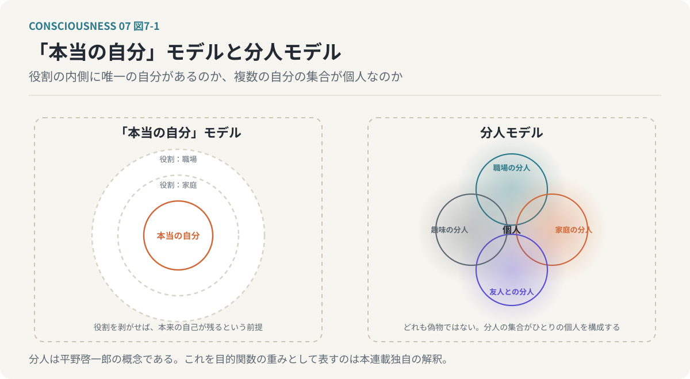
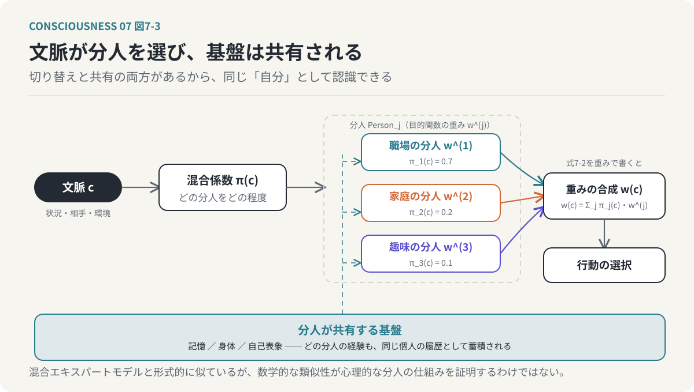
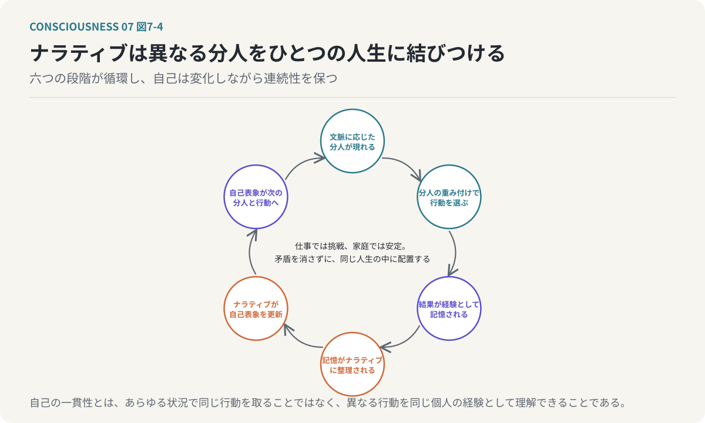
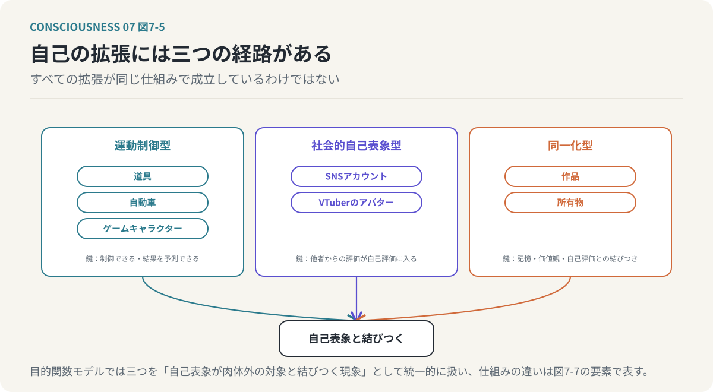
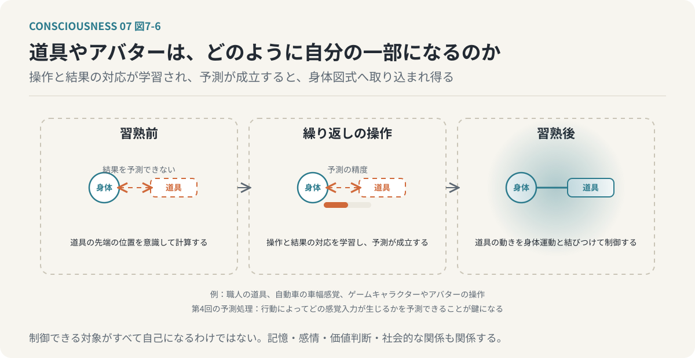
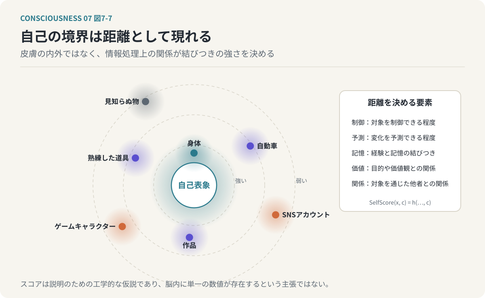
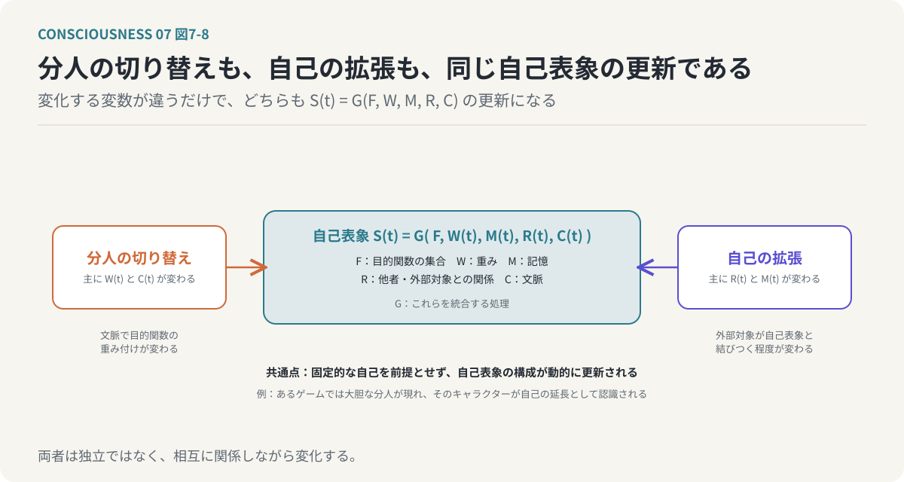
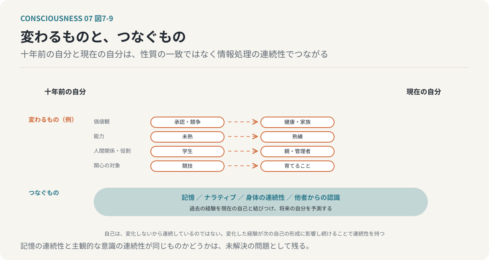

# 第7回　「本当の自分」は一人ではない

## 分人の混合モデルと、肉体の外へ拡張する自己

<!-- NAV:TOP -->
[← 第6回](06-phenomenal-consciousness.md) | [連載目次](../README.md) | [第8回 →](08-narrative-and-self.md)
<!-- /NAV -->

私たちは、状況によって異なる自分を使い分けている。職場では合理的な判断を重視し、家庭では家族との関係や安心感を優先する。親しい友人の前では職場では見せない一面を表すことがあり、趣味に没頭しているときには、普段とは異なる価値観や行動が前面に出る。それでも、私たちはこれらをすべて「自分」だと認識している。

では、その中のどれが本当の自分なのだろうか。職場での自分が本物で、家庭での自分は演じているだけなのだろうか。あるいは、他者の目を気にせずに過ごしているときの自分だけが、本当の自分なのだろうか。そもそも、本当の自分が一つだけ存在するという前提は正しいのだろうか。

ここまで、複数の目的関数の交差点に自己が創発し、その重みが状況で変わり、相互作用する統合構造の中で自己が成立すると考えてきた。今回は、これらの議論を踏まえて自己の文脈依存性を考える。手がかりとなるのが、小説家の平野啓一郎による「分人」という概念である。

**「自分」とは、一つの固定的な人格ではなく、状況や他者との関係によって異なる形で現れる、複数の自己の集合である。**

さらに、その自己は生物学的な肉体の内側に限定されるものでもない。ゲームキャラクターやアバター、所有物、作品など、肉体の外側にある対象にも自己が拡張される。今回は、この二つの現象を情報処理モデルによって説明する。

---

### 1. 「本当の自分」はどこにあるのか

私たちは、さまざまな場面で異なる振る舞いをする。仕事では論理的で厳密な判断をする人が、親しい友人の前では感情的で自由な振る舞いをすることがある。家庭では穏やかに過ごしている人が、競技やゲームの場面では強い競争心を示すこともある。このような違いを、私たちはしばしば「役割」として説明する。職場では仕事上の役割を演じ、家庭では家族としての役割を果たし、友人の前では社会的な役割から解放されている。

しかし、この説明には一つの前提がある。役割を演じている自分の背後に、役割とは無関係な「本当の自分」が存在するという前提である。この考え方では、外部の状況によって変化する自分はどこか表面的な存在として扱われ、社会的な役割をすべて取り除いたところに本来の自己が存在すると考える。しかし、本当にそうだろうか。職場で合理的な判断をする自分も、家庭で愛着を重視する自分も、趣味に没頭する自分も、それぞれ実際に存在している。それらの判断や感情は、単なる偽物ではない。状況によって異なる自分が現れることは、必ずしも人格の不一致や自己欺瞞を意味せず、むしろ、環境や他者との関係に応じて異なる価値判断が働くことは自然である。考えたいのは、自己を一つの固定的な実体として捉える必要があるのかという問題である。

### 2. 分人という考え方

平野啓一郎は、「分人」という概念を提唱している。分人とは、他者との関係や状況に応じて現れる、個人の異なる側面を捉えるための概念である。この考え方では、ひとりの人間の中に唯一の「本当の自分」が存在するとは限らない。他者との関係によって異なる自分が現れ、それらの分人の集合が、ひとりの個人を構成する。ある人は上司と話しているときには慎重に振る舞い、同僚と話しているときには率直に意見を述べ、親しい友人と話しているときには冗談を言い、感情を表現する。こうした振る舞いの違いは必ずしも意識的な演技ではなく、相手との関係や状況によって、自然に異なる自分が現れているのである。

分人という考え方の重要な点は、どれか一つを本物とし、他を偽物としないことである。職場での自分も、家庭での自分も、友人の前での自分も、それぞれが自分の一部である。

*図7-1：「本当の自分」モデルと分人モデル。前者は役割を剥がせば本来の自己が残ると前提する。後者はどれも偽物ではなく、分人の集合がひとりの個人を構成すると考える。*

この見方は、目的関数モデルと接続できる。目的関数モデルでも、自己は単一の固定的な評価基準から形成されるものではなく、生存、社会的承認、愛着、好奇心、倫理、美意識などの目的関数が存在し、その重みは状況によって変化する。つまり、異なる分人は、異なる目的関数の組み合わせや重み付けとして表現できる可能性がある。ただし、分人は本来、人間関係と自己のあり方を説明する概念であり、それを数学的な目的関数モデルとして表現することは、本連載独自の解釈である。

### 3. 分人を目的関数の混合モデルとして考える

第3回では、人間の行動を複数の目的関数の重み付き最適化（式3-2）として表現した。このモデルでは、各目的関数の重みが変化することで行動の選択が変化する。職場では達成や効率に関する目的関数の重みが大きくなり、家庭では愛着や安定に関する目的関数の重みが大きくなり、趣味の時間には好奇心や快楽に関する目的関数の重みが大きくなる。このような状態を、分人ごとの目的関数重みベクトルとして表現する。

`w^(j) = (w_1^(j), w_2^(j), ..., w_n^(j))`　（式7-1）

`j` は分人を表し、この式は「分人 `j` は、目的関数ごとの重みの組として表せる」と読む。職場の分人は達成、効率、社会的評価を重視し、家庭の分人は愛着、安定、関係の維持を重視し、趣味の分人は好奇心、快楽、探求を重視する。ただし、これはそれぞれの分人が独立した人格として存在するという意味ではなく、職場では愛着が存在せず、家庭では達成を重視しないという意味でもない。各目的関数は共通して存在し、その相対的な重みが変化すると考える。この重み付けの違いが、異なる分人の行動傾向として現れるのである。

*図7-2：分人を目的関数の重みベクトルとして描く。目的関数の軸はどの分人にも共通で、相対的な重みだけが異なる。職場に愛着がないわけではない。*

### 4. 分人は文脈によって切り替わる

分人を情報処理モデルとして表現する場合、次に必要となるのは、どの分人がいつ現れるかという仕組みである。ここで「文脈」、すなわち現在の状況や、関係する他者、環境、過去の経験などを含む情報を導入する。同じ言葉を聞いても、職場の会議で聞く場合と親しい友人との会話で聞く場合では意味の受け取り方が異なり、同じ行動であっても、文脈によって望ましさの評価が変わる。このような文脈の影響を、分人の混合係数として表現することができる。

`S(c) = Σ_j π_j(c)・Person_j`　（式7-2）

`S(c)` は文脈 `c` における自己の状態、`Person_j` は `j` 番目の分人、`π_j(c)` は文脈 `c` における分人 `j` の混合係数で、合計は1になる。この式は「文脈に応じた割合で複数の分人を混ぜ合わせたものが、その場での自己である」と読む。職場では仕事に関する分人の混合係数が大きくなり、家庭では愛着や安定を重視する分人の、趣味の時間には好奇心や探求を重視する分人の混合係数が大きくなる。

ただし、ここでいう混合は、単純に複数の人格を加算することではない。計算機上で実装する場合には、各分人を目的関数の重みベクトルや行動方針として表現し、それらを文脈によって選択・合成する仕組みが考えられる。この構造は、複数の専門的な処理系を用意し、入力に応じて利用する処理系を選択する、機械学習の混合エキスパートモデル（Mixture of Experts）と形式的に似ている。数学的な類似性がそのまま人間の心理的な分人の仕組みを証明するわけではなく、目的関数モデルでは、分人を計算可能な形式で近似するための手段として利用する。

### 5. 分人が変わっても、なぜ同じ「自分」だと感じるのか

ここで重要な疑問が生じる。職場と家庭で異なる分人が現れるなら、なぜ私たちは、それらを同じ「自分」だと認識しているのだろうか。職場で厳しい判断をした自分と、家庭で穏やかに過ごす自分がいる。両者の行動や価値判断は異なる。それでも、私たちはその両方を、自分自身の経験として記憶している。

この連続性を説明するためには、分人の切り替えだけでなく、分人間で共有される情報を考える必要がある。その代表的なものが記憶である。職場での出来事も家庭での出来事も、同じ個人の経験として記憶される。身体についての情報も共有され、能力や価値観に関する自己表象も、状況によって異なる側面を示しながら、共通した情報を利用している。つまり、分人ごとに異なる行動が生じても、その背後には共有される情報処理の基盤が存在する。目的関数モデルでは、分人の違いを目的関数の重み付けの違いとして表現し、自己の連続性を共有された記憶や自己表象によって説明する。共有された記憶が存在するだけで主観的な自己同一性が成立すると証明されたわけではなく、ここで説明しているのは、異なる文脈での行動を、一つの個人の履歴として結びつける機能的な仕組みである。

*図7-3：分人は文脈によって切り替わるが、記憶・身体・自己表象は共有される。切り替えと共有の両方があるので、異なる分人を同じ「自分」として認識できる。*

### 6. ナラティブは異なる分人を一つの人生に結びつける

分人間の連続性を考えるうえで、もう一つ重要なのがナラティブ、すなわち出来事や経験を意味のある物語として結びつける働きである。第3回では、統一された自己は事後的に構築されるナラティブであるという仮説を提示した。この考え方は、分人モデルと深く関係する。

ある人が職場では挑戦的な判断を行い、家庭では慎重な判断を行っているとする。この二つの行動は、一見すると矛盾している。しかし、本人は「仕事では新しい価値を生み出したい。一方、家庭では大切な人との安定した生活を守りたい」と説明するかもしれない。この説明によって、異なる行動が一つの人生の中に位置づけられ、それぞれの分人が持つ異なる目的関数が、共通したナラティブによって意味づけられる。重要なのは、ナラティブが矛盾を完全に解消する必要はないということである。仕事では挑戦を重視し、家庭では安定を重視する。この二つは同時に成立していてもよく、ナラティブは、それらを無理に単一の価値観へ統一するのではなく、異なる文脈の中に配置する。つまり、自己の一貫性とは、あらゆる状況で同じ行動を取ることではなく、異なる状況での行動を、同じ個人の経験として理解できることである。

目的関数モデルでは、自己の時間的な連続性を、次のような循環として考える。

1. 文脈に応じた分人が現れる。
2. 分人に応じた目的関数の重み付けで行動が選択される。
3. 行動の結果が経験として記憶される。
4. 記憶がナラティブとして整理される。
5. ナラティブが自己表象を更新する。
6. 更新された自己表象が将来の分人や行動に影響する。

*図7-4：ナラティブは異なる分人を一つの人生に結びつける。六つの段階が循環することで、自己は変化しながら連続性を保つ。矛盾は消さずに、異なる文脈の中に配置される。*

この循環によって、自己は変化しながらも連続性を維持する。

### 7. 情報統合の観点から分人を考える

第5回では、自己の成立を、複数の目的関数が相互に影響し合う統合構造として説明する仮説を提示した。分人モデルでは、文脈によって目的関数の重み付けが変化する。それでは、分人の切り替えは、情報統合の構造の変化として説明できるのだろうか。職場では達成、効率、社会的承認に関する処理が強く相互作用し、家庭では愛着、安定、倫理に関する処理が強く相互作用するとする。この場合、文脈の変化に伴って、情報処理の相互作用の構造も変化する可能性がある。目的関数モデルでは、このような変化を、文脈依存的な統合構造の再構成として捉える。

ただし、目的関数の重みが変化したことと、IITにおける統合情報量Φが変化したことは同じではない（第5回 第11節の留保がここにも当てはまる）。分人ごとに異なる統合構造が存在し、それらが選択されると考えることも、IITから直接導かれる結論ではなく、本連載独自の仮説である。この仮説を検証するためには、文脈が変化すると目的関数間の相互作用は変化するか、異なる分人の表出に対応する内部状態の違いを観測できるか、分人の切り替えによって自己表象の構成は変化するか、その変化を因果的な情報統合の指標によって捉えられるか、といった問いを考える必要がある。これらは、計算機による近似モデルや神経活動の分析によって検討できる可能性がある。

### 8. 自己は肉体の外側にも広がる

ここまでは、同じ人間の中で異なる自己が現れることを考えてきた。しかし、自己の変化は、文脈による分人の切り替えだけではない。自己の範囲そのものが、肉体の外側へ拡張されることもある。

第1回では、現実とバーチャルの境界が曖昧になりつつあることを取り上げた。ゲームキャラクターやSNSアカウント、VTuberのアバターなど、デジタル空間に存在する対象が、人間の自己認識と深く結びつくようになっている。ゲームキャラクターを長い時間操作していると、そのキャラクターを自分の延長として認識し、キャラクターが危険にさらされれば自分が危険にさらされたように反応し、成功すれば自分自身の成功として喜ぶ。SNSアカウントに対する評価や批判が本人の自己評価に影響することがあり、VTuberのアバターでは、物理的な身体とは異なる姿を通じて他者との関係を築くことができる。このような現象は、自己が生物学的な肉体の内部だけで完結していないことを示唆する。

ただし、すべての自己拡張が同じ仕組みで成立しているわけではない。ゲームキャラクターの操作には身体運動の制御に近い側面があり、SNSアカウントには社会的な自己表象としての側面があり、作品や所有物には記憶や価値観、自己評価との結びつきが存在する。それぞれ異なる情報処理によって自己との関係が形成される可能性がある。目的関数モデルでは、これらを「自己表象が肉体外の対象と結びつく現象」として統一的に考える。

*図7-5：自己の拡張には三つの経路がある。制御と予測による身体運動の制御、他者評価が入る社会的な自己表象、記憶・価値観との結びつきで、仕組みは同じではない。*

### 9. 道具やアバターは、どのように自分の一部になるのか

自己の拡張を理解するために、道具の使用を考えてみたい。熟練した職人が道具を操作するとき、その人は道具の先端の位置を細かく計算しているわけではなく、道具の動きを自分の身体運動と結びつけて制御している。自動車を運転する場合も同様で、熟練した運転者は自動車の幅や長さを考慮しながら狭い道を通過する。運転者は身体の大きさそのものが変化したわけではないにもかかわらず、自動車を含めた空間的な広がりを考慮して行動している。

このような現象は、身体図式の拡張という観点から理解できる。身体図式とは、身体の位置や姿勢、運動を制御するための内部的な表象であり、道具を使う経験によって、この内部表象が変化する場合がある。ゲームキャラクターやアバターの操作にも類似した仕組みを考えることができる。操作対象の位置や動きが自分の運動制御と結びつき、操作に対する結果が予測できるようになり、その結果、操作対象が自分の身体の延長のように感じられることがある。

ここで、第4回で扱った予測処理が重要になる。私たちは、自分の行動によってどのような感覚入力が生じるかを予測している。手を動かせば、視覚や身体感覚がどのように変化するかを予測できる。道具やアバターでも、操作と結果の対応が安定していれば同様の予測が成立し、この対応が学習されることで、外部の対象が自己に関する情報処理へ取り込まれる可能性がある。

*図7-6：道具やアバターが自分の一部になる過程。操作と結果の対応が学習されて予測が成立すると、外部の対象が身体図式に取り込まれ得る。制御できる対象がすべて自己になるわけではない。*

つまり、自己の拡張には、対象を制御できることや、行動結果を予測できることが関係していると考えられる。ただし、制御できる対象がすべて自己の一部として認識されるわけではなく、制御できなくても強い愛着や自己同一性を感じる対象は存在する。自己の拡張には、運動制御だけでなく、記憶、感情、価値判断、社会的な関係など、複数の要素が関係していると考える必要がある。

### 10. 「自分らしさスコア」を拡張する

第2回では、身体の各部位に対する自己認識の強さを、「自分らしさスコア」という仮説的な概念で説明した。心臓や脳、四肢、髪、爪、排泄物では、自己として認識する強さが異なる。今回は、この考え方を肉体の外側にも拡張してみたい。生物学的な身体、日常的に使用する道具、自動車、ゲームキャラクター、SNSアカウント、VTuberのアバター、所有物、自分が作成した作品。これらの対象はすべて同じ程度に自己と結びついているわけではなく、同じ対象でも、個人や状況によって自己との結びつきは異なる。この関係を、仮説的な評価関数として表してみる。

`SelfScore(x, c) = h(Control, Prediction, Memory, Value, Relation, c)`　（式7-3）

`x` は自己との関係を評価する対象、`c` は文脈であり、`h` は五つの要素、すなわち制御（Control：対象を制御できる程度）、予測（Prediction：対象の状態や変化を予測できる程度）、記憶（Memory：対象との経験や記憶の結びつき）、価値（Value：対象が自分の目的や価値観に関係する程度）、関係（Relation：対象を通じた他者との関係）を統合する関数である。この式は「対象がどの程度自分と結びつくかは、制御・予測・記憶・価値・関係という複数の要素から決まる」と読む。

このような単一のスコアが脳内に存在すると確認されたわけではなく、それぞれの要素がどのような重みで統合されるかも明らかではない。ここでは、自己の境界を固定的なものとして扱うのではなく、複数の要素によって変化する連続的な関係として表現することが目的である。この考え方を採用すると、肉体の内部と外部を明確に分離する必要はなくなる。身体の一部であっても自己との結びつきが弱い場合があり、反対に、身体の外側にある対象であっても自己との結びつきが強い場合がある。

**自己の境界は、物理的な位置だけでなく、情報処理上の関係によって形成される。**

*図7-7：自分らしさスコアの拡張。対象が自己に結びつく程度は、制御できるか、予測できるか、記憶があるか、価値観に関わるか、他者との関係を担うかで決まり、皮膚の内外とは一致しない。*

### 11. 分人と拡張された自己は、同じ構造で説明できるのか

ここまで、二つの異なる現象を考えてきた。一つは、文脈によって異なる分人が現れることであり、もう一つは、肉体の外側にある対象が自己の一部として認識されることである。一見すると、この二つは異なる問題に見える。分人は同じ人間の内部における自己の変化であり、自己の拡張は自己として認識する対象の範囲の変化である。しかし、情報処理の観点から考えると、共通する構造がある。どちらも、固定的な自己を前提とせず、状況や関係によって自己表象が変化する現象である。分人の場合は文脈によって目的関数の重み付けが変化し、自己の拡張の場合は外部の対象が自己表象と結びつく程度が変化する。変化する対象は異なるが、どちらも自己表象の構成が動的に更新されるという点で共通している。目的関数モデルでは、自己表象を次のように考える。

`S(t) = G(F, W(t), M(t), R(t), C(t))`　（式7-4）

`S(t)` は時刻 `t` における自己表象、`F` は目的関数の集合、`W(t)` は目的関数の重み、`M(t)` は記憶、`R(t)` は他者や外部対象との関係、`C(t)` は文脈、`G` はこれらの情報を統合する処理である。この式は「自己表象は固定した値ではなく、重み、記憶、関係、文脈が変わるたびに統合し直される」と読む。分人の切り替えは主として文脈と目的関数の重みの変化として、自己の拡張は主として外部対象との関係や、それに伴う内部表象の変化として表現できる。

*図7-8：分人の切り替えも自己の拡張も、同じ自己表象の更新である。変化する変数が違うだけで、どちらも固定的な自己を前提とせず、自己表象の構成が動的に更新される。*

もちろん、両者は完全に独立しているわけではない。あるゲームでは大胆に行動する分人が現れ、そのゲームキャラクターが自己の延長として認識されることがある。SNS上では、現実の対人関係とは異なる分人が現れ、そのアカウントが自己表象の一部となることもある。分人と自己の拡張は、相互に関係しながら変化する。

### 12. 自己は変化しても、同じ個人であり続ける

最後の問題を考えたい。自己が文脈によって変化し、肉体の外側にも拡張されるなら、「同じ自分」であり続けるとはどういうことなのだろうか。十年前の自分と現在の自分を比較してみる。価値観は変わっているかもしれず、能力も、人間関係も、社会的な役割も、関心の対象も変化している。それでも、私たちは十年前の自分を、現在の自分と連続した存在として認識している。この連続性は、すべての性質が同じまま維持されていることによって成立しているわけではない。むしろ、性質が変化していることを認めながら、それらを同じ人生の中に位置づけている。

ここで、記憶とナラティブが重要になる。過去の経験を記憶してそれらを現在の自己と結びつけ、過去の判断や行動を振り返って現在の価値観との関係を説明し、将来どのような自分になりたいかを予測する。このような処理によって、時間的に連続した自己表象が形成されると考えられる。目的関数モデルでは、自己の同一性を、固定された性質の一致ではなく、情報処理の連続性として捉える。記憶やナラティブだけで個人の同一性を完全に説明できるわけではなく、身体の連続性、他者からの認識、社会的な関係なども個人の同一性に関係し、記憶の連続性と主観的な意識の連続性が同じものかどうかも未解決の問題である。それでも、自己が変化することと、同じ個人であり続けることは、必ずしも矛盾しない。自己は、変化しないから連続しているのではない。変化した経験が、次の自己の形成に影響し続けることで、連続性を持つのである。

*図7-9：変わるものと、つなぐもの。価値観や能力や関係は変わるが、記憶とナラティブ、身体の連続性、他者からの認識が、性質の一致ではなく情報処理の連続性で自己をつなぐ。*

### おわりに：「本当の自分」を探す必要はない

**本当の自分とは、複数の自分の背後に隠れている唯一の実体ではなく、異なる自分が関係し合い、変化し続ける構造そのものである。**

分人という概念では、状況や他者との関係に応じて異なる自己が現れ、目的関数モデルはその違いを目的関数の重み付けや文脈依存的な行動選択として表現する。自己の範囲は生物学的な肉体に限定されず、道具、ゲームキャラクター、SNSアカウント、アバター、所有物、作品も自己表象と結びつく。これらに共通するのは、自己が固定的な実体ではなく、関係や経験によって変化する情報処理上の構造だということであり、異なる分人や拡張された自己は、記憶やナラティブを通じて一つの人生の中に位置づけられる。職場での自分と家庭での自分が異なることを矛盾として解消する必要はなく、過去の自分と現在の自分が異なることも、自己の喪失を意味しない。

ここでさらに重要な問いが生じる。自己が経験によって変化するなら、その経験はどのように自己を更新するのだろうか。私たちは現実の出来事だけでなく、映画や小説、ゲームの中で経験した出来事によっても価値観や自己評価を変える。なぜ現実には経験していない出来事が、私たちの目的関数や自己表象を変化させるのだろうか。次回は、エンターテイメントを目的関数の学習・修復装置として捉え、異世界転生もの、追放もの、日常系、悪役令嬢ものといった物語がなぜ支持されるのかを、目的関数と自己表象の再構成という観点から考える。

<!-- NAV:BOTTOM -->
---

[← 第6回](06-phenomenal-consciousness.md) | [連載目次](../README.md) | [第8回 →](08-narrative-and-self.md)
<!-- /NAV -->
