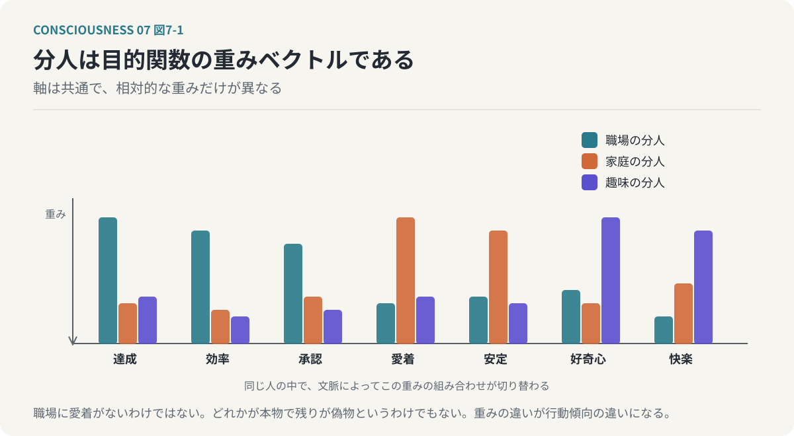
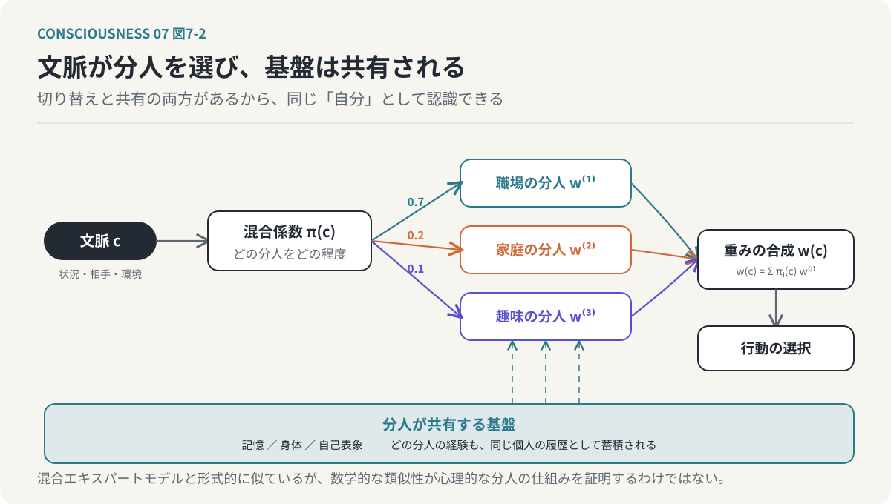

# 第7回　「本当の自分」は一人ではない

## 分人の混合モデルと、肉体の外へ拡張する自己

<!-- NAV:TOP -->
[← 第6回](06-phenomenal-consciousness.md) | [連載目次](../README.md) | [第8回 →](08-narrative-and-self.md)
<!-- /NAV -->

私たちは、状況によって異なる自分を使い分けている。

職場では、合理的な判断を重視する。

家庭では、家族との関係や安心感を優先する。

親しい友人の前では、職場では見せない一面を表すことがある。

趣味に没頭しているときには、普段とは異なる価値観や行動が前面に出る。

それでも、私たちはこれらをすべて「自分」だと認識している。

では、その中のどれが本当の自分なのだろうか。

職場での自分が本物で、家庭での自分は演じているだけなのだろうか。

あるいは、他者の目を気にせずに過ごしているときの自分だけが、本当の自分なのだろうか。

そもそも、本当の自分がひとつだけ存在するという前提は正しいのだろうか。

これまでの連載では、意識を情報処理システムとして捉え、複数の目的関数から自己表象が形成されるという仮説を検討してきた。

第3回では、「自分」は複数の目的関数の交差点に生まれると考えた。

第4回では、目的関数の重みが状況によって変化し、注意や行動の選択に影響することを説明した。

第5回では、目的関数間の相互作用と情報統合から、自己の統一性を考えた。

第6回では、こうした機能的な自己の説明と、主観的な意識体験の問題を区別した。

今回は、これらの議論を踏まえて、自己の文脈依存性を考える。

その手がかりとなるのが、平野啓一郎の「分人」という概念である。

**「自分」とは、ひとつの固定的な人格ではなく、状況や他者との関係によって異なる形で現れる、複数の自己の集合ではないか。**

さらに、その自己は生物学的な肉体の内側に限定されるものでもない。

ゲームキャラクターやアバター、所有物、作品など、肉体の外側にある対象にも自己が拡張される。

今回は、この二つの現象を情報処理モデルによって説明する。

---

### 1. 「本当の自分」はどこにあるのか

私たちは、さまざまな場面で異なる振る舞いをする。

例えば、仕事では論理的で厳密な判断をする人が、親しい友人の前では感情的で自由な振る舞いをすることがある。

家庭では穏やかに過ごしている人が、競技やゲームの場面では強い競争心を示すこともある。

このような違いを、私たちはしばしば「役割」として説明する。

職場では仕事上の役割を演じている。

家庭では家族としての役割を果たしている。

友人の前では、社会的な役割から解放されている。

しかし、この説明にはひとつの前提がある。

役割を演じている自分の背後に、役割とは無関係な「本当の自分」が存在するという前提である。

この考え方では、外部の状況によって変化する自分は、どこか表面的な存在として扱われる。

そして、社会的な役割をすべて取り除いたところに、本来の自己が存在すると考える。

しかし、本当にそうだろうか。

職場で合理的な判断をする自分も、家庭で愛着を重視する自分も、趣味に没頭する自分も、それぞれ実際に存在している。

それらの判断や感情は、単なる偽物ではない。

状況によって異なる自分が現れることは、必ずしも人格の不一致や自己欺瞞を意味しない。

むしろ、環境や他者との関係に応じて、異なる価値判断が働くことは自然である。

ここで考えたいのは、自己をひとつの固定的な実体として捉える必要があるのかという問題である。

### 2. 分人という考え方

平野啓一郎は、「分人」という概念を提唱している。

分人とは、他者との関係や状況に応じて現れる、個人の異なる側面を捉えるための概念である。

この考え方では、ひとりの人間の中に、唯一の「本当の自分」が存在するとは限らない。

他者との関係によって、異なる自分が現れる。

そして、それらの分人の集合が、ひとりの個人を構成する。

例えば、ある人は上司と話しているときには慎重に振る舞う。

同僚と話しているときには、率直に意見を述べる。

親しい友人と話しているときには、冗談を言い、感情を表現する。

こうした振る舞いの違いは、必ずしも意識的な演技ではない。

相手との関係や状況によって、自然に異なる自分が現れているのである。

分人という考え方の重要な点は、どれかひとつを本物とし、他を偽物としないことである。

職場での自分も、家庭での自分も、友人の前での自分も、それぞれが自分の一部である。

この見方は、前回までに検討してきた目的関数モデルと接続できる。

なぜなら、目的関数モデルでも、自己は単一の固定的な評価基準から形成されるものではないからである。

生存、社会的承認、愛着、好奇心、倫理、美意識などの目的関数が存在し、その重みは状況によって変化する。

つまり、異なる分人は、異なる目的関数の組み合わせや重み付けとして表現できる可能性がある。

ただし、分人は本来、人間関係と自己のあり方を説明する概念である。

それを数学的な目的関数モデルとして表現することは、本連載独自の解釈である。

### 3. 分人を目的関数の混合モデルとして考える

第3回では、人間の行動を複数の目的関数の重み付き最適化として表現した。

`U(x) = Σᵢ wᵢ・fᵢ(x)`

ここで、

- `fᵢ(x)`：個別の目的関数
- `wᵢ`：目的関数の重み
- `x`：評価対象の状態

である。

このモデルでは、各目的関数の重みが変化することで、行動の選択が変化する。

例えば、職場では達成や効率に関する目的関数の重みが大きくなる。

家庭では愛着や安定に関する目的関数の重みが大きくなる。

趣味の時間には、好奇心や快楽に関する目的関数の重みが大きくなる。

このような状態を、分人ごとの目的関数重みベクトルとして表現する。

`w^(j) = (w₁^(j), w₂^(j), ..., wₙ^(j))`

ここで、`j` は分人を表す。

例えば、次のような分人を考えることができる。

- 職場の分人
  - 達成を重視する。
  - 効率を重視する。
  - 社会的評価を重視する。
- 家庭の分人
  - 愛着を重視する。
  - 安定を重視する。
  - 関係の維持を重視する。
- 趣味の分人
  - 好奇心を重視する。
  - 快楽を重視する。
  - 探求を重視する。

ただし、これはそれぞれの分人が独立した人格として存在するという意味ではない。

また、職場では愛着が存在せず、家庭では達成を重視しないという意味でもない。

各目的関数は共通して存在し、その相対的な重みが変化すると考える。

この重み付けの違いが、異なる分人の行動傾向として現れるのである。

*図7-1：分人を目的関数の重みベクトルとして描く。目的関数の軸はどの分人にも共通で、相対的な重みだけが異なる。職場に愛着がないわけではない。*

### 4. 分人は文脈によって切り替わる

分人を情報処理モデルとして表現する場合、次に必要となるのは、どの分人がいつ現れるかという仕組みである。

ここで「文脈」という概念を導入する。

文脈とは、現在の状況や、関係する他者、環境、過去の経験などを含む情報である。

例えば、同じ言葉を聞いても、職場の会議で聞く場合と、親しい友人との会話で聞く場合では、意味の受け取り方が異なる。

同じ行動であっても、文脈によって望ましさの評価が変わる。

このような文脈の影響を、分人の混合係数として表現することができる。

`S(c) = Σⱼ πⱼ(c)・Personⱼ`

ここで、

- `S(c)`：文脈cにおける自己の状態
- `Personⱼ`：j番目の分人
- `πⱼ(c)`：文脈cにおける分人jの混合係数
- `Σⱼ πⱼ(c) = 1`

である。

この式は、自己が複数の分人の混合として表現され、その混合比率が文脈によって変化することを意味する。

例えば、職場では仕事に関する分人の混合係数が大きくなる。

家庭では愛着や安定を重視する分人の混合係数が大きくなる。

趣味の時間には、好奇心や探求を重視する分人の混合係数が大きくなる。

ただし、ここでいう混合は、単純に複数の人格を加算することではない。

計算機上で実装する場合には、各分人を目的関数の重みベクトルや行動方針として表現し、それらを文脈によって選択・合成する仕組みが考えられる。

この構造は、機械学習における混合エキスパートモデル（Mixture of Experts）と形式的に似ている。

混合エキスパートモデルでは、複数の専門的な処理系を用意し、入力に応じて利用する処理系を選択する。

分人モデルでも、文脈に応じて異なる評価基準や行動方針を選択するという点で、同様の構造を考えることができる。

ただし、数学的な類似性が、そのまま人間の心理的な分人の仕組みを証明するわけではない。

本モデルでは、分人を計算可能な形式で近似するための手段として利用する。

### 5. 分人が変わっても、なぜ同じ「自分」だと感じるのか

ここで、重要な疑問が生じる。

職場と家庭で異なる分人が現れるなら、なぜ私たちは、それらを同じ「自分」だと認識しているのだろうか。

例えば、職場で厳しい判断をした自分と、家庭で穏やかに過ごす自分がいる。

両者の行動や価値判断は異なる。

それでも、私たちはその両方を、自分自身の経験として記憶している。

この連続性を説明するためには、分人の切り替えだけでなく、分人間で共有される情報を考える必要がある。

その代表的なものが記憶である。

職場での出来事も、家庭での出来事も、同じ個人の経験として記憶される。

また、身体についての情報も共有される。

能力や価値観に関する自己表象も、状況によって異なる側面を示しながら、共通した情報を利用している。

つまり、分人ごとに異なる行動が生じても、その背後には共有される情報処理の基盤が存在する。

本モデルでは、分人の違いを目的関数の重み付けの違いとして表現し、自己の連続性を共有された記憶や自己表象によって説明する。

ただし、共有された記憶が存在するだけで、主観的な自己同一性が成立すると証明されたわけではない。

ここで説明しているのは、異なる文脈での行動を、ひとつの個人の履歴として結びつける機能的な仕組みである。

*図7-2：分人は文脈によって切り替わるが、記憶・身体・自己表象は共有される。切り替えと共有の両方があるので、異なる分人を同じ「自分」として認識できる。*

### 6. ナラティブは異なる分人をひとつの人生に結びつける

分人間の連続性を考えるうえで、もうひとつ重要なのがナラティブである。

ナラティブとは、出来事や経験を意味のある物語として結びつける働きである。

第3回では、統一された自己は事後的に構築されるナラティブであるという仮説を提示した。

この考え方は、分人モデルと深く関係する。

例えば、ある人が職場では挑戦的な判断を行い、家庭では慎重な判断を行っているとする。

この二つの行動は、一見すると矛盾している。

しかし、本人は次のように説明するかもしれない。

「仕事では新しい価値を生み出したい。一方、家庭では大切な人との安定した生活を守りたい」

この説明によって、異なる行動がひとつの人生の中に位置づけられる。

それぞれの分人が持つ異なる目的関数が、共通したナラティブによって意味づけられるのである。

ここで重要なのは、ナラティブが矛盾を完全に解消する必要はないということである。

仕事では挑戦を重視し、家庭では安定を重視する。

この二つは、同時に成立していてもよい。

ナラティブは、それらを無理に単一の価値観へ統一するのではなく、異なる文脈の中に配置する。

つまり、自己の一貫性とは、あらゆる状況で同じ行動を取ることではない。

異なる状況での行動を、同じ個人の経験として理解できることである。

本モデルでは、自己の時間的な連続性を、次のような循環として考える。

1. 文脈に応じた分人が現れる。
2. 分人に応じた目的関数の重み付けで行動が選択される。
3. 行動の結果が経験として記憶される。
4. 記憶がナラティブとして整理される。
5. ナラティブが自己表象を更新する。
6. 更新された自己表象が将来の分人や行動に影響する。

この循環によって、自己は変化しながらも連続性を維持する。

### 7. 情報統合の観点から分人を考える

ここで、第5回で取り上げた統合情報理論（IIT）との関係を考えてみたい。

第5回では、自己の成立を、複数の目的関数が相互に影響し合う統合構造として説明する仮説を提示した。

分人モデルでは、文脈によって目的関数の重み付けが変化する。

それでは、分人の切り替えは、情報統合の構造の変化として説明できるのだろうか。

例えば、職場では達成、効率、社会的承認に関する処理が強く相互作用するとする。

家庭では愛着、安定、倫理に関する処理が強く相互作用する。

この場合、文脈の変化に伴って、情報処理の相互作用の構造も変化する可能性がある。

本モデルでは、このような変化を、文脈依存的な統合構造の再構成として捉える。

ただし、ここで注意が必要である。

目的関数の重みが変化したことと、IITにおける統合情報量Φが変化したことは同じではない。

また、分人ごとに異なるMICSが存在し、それらが選択されると考えることも、IITから直接導かれる結論ではない。

IITでは、特定の因果的な構造に対して統合の程度を評価する。

心理的な文脈の変化をIITの概念へ対応させるためには、文脈によって実際の因果構造がどのように変化するかを調べる必要がある。

したがって、分人を異なるMICSの構成に対応させることは、本連載独自の仮説である。

この仮説を検証するためには、少なくとも次のような問いを考える必要がある。

- 文脈が変化すると、目的関数間の相互作用は変化するか。
- 異なる分人の表出に対応する内部状態の違いを観測できるか。
- 分人の切り替えによって、自己表象の構成は変化するか。
- その変化を因果的な情報統合の指標によって捉えられるか。

これらは、計算機による近似モデルや神経活動の分析によって検討できる可能性がある。

### 8. 自己は肉体の外側にも広がる

ここまでは、同じ人間の中で異なる自己が現れることを考えてきた。

しかし、自己の変化は、文脈による分人の切り替えだけではない。

自己の範囲そのものが、肉体の外側へ拡張されることもある。

第1回では、現実とバーチャルの境界が曖昧になりつつあることを取り上げた。

ゲームキャラクターやSNSアカウント、VTuberのアバターなど、デジタル空間に存在する対象が、人間の自己認識と深く結びつくようになっている。

例えば、ゲームキャラクターを長い時間操作していると、そのキャラクターを自分の延長として認識することがある。

キャラクターが危険にさらされれば、自分が危険にさらされたように反応する。

キャラクターが成功すれば、自分自身の成功として喜ぶ。

SNSアカウントも同様である。

アカウントに対する評価や批判が、本人の自己評価に影響することがある。

VTuberのアバターでは、物理的な身体とは異なる姿を通じて、他者との関係を築くことができる。

このような現象は、自己が生物学的な肉体の内部だけで完結していないことを示唆する。

ただし、すべての自己拡張が同じ仕組みで成立しているわけではない。

ゲームキャラクターの操作には、身体運動の制御に近い側面がある。

SNSアカウントには、社会的な自己表象としての側面がある。

作品や所有物には、記憶や価値観、自己評価との結びつきが存在する。

それぞれ異なる情報処理によって自己との関係が形成される可能性がある。

本モデルでは、これらを「自己表象が肉体外の対象と結びつく現象」として統一的に考える。

### 9. 道具やアバターは、どのように自分の一部になるのか

自己の拡張を理解するために、道具の使用を考えてみたい。

例えば、熟練した職人が道具を操作するとき、その人は道具の先端の位置を細かく計算しているわけではない。

道具の動きを、自分の身体運動と結びつけて制御している。

自動車を運転する場合も同様である。

熟練した運転者は、自動車の幅や長さを考慮しながら、狭い道を通過する。

このとき、運転者は身体の大きさそのものが変化したわけではないにもかかわらず、自動車を含めた空間的な広がりを考慮して行動している。

このような現象は、身体図式の拡張という観点から理解できる。

身体図式とは、身体の位置や姿勢、運動を制御するための内部的な表象である。

道具を使う経験によって、この内部表象が変化する場合がある。

ゲームキャラクターやアバターの操作にも、類似した仕組みを考えることができる。

操作対象の位置や動きが、自分の運動制御と結びつく。

操作に対する結果が予測できるようになる。

その結果、操作対象が自分の身体の延長のように感じられることがある。

ここで、第4回で扱った予測処理が重要になる。

私たちは、自分の行動によってどのような感覚入力が生じるかを予測している。

例えば、手を動かせば、視覚や身体感覚がどのように変化するかを予測できる。

道具やアバターでも、操作と結果の対応が安定していれば、同様の予測が成立する。

この対応が学習されることで、外部の対象が自己に関する情報処理へ取り込まれる可能性がある。

つまり、自己の拡張には、対象を制御できることや、行動結果を予測できることが関係していると考えられる。

ただし、制御できる対象がすべて自己の一部として認識されるわけではない。

また、制御できなくても、強い愛着や自己同一性を感じる対象は存在する。

したがって、自己の拡張には、運動制御だけでなく、記憶、感情、価値判断、社会的な関係など、複数の要素が関係していると考える必要がある。

### 10. 「自分らしさスコア」を拡張する

第2回では、身体の各部位に対する自己認識の強さを、「自分らしさスコア」という仮説的な概念で説明した。

心臓や脳、四肢、髪、爪、排泄物では、自己として認識する強さが異なる。

今回は、この考え方を肉体の外側にも拡張してみたい。

例えば、次のような対象を考える。

- 生物学的な身体
- 日常的に使用する道具
- 自動車
- ゲームキャラクター
- SNSアカウント
- VTuberのアバター
- 所有物
- 自分が作成した作品

これらの対象は、すべて同じ程度に自己と結びついているわけではない。

また、同じ対象でも、個人や状況によって自己との結びつきは異なる。

この関係を、仮説的な評価関数として表してみる。

`SelfScore(x, c) = h(Control, Prediction, Memory, Value, Relation, c)`

ここで、

- `x`：自己との関係を評価する対象
- `c`：文脈
- `Control`：対象を制御できる程度
- `Prediction`：対象の状態や変化を予測できる程度
- `Memory`：対象との経験や記憶の結びつき
- `Value`：対象が自分の目的や価値観に関係する程度
- `Relation`：対象を通じた他者との関係
- `h`：これらの要素を統合する関数

である。

この式は、自己との結びつきを、複数の情報処理上の要素から評価するという考え方を表している。

ただし、このような単一のスコアが脳内に存在すると確認されたわけではない。

また、それぞれの要素がどのような重みで統合されるかも明らかではない。

ここでは、自己の境界を固定的なものとして扱うのではなく、複数の要素によって変化する連続的な関係として表現することが目的である。

この考え方を採用すると、肉体の内部と外部を明確に分離する必要はなくなる。

身体の一部であっても、自己との結びつきが弱い場合がある。

反対に、身体の外側にある対象であっても、自己との結びつきが強い場合がある。

**自己の境界は、物理的な位置だけでなく、情報処理上の関係によって形成される。**

*図7-3：自分らしさスコアの拡張。対象が自己に結びつく程度は、制御できるか、予測できるか、記憶があるか、価値観に関わるか、他者との関係を担うかで決まり、皮膚の内外とは一致しない。*

### 11. 分人と拡張された自己は、同じ構造で説明できるのか

ここまで、二つの異なる現象を考えてきた。

ひとつは、文脈によって異なる分人が現れることである。

もうひとつは、肉体の外側にある対象が自己の一部として認識されることである。

一見すると、この二つは異なる問題に見える。

分人は、同じ人間の内部における自己の変化である。

自己の拡張は、自己として認識する対象の範囲の変化である。

しかし、情報処理の観点から考えると、共通する構造がある。

どちらも、固定的な自己を前提とせず、状況や関係によって自己表象が変化する現象である。

分人の場合、文脈によって目的関数の重み付けが変化する。

自己の拡張の場合、外部の対象が自己表象と結びつく程度が変化する。

つまり、変化する対象は異なるが、どちらも自己表象の構成が動的に更新されるという点で共通している。

本モデルでは、自己表象を次のように考える。

`S(t) = G(F, W(t), M(t), R(t), C(t))`

ここで、

- `S(t)`：時刻tにおける自己表象
- `F`：目的関数の集合
- `W(t)`：目的関数の重み
- `M(t)`：記憶
- `R(t)`：他者や外部対象との関係
- `C(t)`：文脈
- `G`：これらの情報を統合する処理

である。

この式では、自己は固定的な値ではない。

目的関数の重み、記憶、関係性、文脈が変化することで、自己表象も変化する。

分人の切り替えは、主として文脈と目的関数の重みの変化として表現できる。

自己の拡張は、主として外部対象との関係や、それに伴う内部表象の変化として表現できる。

もちろん、両者は完全に独立しているわけではない。

例えば、あるゲームでは大胆に行動する分人が現れ、そのゲームキャラクターが自己の延長として認識されることがある。

SNS上では、現実の対人関係とは異なる分人が現れ、そのアカウントが自己表象の一部となることもある。

このように、分人と自己の拡張は、相互に関係しながら変化する可能性がある。

### 12. 自己は変化しても、同じ個人であり続ける

ここで、最後の問題を考えたい。

自己が文脈によって変化し、肉体の外側にも拡張されるなら、「同じ自分」であり続けるとはどういうことなのだろうか。

例えば、十年前の自分と現在の自分を比較してみる。

価値観は変わっているかもしれない。

能力も変わっている。

人間関係も、社会的な役割も、関心の対象も変化している。

それでも、私たちは十年前の自分を、現在の自分と連続した存在として認識している。

この連続性は、すべての性質が同じまま維持されていることによって成立しているわけではない。

むしろ、性質が変化していることを認めながら、それらを同じ人生の中に位置づけている。

ここで、記憶とナラティブが重要になる。

過去の経験を記憶し、それらを現在の自己と結びつける。

過去の判断や行動を振り返り、現在の価値観との関係を説明する。

そして、将来どのような自分になりたいかを予測する。

このような処理によって、時間的に連続した自己表象が形成されると考えられる。

本モデルでは、自己の同一性を、固定された性質の一致ではなく、情報処理の連続性として捉える。

ただし、記憶やナラティブだけで個人の同一性を完全に説明できるわけではない。

身体の連続性、他者からの認識、社会的な関係なども、個人の同一性に関係している。

また、記憶の連続性と主観的な意識の連続性が同じものかどうかも、未解決の問題である。

それでも、自己が変化することと、同じ個人であり続けることは、必ずしも矛盾しない。

自己は、変化しないから連続しているのではない。

変化した経験が、次の自己の形成に影響し続けることで、連続性を持つと考えられる。

### おわりに：「本当の自分」を探す必要はないのかもしれない

今回は、分人と拡張された自己という二つの現象を、情報処理モデルによって考えた。

分人という概念では、状況や他者との関係に応じて、異なる自己が現れる。

本モデルでは、その違いを目的関数の重み付けや文脈依存的な行動選択として表現した。

また、自己の範囲は生物学的な肉体に限定されない。

道具、ゲームキャラクター、SNSアカウント、アバター、所有物、作品など、肉体の外側にある対象も、自己表象と結びつくことがある。

これらの現象に共通するのは、自己が固定的な実体ではなく、関係や経験によって変化する情報処理上の構造だということである。

そして、異なる分人や拡張された自己は、記憶やナラティブを通じて、ひとつの人生の中に位置づけられる。

ここから、ひとつの結論が導かれる。

**本当の自分とは、複数の自分の背後に隠れている唯一の実体ではなく、異なる自分が関係し合い、変化し続ける構造そのものなのかもしれない。**

この見方では、職場での自分と家庭での自分が異なることを、必ずしも矛盾として解消する必要はない。

どちらも自分である。

また、過去の自分と現在の自分が異なることも、自己の喪失を意味しない。

自己は変化することによって、経験を蓄積し、新しい状態を形成する。

しかし、ここでさらに重要な問いが生じる。

自己が経験によって変化するなら、その経験はどのように自己を更新するのだろうか。

私たちは、現実の出来事だけでなく、物語を読むことによっても価値観を変える。

映画を見て、他者への理解を深める。

小説を読んで、自分の人生を考え直す。

ゲームの中で経験した出来事が、現実の自己評価に影響することもある。

では、なぜ現実には経験していない出来事が、私たちの目的関数や自己表象を変化させるのだろうか。

次回は、エンターテイメントを目的関数の学習・修復装置として捉える。

異世界転生もの、追放もの、日常系、悪役令嬢ものといった物語が、なぜ多くの人に支持されるのか。

その理由を、目的関数と自己表象の再構成という観点から考える。

**物語は、現実を変えなくても、「自分」が世界を評価する仕組みを変えることができるのかもしれない。**

<!-- NAV:BOTTOM -->
---

[← 第6回](06-phenomenal-consciousness.md) | [連載目次](../README.md) | [第8回 →](08-narrative-and-self.md)
<!-- /NAV -->
