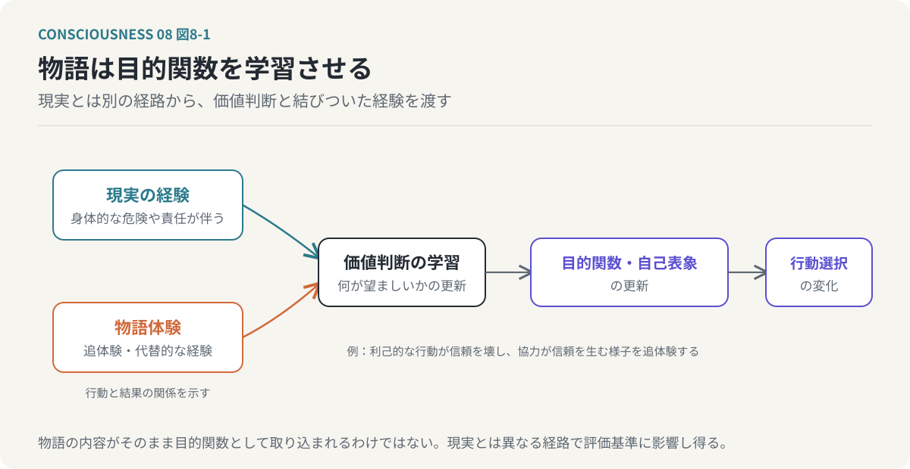
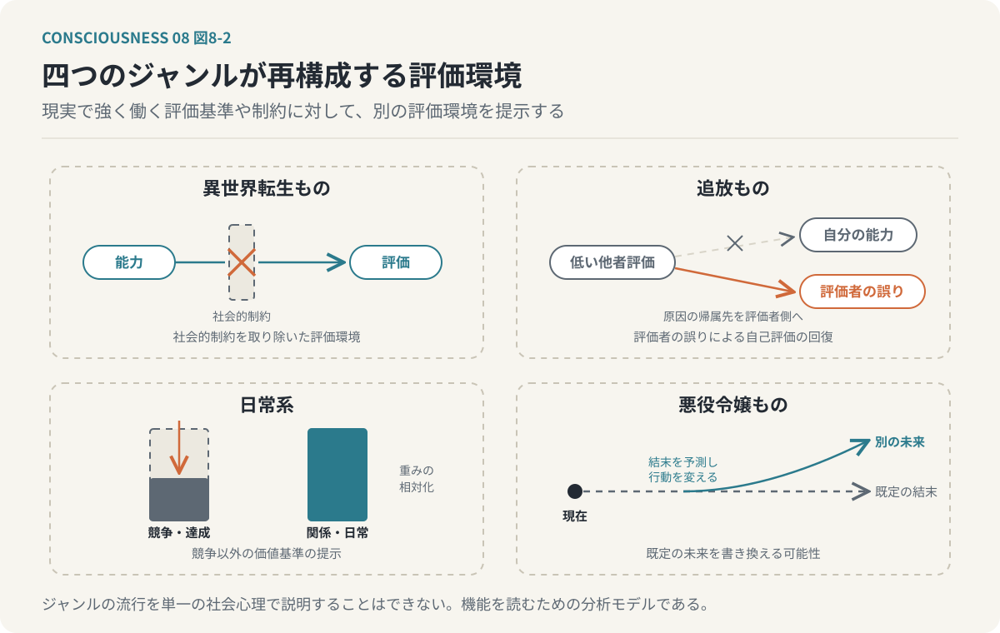
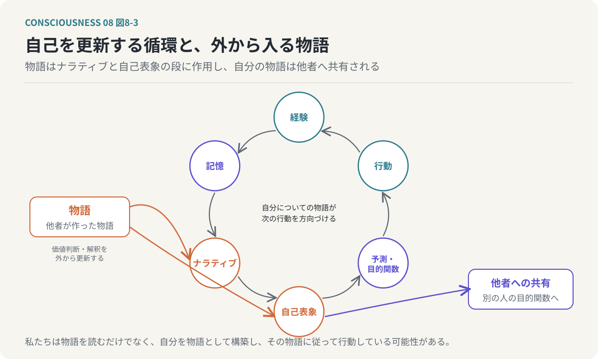

# 第8回　人はなぜ物語を必要とするのか

## 目的関数を学習し修復する装置としての物語

<!-- NAV:TOP -->
[← 第7回](07-dividual-and-extended-self.md) | [連載目次](../README.md) | [第9回 →](09-computational-implementation.md)
<!-- /NAV -->

私たちは、現実には存在しない人物の人生に涙を流す。

小説の登場人物が成功すれば喜び、失敗すれば落胆する。

映画の主人公が困難を乗り越える姿を見て、自分にも何かができるような気持ちになる。

ゲームの中で経験した出来事が、現実の人生について考えるきっかけになることもある。

しかし、ここには不思議なことがある。

私たちは、それが物語であることを知っている。

小説の登場人物は、現実には存在しないかもしれない。

映画で描かれる出来事は、実際には起きていないかもしれない。

ゲームの中で獲得した能力は、現実の身体に備わった能力ではない。

それでも、物語の中で経験した出来事は、現実の感情や価値観に影響する。

なぜだろうか。

これまでの連載では、意識を情報処理システムとして捉え、複数の目的関数から自己表象が形成されるという仮説を検討してきた。

第3回では、「自分」は複数の目的関数の交差点に生まれると考えた。

第4回では、予測処理と目的関数を接続し、人間が世界を予測しながら行動を選択する仕組みを考えた。

第5回では、目的関数間の相互作用と情報統合に注目した。

第7回では、自己が文脈によって変化し、肉体の外側にある対象へも拡張される可能性を考えた。

ここまでの議論を踏まえると、物語の役割について、ひとつの仮説を立てることができる。

**物語とは、人間の目的関数を学習し、修復し、再構成するための情報処理装置ではないか。**

今回は、エンターテイメントをこの観点から考える。

そして、物語が自己を変化させる仕組みを通じて、連載全体の情報処理モデルを統合する。

---

### 1. 物語は娯楽であるだけではない

私たちは、さまざまな理由で物語を楽しむ。

退屈を紛らわせるために映画を見る。

気分転換のために小説を読む。

刺激や達成感を求めてゲームをプレイする。

これらは、エンターテイメントのわかりやすい機能である。

しかし、物語の役割は、それだけではない。

物語を通じて、人間は現実には経験していない状況を疑似的に経験できる。

例えば、歴史小説を読むことで、自分が生きていない時代の社会や人間関係を想像できる。

恋愛小説を読むことで、自分とは異なる立場にある人物の感情や判断を追体験できる。

冒険物語を読むことで、危険や未知の環境に直面したときの判断を考えることができる。

ここで重要なのは、物語が情報を伝えるだけではないという点である。

例えば、「困っている人を助けることは望ましい」と説明するだけなら、短い文章で十分である。

しかし、物語では、困っている人がどのような状況に置かれているのか、その人を助けることで何が起きるのか、助ける側にどのような葛藤が生じるのかを描くことができる。

読者は、その状況を具体的に想像しながら、登場人物の判断を追体験する。

その結果、単なる知識としてではなく、価値判断や感情と結びついた経験として情報を受け取る。

本モデルでは、この働きを目的関数の学習として捉える。

### 2. 物語は目的関数を学習する装置である

第3回では、人間の行動を複数の目的関数によって説明した。

生存、社会的承認、愛着、好奇心、倫理、美意識などの目的関数が、異なる行動や状態を評価する。

しかし、人間はこれらの目的関数を、生まれたときから完成した形で持っているわけではない。

生物学的な基盤に由来する欲求や反応もあれば、社会的な経験を通じて形成される価値判断もある。

例えば、何が社会的に望ましい行動なのかは、文化や時代によって異なる。

他者に対してどのように振る舞うべきか。

困難に直面したときに、どのような選択をすべきか。

どのような人生を成功と考えるか。

これらの価値判断は、経験や学習によって形成される。

物語は、その学習に関与する。

例えば、教養小説を意味するビルドゥングスロマン（Bildungsroman）では、主人公がさまざまな経験を通じて成長する過程が描かれる。

主人公は失敗し、他者と衝突し、自分の価値観を見直す。

読者は、その過程を追体験する。

主人公の判断がどのような結果を生んだのかを知り、自分であればどうするかを考える。

このとき、物語は単なる出来事の記録ではない。

行動と結果、価値判断と社会的評価の関係を示す学習データとして機能している。

本モデルでは、この関係を次のように表現する。

`物語体験 → 価値判断の学習 → 目的関数の更新 → 行動選択の変化`

例えば、物語の中で利己的な行動が他者との関係を破壊し、協力的な行動が信頼を生む様子を経験したとする。

読者は、その経験を通じて、協力や信頼に関する価値判断を更新するかもしれない。

もちろん、物語を読めば必ず価値観が変化するわけではない。

また、物語の内容が、そのまま読者の目的関数として取り込まれるわけでもない。

重要なのは、物語が現実の経験とは異なる経路で、人間の評価基準に影響し得るということである。

この意味で、物語は社会の中で機能するための価値判断を学習する装置として捉えられる。

*図8-1：物語は現実とは別の経路から目的関数を学習させる。行動と結果の関係を追体験させることで、知識ではなく価値判断と結びついた経験として情報を渡す。*

### 3. 物語は傷ついた自己評価を修復する

物語には、もうひとつ重要な働きがある。

それは、現実の経験によって変化した自己評価を、再び調整することである。

例えば、仕事で失敗した人を考えてみよう。

その人は、失敗という出来事を経験する。

そして、その出来事を自分の能力や価値に結びつける。

「自分には能力がない」

「自分は周囲から評価されていない」

「努力しても報われない」

このような自己評価が形成されることがある。

第4回で扱った予測処理の観点から考えると、失敗経験は将来の予測にも影響する。

過去に失敗した経験があれば、似た状況で再び失敗する可能性を高く見積もるかもしれない。

その結果、新しい挑戦を避けるようになることもある。

つまり、失敗経験は単に過去の出来事として記憶されるだけではない。

自己表象や目的関数の評価、将来の行動選択に影響する。

では、このような状態に物語が作用するとしたら、どのような仕組みが考えられるだろうか。

例えば、主人公が不当に低く評価されていたことが明らかになる物語を読む。

主人公の能力は不足していたのではなく、周囲の評価が誤っていたことが示される。

読者は、その物語を通じて、自分の失敗や低い評価について別の解釈が存在することを知る。

あるいは、社会的な成功を目指さず、穏やかな日常を大切にする物語を読む。

その物語では、競争に勝つことや大きな成果を残すことが、必ずしも幸福の条件として描かれない。

読者は、成功や達成以外にも価値があるという評価基準に触れる。

このように、物語は現実の出来事そのものを変更するわけではない。

しかし、出来事に対する評価や解釈を変更する可能性がある。

本モデルでは、これを目的関数の修復、あるいは再較正として捉える。

`現実での失敗 → 自己評価の低下 → 物語による代替的な経験 → 評価基準の再構成`

ただし、「修復」という表現は比喩である。

人間の心理状態が、機械の故障のように単純に修理されるという意味ではない。

また、エンターテイメントが医学的な治療と同等の効果を持つと主張するものでもない。

ここで考えているのは、物語が経験の解釈や価値判断を変化させる機能である。

### 4. 異世界転生ものは、何を修復しているのか

このモデルを用いると、現代のエンターテイメントのジャンルについて、興味深い解釈が可能になる。

まず、異世界転生ものを考えてみたい。

異世界転生ものでは、主人公が現実とは異なる世界へ移動し、新しい人生を始める。

その世界では、現実社会とは異なる評価基準が存在する場合がある。

例えば、現実では評価されなかった知識や能力が、異世界では高く評価される。

現実社会での地位や経歴が、新しい世界では意味を持たなくなる。

新しい世界に移動することで、これまでの制約から解放される。

この構造を、目的関数モデルから考えてみよう。

現実社会では、能力が高くても、必ずしも高い評価を得られるとは限らない。

社会的な地位、所属する組織、人間関係、経済的な条件など、さまざまな要素が評価に影響する。

そのため、自分の能力や努力と、実際に得られる評価が一致しないことがある。

異世界転生ものでは、こうした制約の一部が取り除かれる。

新しい世界では、主人公の能力が直接的に価値へ結びつくように描かれることがある。

つまり、現実社会で成立しなかった能力と評価の対応関係が、物語の中で再構成される。

本モデルでは、これを社会的成功評価の再較正として捉える。

- 現実社会
  - 能力や努力が必ずしも評価に結びつかない。
  - 社会的な制約が存在する。
  - 自己評価と他者評価に不一致が生じる。
- 異世界
  - 現実社会の制約が取り除かれる。
  - 主人公の能力が新しい環境で価値を持つ。
  - 能力と評価の対応が再構成される。

この構造によって、読者は、現実とは異なる評価環境を疑似的に経験する。

ここで修復される可能性があるのは、能力そのものではない。

自分の能力が社会でどのように評価されるべきかという認識である。

もちろん、異世界転生ものの魅力がすべてこの仕組みで説明できるわけではない。

未知の世界への好奇心、冒険、世界観の構築、キャラクターへの愛着など、さまざまな要素が関係する。

それでも、社会的な評価基準を再構成するという観点は、このジャンルの魅力を説明するひとつの仮説となる。

### 5. 追放ものは、評価の失敗を誰に帰属させるのか

次に、追放ものを考えてみたい。

追放ものでは、主人公が所属する組織や集団から、不当に低く評価され、排除される。

しかし、その後、主人公の能力や価値が明らかになる。

主人公を追放した集団は、その判断が誤っていたことを知る。

この構造には、特徴的な評価の反転が存在する。

物語の前半では、主人公は低く評価される。

しかし、後半では、主人公の能力が不足していたのではなく、評価する側が誤っていたことが示される。

ここで、自己評価と他者評価の関係を考える。

人間は、他者からの評価を自己表象に取り込むことがある。

周囲から能力が低いと言われ続ければ、自分自身も能力が低いと考えるようになる場合がある。

このとき、他者評価と自己評価が結びついている。

追放ものは、この関係を切り離す構造を持つ。

主人公の能力は、他者の評価によって決まるものではない。

評価する側が誤っている可能性が示される。

つまり、低い評価の原因を、主人公自身ではなく評価者の側へ帰属させるのである。

本モデルでは、この仕組みを所属・承認欲求に関する目的関数の再較正として捉える。

`低い他者評価 → 自己評価の低下`

という関係に対して、

`低い他者評価 → 評価者の誤り → 自己評価の維持`

という別の解釈を提示する。

ここで重要なのは、現実のすべての低評価が不当であるということではない。

追放ものは、評価の原因について、ひとつの代替的な物語を提示するのである。

読者は、その物語を通じて、他者からの評価と自分自身の価値を必ずしも同一視する必要がないという解釈に触れる。

この点に、追放ものが提供する心理的な機能のひとつがあると考えられる。

### 6. 日常系は、競争という評価軸を無効化する

異世界転生ものや追放ものでは、主人公の能力や価値が再評価される。

一方、日常系と呼ばれる作品には、別の構造がある。

日常系では、大きな成功や劇的な成長が物語の中心にならない場合がある。

登場人物が日々の生活を送り、友人と会話し、食事を楽しみ、穏やかな時間を過ごす。

物語の中で重大な事件が起きないこともある。

では、なぜこのような作品が支持されるのだろうか。

目的関数モデルでは、競争や達成に関する評価基準の働きに注目できる。

現実社会では、多くの行動が成果によって評価される。

仕事では生産性や業績が求められる。

学校では試験の成績が評価される。

社会的な活動でも、他者との比較が行われる。

このような環境では、達成や競争に関する目的関数が強く働く。

しかし、すべての時間を競争や達成の基準で評価する必要はない。

日常系の物語では、競争や成果とは異なる価値が前面に出る。

友人と会話すること。

おいしい食事を楽しむこと。

季節の変化を感じること。

何も特別なことが起きない時間を過ごすこと。

これらは、必ずしも社会的な成功や達成によって評価されるものではない。

本モデルでは、日常系の機能を、競争や達成に関する目的関数の重みを相対的に低下させることとして捉える。

競争に勝たなくてもよい。

成長し続けなくてもよい。

成果を残さなくてもよい。

そのような環境を物語の中に構築することで、日常系は現実社会とは異なる価値判断を経験させる。

重要なのは、達成という目的関数を完全に否定するわけではないという点である。

達成を重視する場面もあれば、そうでない場面もある。

日常系は、何を重視するかという目的関数の重み付けに、別の選択肢を提示しているのである。

### 7. 悪役令嬢ものは、決められた運命を書き換える

悪役令嬢ものにも、特徴的な構造がある。

主人公は、自分が物語の中で悪役として位置づけられていることを知る。

そして、そのまま物語が進めば、不幸な結末を迎える可能性があることを認識する。

そこで主人公は、既定の展開を回避するために行動する。

この構造には、他のジャンルとは異なる特徴がある。

主人公が、自分の置かれている物語の構造そのものを認識していることである。

通常、物語の登場人物は、自分がどのような結末へ向かうかを知らない。

しかし、悪役令嬢ものでは、主人公が物語の展開に関する知識を持つ場合がある。

そのため、主人公は現在の状況だけでなく、将来の展開を予測しながら行動できる。

ここで、第4回で扱った予測処理を思い出してみたい。

人間は世界モデルを用いて、将来の状態を予測する。

そして、予測された結果に基づいて行動を選択する。

悪役令嬢ものでは、この仕組みが物語の中心に置かれている。

主人公は、将来の不幸な結末を予測する。

その予測を前提として、現在の行動を変更する。

その結果、当初予測されていた未来が変化する。

つまり、主人公は世界モデルを利用して、自分の未来を再構成しようとするのである。

本モデルでは、この構造を、運命決定論に対する抵抗として解釈する。

現実社会でも、人間はさまざまな条件によって将来が制約されていると感じることがある。

生まれ育った環境。

社会的な地位。

過去の失敗。

他者から与えられた役割。

これらによって、自分の未来がすでに決まっているように感じる場合がある。

悪役令嬢ものは、そのような既定の展開を書き換えられる可能性を提示する。

重要なのは、単に運命に逆らうことではない。

自分が置かれている状況を、より高い視点から認識することである。

そして、その認識を利用して、自分の行動を変更する。

このような働きは、メタ認知と関係する。

メタ認知とは、自分自身の認知や判断を対象として認識する働きである。

本モデルでは、悪役令嬢ものを、自己や世界に関する予測を再検討し、将来の可能性を再構成する物語として捉える。

### 8. ヒットコンテンツは、何を修復しているのか

ここまで、四つのジャンルを目的関数モデルから考えてきた。

整理すると、次のようになる。

| ジャンル | 主な評価対象 | 物語が提示する再構成 |
|---|---|---|
| 異世界転生もの | 社会的成功・能力評価 | 社会的制約を取り除いた評価環境 |
| 追放もの | 所属・承認 | 評価者の誤りによる自己評価の回復 |
| 日常系 | 達成・競争 | 競争以外の価値基準の提示 |
| 悪役令嬢もの | 運命・自己決定 | 既定の未来を書き換える可能性 |

*図8-2：四つのジャンルが再構成する評価環境。いずれも現実で強く働く評価基準や制約に対して、別の評価環境を提示している。*

これらのジャンルには、共通する構造がある。

現実社会で強く働いている評価基準や制約に対して、別の評価環境を提示していることである。

異世界転生ものでは、能力と評価の関係が再構成される。

追放ものでは、他者評価と自己評価の関係が再構成される。

日常系では、競争や達成を中心とする評価基準が相対化される。

悪役令嬢ものでは、決められた未来と自己決定の関係が再構成される。

ここから、エンターテイメントのヒットについて、ひとつの仮説を立てることができる。

**多くの人が現実社会で抱えている評価上の葛藤に対して、効果的な再解釈や代替体験を提供する物語は、支持を集める可能性がある。**

この仮説は、コンテンツの企画やマーケティングにも応用できる。

例えば、ある時代に社会的な競争圧力が強まっているなら、その競争から解放される物語が魅力を持つかもしれない。

他者から正当に評価されていないと感じる人が多ければ、評価の反転を描く物語が支持されるかもしれない。

将来への閉塞感が強い環境では、既定の運命を書き換える物語が魅力を持つかもしれない。

ただし、ジャンルの流行を単一の社会心理だけで説明することはできない。

作品の品質、流通プラットフォーム、読者層、文化的な慣習、推薦アルゴリズムなど、多くの要素が関係する。

また、同じ作品であっても、読者によって魅力を感じる理由は異なる。

ここで提示しているのは、ヒットコンテンツを理解するためのひとつの機能的な分析モデルである。

### 9. なぜ架空の出来事が現実の自己を変えるのか

ここで、今回の最初の問いに戻りたい。

なぜ、現実には存在しない出来事が、人間の価値観や自己評価に影響するのだろうか。

第4回では、人間の脳が外界を直接認識するのではなく、感覚情報から世界モデルを構築しているという考え方を取り上げた。

私たちは、過去の経験から世界の状態を予測し、予測と実際の入力を比較しながら世界モデルを更新する。

この仕組みを考えると、物語の働きを理解するための手がかりが得られる。

物語を読んでいるとき、私たちは文章を単なる記号の列として処理しているわけではない。

登場人物の置かれた状況を想像する。

登場人物がどのような行動を選ぶかを予測する。

その行動によって何が起きるかを考える。

予想外の出来事が起きれば、物語世界についての理解を更新する。

つまり、物語を理解する過程には、現実世界を理解するときと共通する認知的な処理が含まれている。

もちろん、物語の理解と現実の経験が完全に同じという意味ではない。

物語には、現実の身体的な危険や社会的な責任が直接伴わない場合が多い。

また、物語の内容が現実の出来事でないことを、読者は通常理解している。

それでも、物語の中で示される行動と結果の関係は、価値判断や将来の予測に影響する可能性がある。

例えば、物語の中で主人公が失敗を乗り越えたとする。

読者は、自分自身が同じ成功を経験したわけではない。

しかし、失敗が必ずしも最終的な結果ではないという、新しい行動と結果の関係を学習することはできる。

この意味で、物語は現実の経験とは異なる経路から、世界モデルや自己表象を更新するための情報を提供している。

本モデルでは、これを経験の間接的な学習として捉える。

### 10. 没入とは、自己と物語世界の境界が曖昧になることなのか

ここで、物語への没入について考えてみたい。

映画を見ているとき、時間を忘れることがある。

小説を読んでいるとき、周囲の音が気にならなくなることがある。

ゲームに熱中しているとき、画面上のキャラクターの動きを、自分自身の行動のように感じることがある。

このような状態を、一般に没入と呼ぶ。

没入しているとき、私たちは物語世界に強く注意を向けている。

登場人物の行動を予測し、その結果に感情的に反応する。

物語世界の出来事が、自分自身に関係する出来事のように感じられる場合もある。

第7回では、自己がゲームキャラクターやアバターなど、肉体の外側へ拡張される可能性を考えた。

物語への没入も、自己表象と外部の情報との関係が変化する現象として捉えられるかもしれない。

ただし、物語世界の出来事を自分のことのように感じることと、物語世界そのものが自分の一部になることは、必ずしも同じではない。

読者は、登場人物に共感しながらも、自分と登場人物を区別できる。

また、物語の内容を強く理解していても、必ずしも自己同一性が変化するわけではない。

したがって、没入を単純に自己と物語世界の境界の消失として説明することは適切ではない。

本モデルでは、没入を次のような複数の処理が組み合わさった状態として考える。

- 物語世界への注意の集中
- 登場人物の状態や行動の予測
- 登場人物への感情的な反応
- 自己の経験と物語の出来事の関連づけ
- 物語世界の情報による価値判断の更新

これらの処理が強く結びつくことで、物語の経験が自己表象や目的関数へ影響する可能性がある。

### 11. 物語への没入と統合情報理論

ここで、第5回で取り上げた統合情報理論（IIT）との関係を考えてみたい。

IITでは、意識体験とシステム内部の統合的な因果構造の関係が重視される。

本連載では、目的関数、予測処理、記憶、自己表象などの相互作用から、自己が形成されるという仮説を考えてきた。

では、物語への没入は、こうした情報処理の統合状態の変化として説明できるのだろうか。

例えば、物語を読んでいるとき、読者の内部では次のような処理が行われる。

物語の内容を理解する。

登場人物の状態を推測する。

将来の展開を予測する。

自分自身の経験と比較する。

登場人物の判断を評価する。

これらの処理は、完全に独立しているわけではない。

物語の展開に対する予測が、登場人物への感情を変える。

登場人物への感情が、行動への評価を変える。

その評価が、自分自身の経験についての解釈を変える。

つまり、物語の理解には、複数の情報処理の相互作用が存在する。

本モデルでは、この相互作用を工学的な統合度として評価することを考える。

例えば、自己に関する処理と物語に関する処理の結びつきを、概念的に次のように表現できる。

`J_total = J_self + J_narrative + J_interaction`

ここで、

- `J_self`：自己に関する情報処理の統合度
- `J_narrative`：物語に関する情報処理の統合度
- `J_interaction`：自己と物語の処理間に生じる相互作用
- `J_total`：全体の統合状態を表す近似指標

である。

ただし、この式は本モデル独自の概念的な表現であり、IITのΦを表すものではない。

IITの統合情報量は、このように単純に加算できるとは限らない。

また、物語世界そのものが、読者の脳とひとつの意識システムを形成するという意味でもない。

ここで考えているのは、物語に関する情報が読者の内部処理へ取り込まれ、自己に関する処理と相互作用するということである。

この相互作用が強くなるほど、物語の経験が自己表象や目的関数に影響しやすくなるのではないか。

これが本モデルの仮説である。

この仮説を検証するためには、没入度、注意、感情、記憶、価値判断の変化などを測定する必要がある。

さらに、これらの変化と神経活動の統合状態との関係を調べることも考えられる。

ただし、没入度が高いことから、IITのΦが高いと直接結論づけることはできない。

心理的な没入と因果的な情報統合は、区別して扱う必要がある。

### 12. 物語は分人を変化させるのか

第7回では、自己を文脈依存的な分人の集合として考えた。

職場、家庭、趣味などの状況によって、異なる目的関数の重み付けが現れる。

ここで、物語が分人に与える影響を考えてみたい。

例えば、ある人が仕事では競争や達成を重視しているとする。

しかし、日常系の物語を通じて、競争や成果とは異なる価値観に触れる。

その経験によって、仕事以外の時間を重視するようになるかもしれない。

あるいは、失敗から立ち直る物語を読んだことで、新しい挑戦に対する不安が小さくなるかもしれない。

このような変化は、単なる知識の獲得ではない。

どの目的関数を重視するかという、重み付けの変化として考えることができる。

第7回では、分人を次のように表現した。

`S(c) = Σⱼ πⱼ(c)・Personⱼ`

ここで、

- `Personⱼ`：j番目の分人
- `πⱼ(c)`：文脈に依存する混合係数

である。

物語による経験が、ある分人の目的関数の重みを変える場合がある。

また、新しい価値判断を獲得することで、これまでとは異なる分人の振る舞いが現れる場合も考えられる。

例えば、物語を読む前は、失敗を避けることを重視していた人が、物語を通じて挑戦そのものに価値を見いだすようになる。

この場合、同じ状況に直面しても、以前とは異なる判断を行う可能性がある。

本モデルでは、こうした変化を、経験による目的関数の重みと自己表象の更新として捉える。

物語は、自分が直接経験していない状況を通じて、将来の行動選択に影響する可能性がある。

### 13. 私たちは自分自身の物語を作っている

ここまで、他者が作った物語を読むことについて考えてきた。

しかし、私たちは日常的に、自分自身についても物語を作っている。

例えば、過去の出来事を振り返り、「あの失敗があったから今の自分がある」と考える。

あるいは、「自分は昔から新しいことに挑戦する人間だった」と説明する。

こうした説明は、過去の出来事を単に列挙したものではない。

出来事の間に意味や因果関係を与え、ひとつの人生として整理している。

第3回では、統一された自己は事後的に構築されるナラティブであるという仮説を提示した。

第7回では、分人が異なる行動を取っても、記憶とナラティブによって同じ個人としての連続性が維持されると考えた。

ここで重要なのは、ナラティブが過去を説明するだけではないという点である。

自分についての物語は、将来の行動にも影響する。

例えば、「自分は挑戦する人間だ」という自己認識を持つ人は、新しい機会に直面したとき、挑戦を選びやすくなるかもしれない。

「自分は失敗しやすい人間だ」という自己認識を持つ人は、同じ状況で行動を避けるかもしれない。

つまり、自分についての物語は、自己表象として将来の行動選択へ影響する。

そして、行動の結果が、再び自分についての物語を更新する。

この関係を整理すると、次のようになる。

1. 経験が生じる。
2. 経験が記憶される。
3. 記憶がナラティブとして整理される。
4. ナラティブから自己表象が形成される。
5. 自己表象が将来の予測や目的関数に影響する。
6. 行動が選択される。
7. 行動の結果が新たな経験となる。

この循環によって、自己は継続的に更新される。

**私たちは物語を読むだけではない。自分自身を物語として構築し、その物語に従って行動している可能性がある。**

*図8-3：自己を更新する循環。外部の物語はナラティブと自己表象の段に作用し、自分についての物語は他者へ共有されて別の人の目的関数にも影響する。*

### 14. 物語は他者の目的関数にも影響する

自己についてのナラティブは、必ずしも自分の内部に閉じているわけではない。

私たちは、自分の経験や考えを他者へ伝える。

会話、文章、SNS、映像など、さまざまな方法で自分についての物語を共有する。

他者は、その物語を受け取り、自分自身の経験や価値観と比較する。

そして、場合によっては、自分の価値判断を変化させる。

例えば、ある人の失敗談を聞いたことで、自分の失敗に対する考え方が変わることがある。

他者の挑戦について知ったことで、自分も挑戦してみようと考えることがある。

他者の経験を通じて、自分が経験していない状況について学ぶこともできる。

このように、物語は個人の内部だけでなく、個人間でも情報を伝達する。

その結果、ある人の経験が、別の人の目的関数や自己表象に影響する可能性がある。

ここで、第1回で取り上げた共通体験の変化を思い出してみたい。

かつて、学校や職場などの物理的な環境が、物語の共通基盤として機能していた。

現在では、ゲームやSNS、動画配信、バーチャルな世界での体験も、共通体験として共有されている。

つまり、人間の価値判断を形成するための学習データが、物理的な現実に限定されなくなっている。

デジタル空間での経験も、他者と共有され、社会的な価値観の形成に関与する。

本モデルでは、この過程を、目的関数の社会的な伝播として捉える。

ただし、価値観がコンピューターのプログラムのように、そのままコピーされるわけではない。

他者の経験をどう解釈し、どの程度取り入れるかは、受け手の記憶、価値観、状況などによって異なる。

それでも、物語を通じた価値判断の学習が、個人の内部を超えて社会的に広がるという構造は重要である。

### 15. 意識・自己・物語を統合する

ここまでの議論を通じて、本連載で考えてきた意識の情報処理モデルを、ひとつの構造として整理できる。

まず、人間は感覚器官を通じて外界の情報を受け取る。

脳は、その情報をもとに世界の状態を推定し、将来を予測する。

予測と実際の入力の差によって、世界モデルが更新される。

一方、人間には複数の目的関数が存在する。

生存、愛着、承認、好奇心、倫理、美意識などの目的関数が、異なる状態や行動を評価する。

目的関数は相互に作用し、その評価や重み付けが状況によって変化する。

この相互作用の中で、身体、能力、価値観、記憶などに関する自己表象が形成される。

自己表象は、情報処理の結果であると同時に、将来の予測や行動選択へ影響する。

さらに、記憶とナラティブによって、異なる経験や分人がひとつの人生として結びつけられる。

物語は、この循環に外部から影響する。

物語を通じて新しい価値判断を学習する。

過去の経験について別の解釈を獲得する。

自己評価を更新する。

その結果、将来の行動選択が変化する可能性がある。

この全体を、次のように整理できる。

- 外界との相互作用
  - 感覚情報の受信
  - 世界モデルによる予測
  - 予測誤差による更新
- 目的関数による評価
  - 生存
  - 愛着
  - 社会的承認
  - 好奇心
  - 倫理
  - 美意識
- 自己の形成
  - 目的関数間の相互作用
  - 自己表象の形成
  - 文脈に応じた分人の表出
  - 肉体外への自己の拡張
- 時間的な自己の維持
  - エピソード記憶
  - ナラティブの生成
  - 自己表象の更新
- 社会的な拡張
  - 物語の共有
  - 他者の経験からの学習
  - 目的関数や価値判断への影響
  - 新しい社会的な共通体験の形成

この構造では、自己は固定的な存在ではない。

外界から情報を受け取り、目的関数に基づいて行動し、その結果を記憶し、自己表象を更新する。

そして、更新された自己表象が、次の行動選択へ影響する。

意識と自己は、この循環的な情報処理の中で考えられる。

ただし、このモデルは、自己の機能的な形成と変化を説明するための仮説である。

主観的な意識体験そのものが、なぜ存在するのかという問題は、第6回で検討したとおり、未解決のままである。

### 16. 物語は「自分」を作り替える技術なのか

ここで、今回の議論をさらに進めてみたい。

物語が目的関数や自己表象を変化させるのであれば、物語を単なる娯楽としてではなく、自己を再構成するための技術として捉えることができるかもしれない。

例えば、ある人が失敗によって自己評価を低下させているとする。

その人は、失敗という出来事を、自分の能力の不足として解釈している。

しかし、別の物語に触れることで、失敗を学習の過程として捉え直す可能性がある。

その結果、失敗に対する評価が変化する。

新しい挑戦への抵抗が小さくなるかもしれない。

また、社会的な成功を最も重要な価値としていた人が、日常的な関係や穏やかな時間を重視する物語に触れることで、価値判断を変える可能性もある。

このように、物語は現実の出来事を変更することなく、出来事に対する評価基準を変更し得る。

これは、第4回で扱った予測処理とも関係する。

私たちは、世界モデルによって将来を予測する。

その予測は、過去の経験や価値判断に依存する。

物語によって新しい経験の解釈を獲得すれば、将来の予測も変化する可能性がある。

そして、予測が変化すれば、行動選択も変化する。

ここから、本連載の重要な帰結が導かれる。

**「自分」を変えるために、必ずしも現実の環境そのものを変える必要はない。世界を評価し、予測する内部モデルが変化すれば、同じ環境に対する行動も変わり得る。**

もちろん、現実の環境を変えることが不要だという意味ではない。

また、物語によってあらゆる問題が解決できるわけでもない。

現実の制約や身体的な条件、社会的な関係は、依然として存在する。

しかし、同じ現実に対しても、異なる評価や解釈が可能である。

そして、その違いが行動を変化させる可能性がある。

物語は、そのための新しい評価基準や予測モデルを提供する装置として機能するのである。

### おわりに：私たちは物語によって「自分」を更新している

今回は、エンターテイメントを目的関数の学習・修復装置として捉えた。

物語は、現実には経験していない状況を疑似的に経験させる。

その経験を通じて、人間は行動と結果の関係を学習し、価値判断を変化させる可能性がある。

また、物語は現実の経験に対して別の解釈を提示する。

異世界転生ものは、能力と社会的評価の関係を再構成する。

追放ものは、他者評価と自己評価の関係を再構成する。

日常系は、競争や達成以外の価値を提示する。

悪役令嬢ものは、決められた未来を書き換える可能性を示す。

これらの物語は、異なる方法で目的関数や自己表象へ影響する可能性がある。

さらに、物語への没入では、登場人物への感情、将来の予測、自己の記憶などが相互に作用する。

その結果、物語の中で得られた情報が、現実の自己に関する判断へ反映されることがある。

私たちは、他者が作った物語を読むだけではない。

自分自身の経験を物語として整理し、その物語をもとに将来の行動を選択している。

そして、自分についての物語は、他者にも共有される。

他者は、その物語から学習し、自分自身の価値判断を変えることがある。

このように、物語は個人の内部と社会の間を循環する。

本連載では、意識を情報処理システムとして捉え、その中で自己が形成され、変化するという仮説を検討してきた。

その議論を通じて見えてきたのは、自己が固定的な実体ではなく、経験によって更新され続ける情報処理上の構造だということである。

そして、物語は、その更新に関与する重要な情報のひとつである。

**私たちは、物語の中に自分を見いだすだけではない。物語を通じて、自分自身を作り替えているのかもしれない。**

ここで、次の問いが生じる。

これまで検討してきた自己の情報処理モデルを、実際に計算機上で動作させることはできるのだろうか。

複数の目的関数を持ち、世界を予測し、行動を選択するシステム。

過去の経験を記憶し、自己表象を形成するシステム。

状況によって異なる分人を表出し、物語によって価値判断を更新するシステム。

こうした仕組みは、少なくとも機能的なモデルとしては、計算機上で実装できる可能性がある。

もちろん、その計算機に主観的な意識体験が生じるかどうかは別問題である。

しかし、自己表象を持つことによって行動がどのように変わるかを観測することはできる。

目的関数間の相互作用が、判断や適応にどのような影響を与えるかを検証することもできる。

次回は、これまでの理論的な仮説を、計算可能なモデルへ変換する。

自己を持つAIを作るとは、何を実装することなのか。

そして、何をもって自己の機能が実現されたと判断できるのか。

**意識そのものを作ることはできなくても、「自分」という概念が情報処理の中でどのように働くのかを、計算機によって検証することはできる。**

<!-- NAV:BOTTOM -->
---

[← 第7回](07-dividual-and-extended-self.md) | [連載目次](../README.md) | [第9回 →](09-computational-implementation.md)
<!-- /NAV -->
