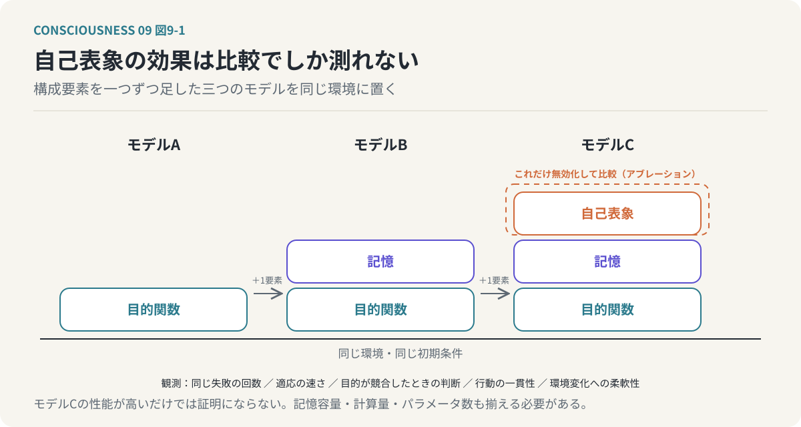
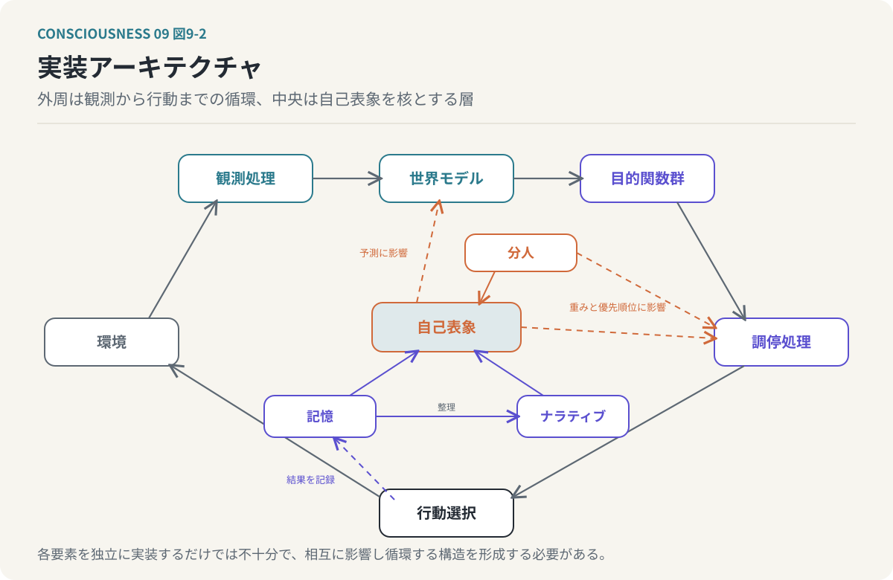

# 第9回　意識の情報処理モデルを計算機で実現する

## 自己を持つAIの機能的近似

<!-- NAV:TOP -->
[← 第8回](08-narrative-and-self.md) | [連載目次](../README.md)
<!-- /NAV -->

私たちは、自分という存在を当然のものとして受け入れている。

自分には過去がある。

自分には価値観がある。

自分には得意なことと苦手なことがある。

そして、過去の経験をもとに、これから何をするべきかを判断している。

しかし、これらの働きを情報処理として考えた場合、何が必要になるのだろうか。

例えば、ある計算機が複数の目的を持ち、状況に応じて行動を選択するとする。

その計算機は、過去の経験を記憶し、失敗から学習する。

さらに、自分自身の能力や価値観についての内部モデルを持ち、そのモデルを利用して将来の行動を決定する。

このとき、その計算機は「自分」を持っているといえるのだろうか。

もちろん、人間と同じ意味で意識を持つと結論づけることはできない。

計算機が自己についての情報を処理することと、自分が存在しているという主観的な体験を持つことは、別の問題だからである。

しかし、ここには検証可能な問いがある。

**「自分」という内部表象を持つことによって、計算機の情報処理や行動はどのように変化するのだろうか。**

これまでの連載では、意識を情報処理システムとして捉え、その中で自己が形成されるという仮説を検討してきた。

第2回では、意識と自己表象を区別した。

第3回では、複数の目的関数の相互作用から自己が創発するという仮説を提示した。

第4回では、予測処理と目的関数を接続した。

第5回では、情報統合と自己の関係を検討した。

第6回では、機能的意識と現象的意識を区別した。

第7回では、文脈によって変化する分人と、肉体外へ拡張される自己を考えた。

第8回では、物語が目的関数や自己表象を更新する可能性を考えた。

今回は、これらの議論を計算機上で動作するモデルへ変換する。

目指すのは、人間と同じ意識を持つAIの完成ではない。

**自己の形成、維持、変化という機能を計算機上で近似し、その働きを観測可能な形で検証することである。**

---

### 1. 意識を実装するのではなく、その機能を近似する

まず、何を実装し、何を実装しないのかを明確にしたい。

これまでの連載では、意識に関する二つの問題を区別してきた。

ひとつは、機能的な問題である。

人間がどのように外界を認識し、未来を予測し、行動を選択し、自己についての情報を維持するのかという問題である。

もうひとつは、現象的な問題である。

なぜ情報処理に、痛みや喜び、赤い色を見るという主観的な体験が伴うのかという問題である。

今回、計算機によって実現しようとするのは前者である。

具体的には、次の機能を対象とする。

- 外界の状態を観測する。
- 観測から世界の状態を推定する。
- 将来の状態を予測する。
- 複数の目的関数によって行動を評価する。
- 目的関数間の矛盾を調停する。
- 自分自身に関する内部表象を形成する。
- 過去の経験を記憶する。
- 経験によって自己表象を更新する。
- 文脈によって異なる行動傾向を表出する。
- 物語から新しい価値判断を学習する。

これらは、一定の条件を定義すれば計算機上で実装できる。

一方、主観的な体験が生じているかどうかを、これらの機能の実装だけで確認することはできない。

したがって、本モデルでいう「自己を持つAI」とは、自己についての情報を内部状態として保持し、その情報を自身の判断や行動へ利用するシステムを意味する。

それは、人間と同じ主観的な自己意識を持つという意味ではない。

この区別を維持することで、意識という未解決の問題を抱えたままでも、自己の機能について実験できるようになる。

### 2. まず、計算機にとっての「世界」を定義する

自己を持つAIを実装する場合、最初に考えるべきことは、AIにどのような世界を与えるかである。

現実の世界は極めて複雑である。

視覚、聴覚、触覚、身体の状態、他者との関係など、膨大な情報が存在する。

最初から現実世界のすべてを再現する必要はない。

むしろ、自己の形成に関係する要素だけを取り出した、小さな仮想環境から始める方がよい。

例えば、計算機上に次のような環境を構築する。

エージェントには、エネルギーという内部資源がある。

行動するたびにエネルギーを消費する。

環境には、資源を獲得できる場所と、危険が存在する場所がある。

未知の場所を探索すると、新しい情報を獲得できる。

さらに、他のエージェントが存在し、協力や競争ができる。

この環境で、エージェントは次のような選択を行う。

資源を獲得するか。

危険を避けるか。

未知の場所を探索するか。

他者と協力するか。

自分の利益を優先するか。

重要なのは、エージェントに世界の完全な情報を与えないことである。

第4回では、人間の脳が外界そのものを直接認識できず、感覚情報から世界を推定すると考えた。

計算機モデルでも、この構造を近似する。

エージェントが受け取れるのは、環境の一部に関する観測情報だけとする。

観測できない部分については、過去の経験から推測する。

そして、自分の行動によって環境が変化した結果を観測し、世界モデルを更新する。

この構造によって、単純な条件分岐で行動するプログラムとは異なる、予測に基づく意思決定を検討できる。

### 3. 世界モデルと予測処理を実装する

第4回では、脳が世界モデルを利用して将来の状態を予測するという考え方を取り上げた。

この仕組みを計算機上で近似するために、部分観測マルコフ決定過程（Partially Observable Markov Decision Process：POMDP）を利用できる。

POMDPは、環境の状態を直接すべて観測できない条件で、行動を選択するための数学的な枠組みである。

例えば、エージェントが未知の場所へ移動する場面を考える。

その場所には、資源が存在するかもしれない。

危険が存在するかもしれない。

しかし、移動する前には確実なことはわからない。

エージェントは、過去の経験や現在の観測から、それぞれの可能性を推定する。

この推定を、信念状態（Belief State）として表す。

`b_t(s) = P(s_t = s | o_1:t, a_1:t-1)`

ここで、

- `b_t(s)`：時刻tにおいて環境が状態sにあると考える確率
- `o`：観測情報
- `a`：過去に選択した行動
- `s`：実際の環境状態

である。

エージェントは、この信念状態を利用して行動を選択する。

例えば、ある場所に資源が存在する確率が高く、危険が存在する確率が低ければ、その場所への移動を選びやすくなる。

一方、危険が存在する可能性が高ければ、移動を避けるかもしれない。

そして実際に移動した結果、新しい観測を得る。

その観測によって、信念状態を更新する。

これが、世界モデルを利用した予測処理の基本的な近似である。

ただし、POMDPを利用したからといって、人間の脳の予測処理を再現したことにはならない。

POMDPは部分観測下の意思決定を表現する数学的な枠組みであり、人間の神経活動そのものを説明するものではない。

ここでは、予測と観測の循環を計算可能な形式で表現するために利用する。

### 4. 複数の目的関数を実装する

次に、第3回で提示した目的関数モデルを実装する。

仮想環境のエージェントに、複数の目的関数を与える。

例えば、次のようなものが考えられる。

- 生存
  - エネルギーを維持する。
  - 危険を回避する。
  - 活動を継続できる状態を保つ。
- 効率
  - 少ない資源で目的を達成する。
  - 無駄な移動や行動を減らす。
- 好奇心
  - 未知の場所を探索する。
  - 新しい情報を獲得する。
- 社会的承認
  - 他のエージェントからの信頼を獲得する。
  - 協力関係を維持する。
- 倫理的整合性
  - 定義された行動規範を守る。
  - 他者への不利益を抑える。

これらの目的関数は、必ずしも同じ行動を高く評価しない。

例えば、未知の場所を探索する行動は、好奇心の目的関数では高く評価される。

しかし、安全性の目的関数では低く評価されるかもしれない。

他者に資源を分配する行動は、社会的承認や倫理的整合性の観点では望ましい。

一方、自分の資源を維持するという観点では不利になる場合がある。

このような競合を、計算機上で意図的に発生させる。

目的関数を次のように定義する。

`F = {f₁, f₂, ..., fₙ}`

各目的関数は、状態と行動を入力として評価値を返す。

`fᵢ(s, a)`

そして、総合的な行動評価を次のように定義する。

`U(s, a, c) = Σᵢ wᵢ(s, c)・fᵢ(s, a)`

ここで、

- `s`：現在の推定状態
- `a`：候補行動
- `c`：文脈
- `wᵢ(s, c)`：状態と文脈に応じた目的関数の重み

である。

この式を利用して、複数の目的を考慮した行動選択を実装できる。

ただし、倫理や安全のような一部の基準は、単なる重み付き評価ではなく、制約条件として扱う必要がある場合もある。

例えば、禁止された行動は、他の目的関数で高く評価されても選択対象から除外する。

このように、実装では重み付き最適化と制約条件を区別する。

重要なのは、目的関数を単に複数用意することではない。

目的関数間の競合が生じたとき、どのように優先順位を決めるかを観測できる構造にすることである。

### 5. 自己表象を内部状態として実装する

ここから、今回の中心となる自己表象の実装へ進む。

まず、自己表象を持たないエージェントを考える。

このエージェントは、現在の状態を観測し、目的関数によって行動を評価する。

過去の経験を利用する場合もあるが、自分自身についての統合的な内部モデルは持たない。

例えば、資源が不足していれば資源を獲得する。

危険があれば回避する。

未知の場所があれば探索する。

このような行動は、目的関数と世界モデルだけでも実現できる。

では、自己表象を導入すると何が変わるのだろうか。

自己表象には、例えば次のような情報を保持する。

- 自分の能力
  - 探索の成功率
  - 危険を回避する能力
  - 他者と協力する能力
- 自分の価値観
  - 安全性をどの程度重視するか
  - 好奇心をどの程度重視するか
  - 他者との関係をどの程度重視するか
- 自分の経験
  - 過去に成功した行動
  - 過去に失敗した行動
  - 他者から受けた評価
- 自分の傾向
  - 危険な状況でどのような選択をしやすいか
  - 未知の状況にどの程度積極的か
  - 他者との協力をどの程度選ぶか

これらを統合した内部状態を、自己表象 `S_t` として定義する。

`S_t = (Ability_t, Value_t, Experience_t, Tendency_t)`

ここで重要なのは、自己表象を単なる記録として扱わないことである。

自己表象は、将来の判断へ影響する必要がある。

例えば、探索に何度も失敗した経験から、エージェントが自分の探索能力を低く評価するようになったとする。

その自己評価が将来の行動選択に反映されれば、同じ環境に直面しても、以前とは異なる判断を行う可能性がある。

反対に、他者との協力によって成功した経験から、自分は協力に適していると認識するようになれば、将来の行動で協力を選びやすくなるかもしれない。

このように、自己表象は行動の結果によって形成され、次の行動選択へ影響する。

`S_(t+1) = Update(S_t, o_t, a_t, r_t)`

ここで、

- `S_t`：現在の自己表象
- `o_t`：観測
- `a_t`：行動
- `r_t`：行動結果に対する評価
- `Update`：自己表象の更新処理

である。

そして、行動選択にも自己表象を利用する。

`a_t = Policy(b_t, S_t, F, W_t)`

この構造によって、自己表象は単なる行動履歴の要約ではなく、意思決定に影響する内部状態となる。

**本モデルで実装する「自分」とは、自身の状態を表現し、その表現が将来の行動を変える情報処理上の構造である。**

### 6. 自己表象が本当に必要なのかを検証する

ここで、重要な問題がある。

自己表象を実装したエージェントが複雑な行動を示したとしても、それだけでは自己表象の効果を証明できない。

なぜなら、自己表象を持たないシステムでも、複雑な行動を実現できる可能性があるからである。

例えば、過去の成功率を記録して行動選択に利用するだけなら、自己表象を導入しなくても実現できる。

目的関数の重みを経験に応じて更新する仕組みも、自己表象なしで実装できる。

そのため、自己表象の必要性を検討するには、比較実験が必要となる。

ここでは、三つのエージェントを考える。

#### モデルA：目的関数のみ

- 現在の観測から行動を選択する。
- 複数の目的関数を持つ。
- 目的関数の重みは固定する。
- 経験による内部状態の更新は行わない。

#### モデルB：目的関数と記憶

- 複数の目的関数を持つ。
- 過去の経験を記憶する。
- 経験に応じて世界モデルや行動方針を更新する。
- 自己についての統合的な表象は持たない。

#### モデルC：目的関数・記憶・自己表象

- 複数の目的関数を持つ。
- 過去の経験を記憶する。
- 自分の能力や価値観に関する自己表象を持つ。
- 自己表象を行動選択へ反映する。
- 経験によって自己表象を更新する。

これらのモデルに、同じ初期条件と同じ環境を与える。

そして、行動の違いを観測する。

例えば、次のような評価を行う。

- 同じ失敗を繰り返す回数
- 未知の環境への適応速度
- 目的関数が競合する状況での判断
- 長期的な行動の一貫性
- 環境が変化したときの柔軟性

さらに、モデルCから自己表象だけを取り除く実験も行う。

このように、特定の構成要素を無効化して効果を比較する方法を、アブレーション（Ablation）と呼ぶ。

自己表象を無効化することで、行動の一貫性や適応性が低下するなら、その自己表象が情報処理上で一定の機能を持っていたと判断できる。

ただし、モデルCの性能が高いだけでは、自己表象という概念の必要性が証明されたことにはならない。

記憶容量や計算量、学習可能なパラメータ数など、他の条件も揃える必要がある。

また、同じ機能を異なる内部構造で実現できる可能性もある。

したがって、この実験が検証するのは、特定の実装において自己表象を導入することの効果である。

*図9-1：自己表象の効果は比較でしか測れない。構成要素を一つずつ足した三つのモデルを同じ環境に置き、自己表象を無効化したときに行動が変わるかを観測する。*

### 7. 記憶とナラティブを実装する

第7回と第8回では、記憶とナラティブが自己の連続性を形成するという仮説を考えた。

この仕組みも、計算機上で近似できる。

まず、記憶を複数の種類に分ける。

ひとつ目は、エピソード記憶である。

エージェントが経験した具体的な出来事を保持する。

例えば、ある場所を探索して資源を獲得したことや、他者と協力して危険を回避したことを記録する。

二つ目は、意味記憶である。

経験から獲得した一般的な知識を保持する。

例えば、ある環境では危険が発生しやすいことや、特定の行動が資源の獲得につながりやすいことを記録する。

三つ目は、自己記憶である。

自分自身に関する情報を保持する。

例えば、自分は探索が得意である、自分は協力行動を選びやすい、といった情報である。

この三種類を区別することで、経験した出来事と、そこから獲得した知識と、自分についての認識を分離できる。

次に、ナラティブを生成する。

例えば、エージェントが何度か探索に失敗した後、他者との協力によって成功したとする。

エピソード記憶には、それぞれの出来事が保存される。

意味記憶には、協力が探索の成功率を高めるという知識が形成されるかもしれない。

自己記憶には、自分は単独での探索よりも協力した探索に適しているという認識が形成されるかもしれない。

そして、これらの情報を関係づけたナラティブとして、次のような説明を生成できる。

「自分は単独で探索すると失敗しやすいが、他者と協力することで成功できる」

この説明は、単なる出来事の列挙ではない。

複数の経験から、自分自身についての意味を構築している。

重要なのは、このナラティブが将来の行動へ影響することである。

単に文章として保存されるだけなら、自己表象の機能は限定的である。

ナラティブから抽出された能力評価や行動傾向が、次の意思決定に利用される必要がある。

この仕組みによって、過去の経験が現在の自己表象へ統合され、将来の行動に影響する循環を実装できる。

ただし、ナラティブが過去の出来事を正しく説明しているとは限らない。

人間の場合と同様に、後から生成された説明が、実際の行動原因と異なる可能性がある。

そのため、計算機モデルでは、実際に記録された行動履歴と、生成されたナラティブを区別して保持する必要がある。

### 8. 分人を文脈依存の混合モデルとして実装する

第7回では、分人を文脈によって変化する目的関数の重み付けとして考えた。

この考え方も、計算機上で近似できる。

例えば、同じエージェントに次の三つの文脈を与える。

- 競争環境
  - 効率や達成を重視する。
- 協力環境
  - 信頼や関係の維持を重視する。
- 探索環境
  - 好奇心や情報獲得を重視する。

それぞれの文脈に対応する目的関数の重みベクトルを定義する。

`w^(j) = (w₁^(j), w₂^(j), ..., wₙ^(j))`

さらに、文脈に応じて分人の混合係数を計算する。

`π_j(c) = P(Person_j | c)`

そして、現在の目的関数の重みを次のように決定する。

`w(c) = Σ_j π_j(c)・w^(j)`

この構造によって、同じエージェントが、文脈に応じて異なる行動傾向を示す。

例えば、競争環境では自分の資源獲得を優先する。

協力環境では、他者への資源分配を優先する。

探索環境では、情報獲得を優先する。

ここで重要なのは、分人が変化しても、記憶や自己表象の一部を共有することである。

文脈ごとに完全に独立したエージェントを用意するだけでは、ひとりの個人の中に複数の分人が存在するという構造を再現したことにはならない。

共通する記憶や自己表象を持ちながら、文脈によって行動方針が変化する必要がある。

さらに、ある文脈での経験が、別の文脈での判断へ影響するかどうかも検証できる。

例えば、協力環境で成功した経験によって、競争環境でも協力を選択するようになるかもしれない。

このような変化を観測することで、分人間の情報共有や自己表象の更新を検討できる。

### 9. 自己の境界を計算機上で表現する

第2回と第7回では、自己の境界が必ずしも肉体の物理的な境界と一致しないことを考えた。

人間は、道具や所有物、ゲームキャラクター、アバターなどを自己の延長として認識する場合がある。

計算機上でこの現象を近似するためには、自己に関係する対象を評価する仕組みを考える必要がある。

例えば、仮想環境のエージェントに、操作できる道具や外部の装置を与える。

エージェントは、その装置を利用して環境へ働きかける。

最初は、装置の動作を正確に予測できない。

しかし、操作を繰り返すことで、行動と結果の対応関係を学習する。

その結果、装置の状態を自分の行動計画に組み込めるようになる。

このような状態を、自己表象の拡張として捉えることができる。

また、エージェントに所有物や成果物を与え、それらの状態を目的関数と結びつけることもできる。

例えば、自分が作成した成果物が失われることを、エージェントが大きな損失として評価するようにする。

この場合、その成果物は生物学的な身体に相当する内部資源ではないにもかかわらず、エージェントの意思決定に強く影響する。

本モデルでは、このような対象との結びつきを、次のような評価関数で表現する。

`SelfScore(x, c) = h(Control, Prediction, Memory, Value, Relation, c)`

ここで、

- `Control`：対象を制御できる程度
- `Prediction`：対象の変化を予測できる程度
- `Memory`：対象との経験の蓄積
- `Value`：目的関数との関係
- `Relation`：他者との関係
- `c`：文脈

である。

このスコアは、人間の自己認識を直接測定するものではない。

自己の境界を計算機上で近似するために導入する、工学的な指標である。

重要なのは、外部対象との結びつきが変化することで、エージェントの行動も変化するかどうかである。

この実験によって、自己の範囲が固定的ではなく、経験や制御関係によって変化するという仮説を機能的に検証できる。

### 10. 情報統合をどのように測定するのか

ここで、第5回で取り上げた統合情報理論との関係を考えたい。

本モデルでは、複数の目的関数が相互に作用し、その結果として自己表象が形成されるという仮説を採用している。

しかし、単に目的関数を組み合わせただけでは、情報統合が成立したとはいえない。

例えば、安全性、効率、好奇心の評価関数を独立に計算し、その結果を最後に加算するだけなら、それぞれの処理を分離しても同じ結果を得られる。

一方、ある目的関数の状態が他の目的関数に影響し、自己表象がさらにそれらの評価へフィードバックする場合、内部の相互依存関係が生じる。

この違いを測定するために、いくつかの工学的な指標を利用できる。

例えば、目的関数間の相互情報量を計測する方法がある。

ある目的関数の状態を知ることによって、別の目的関数の状態についてどの程度の情報が得られるかを評価する。

また、ある目的関数を無効化したときに、他の目的関数や行動選択がどの程度変化するかを測定できる。

さらに、自己表象へのフィードバックを取り除き、内部状態や行動の変化を比較することもできる。

これらの実験によって、システム内部の相互依存関係を調べられる。

ただし、相互情報量や相関関係は、因果的な情報統合そのものを意味しない。

二つの処理が強く相関していても、共通の入力によって同時に変化しているだけの場合がある。

また、工学的な統合指標が大きくなったとしても、IITの統合情報量Φが大きくなったとは限らない。

IITのΦを厳密に評価するためには、システムの因果的な状態遷移や、分割による因果構造の変化を分析する必要がある。

さらに、その計算量はシステムの規模に応じて急激に増大する。

したがって、最初から大規模なAI全体のΦを計算することは現実的ではない。

本モデルでは、まず小規模な状態遷移システムを対象に、因果的な相互作用を分析する。

そして、必要に応じてIITの計算手法との対応を検討する。

重要なのは、情報処理の統合と、現象的意識の存在を区別することである。

### 11. 物語による自己の更新を実装する

第8回では、物語を目的関数の学習・修復装置として捉えた。

この仮説も、計算機上で検証できる。

例えば、エージェントに繰り返し失敗を経験させる。

その結果、エージェントは自分の能力を低く評価するようになる。

そして、将来の行動でも、挑戦を避けるようになるとする。

ここで、物語に相当する代替的な経験を与える。

例えば、別のエージェントが同じような失敗を経験しながら、行動を変えることで成功したという情報を与える。

その情報をもとに、失敗に対する解釈や将来の予測が変化するかを観測する。

あるいは、競争による成功を重視するエージェントに、協力によって高い成果が得られるという物語を与える。

その結果、目的関数の重みや行動選択が変化するかを調べる。

ここでは、物語を単なる文章として入力する必要はない。

最初の実験では、出来事、行動、結果を構造化したデータとして表現する方が、効果を検証しやすい。

例えば、次のような情報を与える。

- 初期状態
  - エージェントが失敗している。
- 行動
  - 別の戦略を試す。
- 結果
  - 以前より高い成果を得る。
- 解釈
  - 失敗は能力の欠如ではなく、戦略の不適合によって生じた可能性がある。

この情報を入力した後、エージェントの自己評価や行動が変化するかを測定する。

ただし、モデルの設計上、物語を入力すれば必ず目的関数の重みが変更されるようにしてしまえば、結果は最初から決まっている。

検証すべきなのは、物語からどのような情報を抽出し、それを自己表象や行動方針へ反映するかという処理である。

また、物語から獲得した情報が、実際の環境でも有効であるとは限らない。

そのため、代替的な経験による学習が、どのような条件で適応的な行動につながるのかを検証する必要がある。

### 12. 実装アーキテクチャを整理する

ここまでの議論を統合すると、計算機上で実現するシステムの構造が見えてくる。

まず、外界に相当する仮想環境が存在する。

エージェントは環境を観測し、世界モデルを更新する。

世界モデルは、候補行動によって将来どのような状態が生じるかを予測する。

目的関数群は、予測された状態や行動を評価する。

その評価には、現在の文脈や目的関数の重みが関係する。

自己表象は、自分の能力や価値観、過去の経験に関する情報を保持する。

そして、自己表象が目的関数の重みや行動選択へ影響する。

行動の結果は記憶され、ナラティブとして整理される。

その結果、自己表象が更新される。

また、文脈によって異なる分人が表出する。

物語から新しい経験を学習することで、目的関数や自己表象が変化する可能性もある。

この構造を整理すると、次のようになる。

1. 環境
   - 外界の状態を保持する。
   - 行動によって状態を変化させる。
   - 観測可能な情報を提供する。
2. 観測処理
   - 環境から感覚情報に相当する入力を取得する。
   - 観測情報を内部表現へ変換する。
3. 世界モデル
   - 現在の状態を推定する。
   - 将来の状態を予測する。
   - 予測と観測の差によって更新する。
4. 目的関数群
   - 複数の評価基準を保持する。
   - 候補行動を評価する。
   - 目的間の競合を発生させる。
5. 調停処理
   - 目的関数の重みを決定する。
   - 制約条件を適用する。
   - 候補行動の優先順位を決定する。
6. 自己表象
   - 能力、価値観、傾向を保持する。
   - 行動選択へ影響する。
   - 経験によって更新される。
7. 記憶
   - 経験した出来事を保持する。
   - 学習した知識を保持する。
   - 自己に関する情報を保持する。
8. ナラティブ
   - 経験を関係づける。
   - 行動の理由を説明する。
   - 自己表象の更新に利用する。
9. 分人
   - 文脈に応じて目的関数の重みを変える。
   - 記憶や自己表象を共有する。
10. 行動選択
    - 世界モデル、目的関数、自己表象から行動を決定する。
    - 行動の結果を再び観測する。

*図9-2：実装アーキテクチャ。外周は観測から行動までの循環、中央は自己表象を核とする記憶・ナラティブ・分人の層である。各要素が独立に動くだけでは足りず、循環を形成する必要がある。*

ここで重要なのは、各要素を独立した機能として実装するだけでは不十分だということである。

それぞれの処理が相互に影響し、循環する構造を形成する必要がある。

自己表象は行動結果から更新される。

更新された自己表象は、次の行動へ影響する。

その行動が新しい経験を生む。

この循環が、機能的な自己の維持と変化を実現する中心となる。

### 13. 最初から大規模言語モデルを使う必要はない

ここで、実装方法について重要な判断がある。

自己を持つAIを考えると、最初から大規模言語モデル（LLM）を利用したくなるかもしれない。

LLMは自然言語を理解し、自分自身についての説明を生成できる。

過去の会話を参照し、価値観や行動方針について語ることもできる。

しかし、最初の検証では、LLMを中心に据える必要はない。

むしろ、自己表象の成立条件を調べるという目的に限れば、単純な計算モデルから始める方が適している。

なぜなら、LLMを利用すると、モデルが内部でどのような情報処理を行っているかを完全には追跡できないからである。

例えば、LLMが「私は慎重な性格です」と発言したとする。

その発言が、実際の内部状態を反映しているのか。

過去の会話に含まれる表現を再利用しているのか。

単に文脈上もっともらしい文章を生成しているのか。

これらを区別することは容易ではない。

一方、目的関数や自己表象を明示的なデータ構造として実装すれば、内部状態を直接観測できる。

どの目的関数がどの程度重視されたのか。

自己表象がどのように更新されたのか。

その更新が行動選択にどのような影響を与えたのか。

これらを追跡できる。

したがって、最初の実装では、明示的な状態遷移モデルや数値的な目的関数を利用する。

LLMは、後からナラティブの生成や自然言語による物語の理解などに利用すればよい。

このように、検証したい機能と、その機能を実現する技術を分離することが重要である。

### 14. 何をもって自己の機能が実現されたと判断するのか

ここまで、計算機による実装方法を考えてきた。

しかし、最も重要なのは、何をもって実装が成功したと判断するかである。

例えば、エージェントが「私は自分を持っています」と発言しても、それだけでは成功とはいえない。

自分についての文章を生成することと、自己表象が情報処理上で機能していることは異なるからである。

本モデルでは、自己表象が行動に与える因果的な影響を重視する。

具体的には、次のような条件を考える。

第一に、自己表象が経験から更新されることである。

成功や失敗を経験した結果、自分の能力や価値観についての内部状態が変化する。

第二に、自己表象が将来の行動へ影響することである。

内部状態が変化した結果、同じ状況に対して異なる行動を選択する。

第三に、自己表象が複数の目的関数を横断して利用されることである。

例えば、能力についての自己評価が、好奇心、安全性、社会的承認など、複数の目的関数の判断に影響する。

第四に、文脈によって異なる行動傾向を示しながら、経験を共有できることである。

異なる分人が表出しても、共通した記憶や自己表象によって行動が関係づけられる。

第五に、自己表象を無効化した場合、行動に観測可能な変化が生じることである。

自己表象が単なる付加情報であれば、無効化しても行動は変化しないかもしれない。

一方、自己表象が意思決定に組み込まれていれば、その除去によって判断が変化する可能性がある。

これらを検証することで、自己表象が計算機システムの中で実際に機能しているかを評価できる。

ただし、これらの条件を満たしたとしても、人間と同じ自己意識が成立したとはいえない。

ここで検証しているのは、あくまで機能的な自己モデルである。

*図9-3：実装が成功したと判断する五つの条件。すべて自己表象が行動へ与える因果的な影響を問う。満たしても、人間と同じ自己意識が成立したとはいえない。*

### 15. 計算機による実現が明らかにするもの

ここで、今回の試みが何を明らかにしようとしているのかを整理したい。

これまでの連載では、自己を情報処理の中で形成される概念として捉えた。

しかし、理論的な説明だけでは、実際にその構造が必要なのかどうかを判断できない。

例えば、目的関数が複数存在すれば自己表象が形成されるという仮説を考えたとする。

それが本当に成立するかどうかは、目的関数を組み合わせただけではわからない。

自己表象を明示的に与えなければ形成されない可能性もある。

また、自己表象を導入しても、行動に何の影響も与えないかもしれない。

あるいは、自己表象を持たないシステムが、同じような行動を実現できるかもしれない。

こうした可能性を比較することで、仮説の妥当性を検討できる。

同様に、分人モデルについても、文脈による目的関数の重み付けだけで十分なのか、共有記憶や自己表象が必要なのかを調べられる。

物語による自己の更新についても、代替的な経験が実際の行動選択に影響するかを検証できる。

重要なのは、理論に合うようにシステムを作ることではない。

理論が想定している構造を取り除いた場合にも、同じ機能が成立するかを調べることである。

例えば、自己表象を持たないシステムが、自己表象を持つシステムと同等の性能を示すなら、自己表象の必要性についての仮説は再検討しなければならない。

目的関数の相互作用がなくても同じ行動が成立するなら、統合構造の役割について再検討が必要となる。

このように、計算機実験は、仮説を支持するためだけでなく、仮説を反証するためにも利用できる。

**自己を持つAIを作ることの価値は、AIに人間らしい人格を与えることではなく、「自分」という概念が情報処理の中で本当に必要なのかを検証できる点にある。**

### 16. 意識の存在は、計算機実験だけでは証明できない

最後に、計算機による実現の限界を確認しておきたい。

ここまで検討してきたシステムは、複数の目的関数を持ち、環境を予測し、記憶を蓄積し、自己表象を更新する。

文脈によって異なる分人を表出する。

物語によって価値判断を変化させる。

これらの機能を実装できたとしても、そのシステムが何かを主観的に体験しているとは限らない。

第6回で考えたように、機能的な情報処理と現象的な意識は、区別して扱う必要がある。

自己表象を内部状態として保持することは、自分が存在しているという感覚を持つこととは異なる。

失敗を低く評価することは、失敗を悔しいと感じることとは異なる。

他者との関係を維持する行動を選ぶことは、他者への愛着を主観的に体験することとは異なる。

計算機が人間と似た行動を示したとしても、その内部で何が体験されているかを、行動だけから直接確認することはできない。

また、IITのような理論を利用して、内部の因果的な統合を評価できたとしても、その理論自体の妥当性を検討する必要がある。

したがって、本モデルが目指すのは、意識の存在証明ではない。

自己の機能的な成立条件を、計算可能で、観測可能で、比較可能な形式へ変換することである。

この区別を維持することで、哲学的な問いを実験的な問題へ接続しながら、説明できていないことを明確に残すことができる。

### おわりに：「自分」を計算可能な構造として捉える

今回は、これまで検討してきた意識の情報処理モデルを、計算機上で実現するための方法を考えた。

まず、仮想環境を構築し、エージェントに部分的な観測情報を与える。

エージェントは世界モデルを利用して将来を予測する。

複数の目的関数が、予測された状態や行動を評価する。

目的関数間の競合を調停し、行動を選択する。

行動の結果は記憶され、自己表象を更新する。

更新された自己表象は、将来の判断へ影響する。

さらに、文脈によって目的関数の重みを変えることで、分人のような行動の切り替えを実現する。

物語に相当する代替的な経験を入力することで、自己評価や行動方針の変化を検証することもできる。

これらの仕組みを組み合わせることで、自己の形成、維持、変化という機能を計算機上で近似できる。

ただし、最も重要なのは、機能を実装することそのものではない。

その機能が本当に必要なのかを、比較実験によって明らかにすることである。

自己表象を持たないシステムと、自己表象を持つシステムでは、何が変わるのか。

目的関数が独立している場合と、相互作用する場合では、どのような違いが生じるのか。

記憶やナラティブによって、行動の一貫性は変化するのか。

分人の切り替えによって、環境への適応は改善するのか。

物語によって、自己評価や目的関数は更新されるのか。

こうした問いは、計算機上で検証できる。

そして、実験の結果によっては、これまで構築してきた自己のモデルを修正する必要が生じるかもしれない。

それこそが、計算機による近似を行う意味である。

意識という現象のすべてを説明できなくても、その一部を構成する機能について、実験的に理解を深めることはできる。

本連載では、現実とバーチャルの境界から出発し、意識と自己の関係、目的関数、予測処理、情報統合、現象的意識、分人、物語について考えてきた。

そこから見えてきたのは、自己を固定的な実体としてではなく、複数の情報処理が相互に作用することで形成され、維持され、更新される構造として捉える可能性である。

そして、その構造を計算可能な形式に変換することで、自己の機能を実験的に検証する道が開かれる。

**「自分」は、最初から与えられた実体ではなく、情報処理の中で構築され、その後の情報処理を変化させる内部モデルなのかもしれない。**

計算機による近似は、この仮説を検証するための手段となる。

それは、人間の意識を計算機へ移し替える試みではない。

自己という概念が、情報処理システムの中でどのような役割を果たしているのかを明らかにする試みである。

そして、もし自己表象を持つことによって、システムの行動や適応に明確な違いが生じるなら、私たちは「自分」という概念の機能について、ひとつの具体的な説明を得ることになる。

一方、自己表象を持たなくても同じ機能を実現できるなら、自己という概念の必要性を改めて考え直すことになる。

どちらの結果であっても、意識と自己の理解は前進する。

**「自分」とは何かという問いは、哲学的に考えるだけでなく、計算機上で実際に動かし、その働きを確かめることができる問いでもある。**

<!-- NAV:BOTTOM -->
---

[← 第8回](08-narrative-and-self.md) | [連載目次](../README.md)
<!-- /NAV -->
